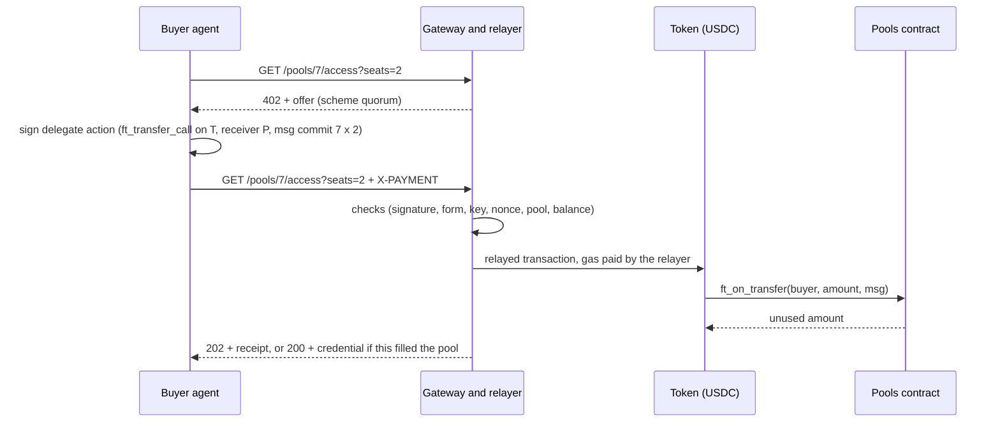

# Quorum on NEAR

Quorum on NEAR is a threshold group purchase with a refund bonus, on NEAR testnet. A seller opens a
**pool**: a number of seats, a seat price and a deadline, and escrows a **refund bonus** in the
contract when it opens it. Buyers, here AI agents, pay for seats over HTTP 402. If every seat is
taken before the deadline, the seller is paid and each buyer receives an access credential. If not,
every buyer gets its seats' price back plus a share of the bonus. This repository holds the pools
escrow contract (Rust), an HTTP 402 gateway that relays buyers' payments and issues credentials, a
swarm of scripted buyer agents, an MCP server through which an LLM agent buys seats, and a
read-only live page.

**Try it now, with nothing to install:** <https://quorum-on-near-demo.fly.dev> runs the whole flow on
NEAR testnet when you click a button. See [level 0](#0-the-hosted-demo-nothing-to-install) below.

## What is simulated, and what is real

**The provider is simulated. The money flow is not.**

| | In this system |
|---|---|
| **Simulated** | The provider (the seller) and the GPU access it sells. The access credential is a signed token, a JWS whose claims include `simulated: true`. No GPU stands behind it. |
| **Real** | Seats, the bonus, the payout to the seller and the refunds. Each is a transaction on NEAR testnet, in Circle's testnet USDC (`3e2210e1184b45b64c8a434c0a7e7b23cc04ea7eb7a6c3c32520d03d4afcb8af`). |
| **Scaled** | Prices are scaled down 10,000 times: a seat at 0.00018 USDC stands for 1.80 USDC per GPU-hour. No pool holds, and no run moves, as much as 0.1 USDC. |

The live page's banner says the same: "The provider is simulated, and prices are scaled down 10,000
times. The money flow is real: USDC on NEAR testnet." The local sandbox tests use a mock token
instead, Mock USD (`mUSD`, 6 decimals), which is never deployed to testnet.

## The problem

Some purchases only make sense if enough buyers commit. The worked example is a block of GPU
capacity: 8 GPUs for 24 hours, sold as 192 one-GPU-hour seats. A provider would rather not set
hardware aside for a block that is only half committed, and a small team cannot commit to a whole
block alone. Pooling the teams' demand makes the block sellable.

The refund bonus turns the pool into a *dominant assurance contract*: a buyer that wants a seat at
that price is never worse off for committing, whatever the other buyers do. If the pool fills, it
gets what it wanted; if not, it gets its money back plus a share of the bonus. The contract holds
the bonus from the moment the pool opens, so the promise is credible to strangers, and an agent's
rule is one line: **commit if the seat is worth the price.** (The claim is strict only when the
bonus is above zero, and it counts money, not the time the money is locked.)

## How it works

1. **The provider opens a pool** by sending the bonus to the pools contract with NEP-141
   `ft_transfer_call` and an `open` message (seat price, target, deadline, seats per buyer, terms).
2. **A buyer asks for access.** `GET /pools/7/access?seats=2` is answered `402 Payment Required`
   with an offer in the `quorum` scheme on `near:testnet`: amount, contract to pay, token, and the
   pool's seat price, seats taken, deadline, bonus and minimum bonus per seat.
3. **The buyer checks the offer and signs** an NEP-366 delegate action holding one call:
   `ft_transfer_call` on the token, to the pools contract, with the message
   `{"commit":{"pool_id":7,"seats":2}}` and 1 yoctoNEAR. It repeats the request with `X-PAYMENT`.
4. **The gateway checks, then relays**: signature, the call and its arguments, key, nonce, expiry,
   pool, balance and seat cap. Its relayer submits the delegate action and pays the gas.
5. **The seats are taken.** The token calls the contract's `ft_on_transfer`, which takes the seats
   (or those left) and returns any unused amount. The gateway answers `202 Accepted` with a receipt,
   or `200` with the credential if this payment filled the pool.
6. **The buyer follows its seats** with an NEP-413 signed proof in `X-QUORUM-PROOF`: `202` while the
   pool fills, `200` with the credential once it has filled, `410` with its refund once it expired.
7. **The pool ends.** Filled: `settle` pays the seller every seat's price plus the bonus. Deadline
   passed first (block time): `refund` pays each buyer, in batches, its seats' price plus an equal
   bonus share per seat, the remainder to the seller. Both are open to anyone; the gateway's keeper
   calls them when due. A buyer can also call `claim_refund` itself.



The gateway also serves `GET /pools`, `GET /activity?pool=:id`, `GET /.well-known/jwks.json`,
`GET /config.json` and the live page at `/`, for its provider's pools only. Every check and response
code is in section 6 of the [design spec](docs/specs/2026-11-09-quorum-on-near-design.md).

## How NEAR is used

| NEAR feature | What it does here |
|---|---|
| Sub-accounts | The system's accounts are sub-accounts of one parent: `pools.`, `relay.`, `provider.`, `funding.` (by default), `buyer-01.` to `buyer-20.` and `buyer-llm.`. `swarm setup` creates them from the parent, each with its own key. A buyer holds only its own budget, so a leaked buyer key can lose at most that. |
| NEP-141 `ft_transfer_call` | The only way money enters the contract. The token calls the contract's `ft_on_transfer` with a message: `open` escrows the bonus, `commit` takes seats. An unused amount comes back through the token's `ft_resolve_transfer`; a refused message panics, and the whole amount comes back. |
| NEP-145 storage | Every account is registered on the token with `storage_deposit`, at the amount the token's `storage_balance_bounds` gives. |
| NEP-366 delegate actions | A buyer signs a delegate action; the gateway checks it and its relayer submits it, paying the gas. The relayer holds several access keys (4 by default), so payments relay in parallel without nonce clashes. The buyer stays `predecessor_account_id`; the contract never reads `signer_account_id`. NEAR's documentation is not consistent about who is charged the 1 yoctoNEAR deposit, so buyers keep a little NEAR; in the gateway's sandbox test, the relayer is. |
| Full-access keys | A function-call access key cannot attach a deposit, not even 1 yoctoNEAR, and `ft_transfer_call` requires exactly 1 yoctoNEAR. Buyers therefore sign with full-access keys to their own sub-accounts; the MCP server adds a spend cap. |
| NEP-413 signed messages | Redemption: the buyer signs `quorum:redeem:<poolId>` for the gateway's host. The gateway checks the signature, that the key is a full-access key of the account, that the proof is under 5 minutes old, and that its nonce is new. |
| Promises with `#[private]` callbacks | `settle`, `refund` and `claim_refund` mark the state (Settled, Refunded) before each `ft_transfer`; the callback restores it if the transfer fails, and never panics. Each method checks at entry that its gas covers every transfer and callback it creates. |
| No owner or admin methods | Nothing can change a pool's terms or move its money except the transitions above. `settle` and `refund` are open to anyone, and each buyer can call `claim_refund`, so no buyer's money depends on the gateway. |
| Block time | Every deadline is measured with `env::block_timestamp_ms()`, never a server clock. |
| NEP-297 events | The contract logs `pool_opened`, `seats_committed`, `pool_filled`, `pool_settled`, `seat_refunded`, `refund_failed`, `refund_claimed` and `pool_refunded` (standard `quorum`). |

## Try it

| Level | Runs on | Needs |
|---|---|---|
| 0. Hosted demo | Any browser | Nothing |
| a. Unit tests | Any OS, Windows included | Node 22.22.2 or later; pnpm 10.23.0 through Corepack; Rust through rustup |
| b. Local sandbox | Linux (x86_64, aarch64), macOS on Apple silicon, or WSL2; glibc 2.38 or later (Ubuntu 24.04 or later) | Level a, plus cargo-near 0.23.0 |
| c. NEAR testnet | As level b | Level b, plus near-cli-rs, a browser for Circle's faucet, and Claude Code for the MCP step |

Rust 1.99.1, with the `wasm32-unknown-unknown` target, is pinned in `rust-toolchain.toml`; pnpm in
`package.json` (`packageManager`). Node runs the TypeScript sources directly: there is no build step.

### 0. The hosted demo (nothing to install)

<https://quorum-on-near-demo.fly.dev> is the live page, served by this repository's gateway on one
Fly.io machine, against NEAR testnet. Its accounts are sub-accounts of `quorum-hosted-7316.testnet`;
the pools contract is
[`pools.quorum-hosted-7316.testnet`](https://testnet.nearblocks.io/address/pools.quorum-hosted-7316.testnet),
and the token is Circle's testnet USDC. The banner repeats what is simulated: the provider and its
access. The money is real USDC on testnet.

| Do | See |
|---|---|
| Open the page. | The banner, the provider's newest pool (or "The provider has not opened a pool yet."), two enabled buttons, and the line "Start a run to watch a pool from its first seat." |
| Click **Start a pool that fills**. | The buttons disable and the demo line says a run started. A pool opens, and its bar fills as the scripted buyers commit, one row each in the buyers table. After about two and a half minutes the pool reads "Settled: the seller is paid", and "Paid to the seller" in the ledger is the seats' price plus the bonus. |
| Once the run has ended, click **Start a pool that fails**. | A pool that only some of the buyers commit to. When its 3-minute deadline has passed, the gateway's keeper refunds it: the pool reads "Refunded", each buyer's row reads "refunded, bonus …", and the seller keeps only the dust. The run takes about three and a half minutes. |
| Follow a `commit`, `settle` or `refund` link. | The transaction on NEAR testnet's explorer (nearblocks). |

When a run ends, the demo line reads "The last run (fills) ended at <time>."

Three transactions from the hosted runs, each checked on chain:

- [A commit](https://testnet.nearblocks.io/txns/3wnFLhASgttWsyxSGLpKPNc5SUvXMmzgQsf18rkXVmLW): the
  relayer signs and pays the gas; inside it is `buyer-05`'s NEP-366 delegate action, a
  `ft_transfer_call` on the token that takes 12 seats in pool 6.
- [A settlement](https://testnet.nearblocks.io/txns/HAZNvusXgffrMDgZMoQeTdSHzongLawHcfEEn7uTmf6x):
  `settle` on pool 6, which paid the seller 0.036288 USDC, the seats' 0.034560 plus the 0.001728
  bonus.
- [A refund](https://testnet.nearblocks.io/txns/DAtK6zM2s2vZT7Rfwa6KZCTuP6tMHK8PvihFp3TvXQv1): one
  `refund` on pool 5 that returned six buyers their seats' price and their shares of the bonus, and
  paid the seller the 0.000072 USDC of dust.

Measured with the hosted deployment's image, in a local rehearsal and on the Fly.io machine: a run
that fills takes about two and a half minutes (2 min 26 s and 2 min 47 s) and costs about 0.041 NEAR,
mostly storage on the pools account that is never freed; a run that fails takes about three and a half
minutes and costs about 0.022 NEAR. In the rehearsal's checks, each commit burned at most 7.15 Tgas
(the check's limit is 50 Tgas), and a payout's `ft_transfer` at most 2.29 Tgas with its callback at
most 1.48 Tgas.

The hosted demo has limits of its own. It runs one swarm run at a time (the first click wins; the
other visitors watch), at most 100 a day, counted in memory and so restarted with the gateway. Its
testnet NEAR and USDC are refilled by hand. If its RPC endpoint refuses reads, which providers do
above a requests-per-second limit, a run can end early, and the page then shows the same line as for
dry funds: "The last run ended with an error. Its testnet funds may need a refill."

### a. Unit tests (any OS)

```bash
git clone https://github.com/lxfoundry/quorum-on-near.git
cd quorum-on-near
corepack enable
pnpm install
pnpm typecheck
pnpm test
rustup toolchain install --profile minimal
cargo test -p quorum-pools --lib
```

`pnpm typecheck` exits 0 with no error printed. `pnpm test` runs the six packages' vitest suites
against stubs and a fake chain, with no network, and exits 0; each package's run ends like this
(pnpm prefixes the lines with the package's folder):

```text
 Test Files  N passed (N)
      Tests  N passed (N)
```

On Windows, two tests of POSIX file modes are reported skipped; the sandbox suites (`test/sandbox/`)
are left out everywhere. The contract's unit tests end with `test result: ok.` and 0 failed: the
bonus split and the dust, every state transition and refusal, checked arithmetic at the limits.
CI (`.github/workflows/ci.yml`) also runs `cargo fmt`, `cargo clippy`, `cargo test --workspace`
and the gateway's sandbox suite; the swarm's and MCP server's sandbox suites are run by hand.

### b. A local sandbox

The sandbox suites start a local NEAR node through near-sandbox, which ships no Windows binary (on
Windows the TypeScript sandbox suites report themselves skipped). In WSL2, clone the repository
onto the WSL filesystem, not a mounted Windows drive. With Node and pnpm installed as in level a:

```bash
sudo apt-get update && sudo apt-get install -y build-essential   # Ubuntu, WSL2 included
ldd --version | head -n 1                                         # glibc 2.38 or later
curl --proto '=https' --tlsv1.2 -sSf https://sh.rustup.rs | sh
rustup toolchain install --profile minimal
curl --proto '=https' --tlsv1.2 -LsSf "https://github.com/near/cargo-near/releases/download/cargo-near-v0.23.0/cargo-near-installer.sh" | sh
cargo near --version
cargo test --workspace
cargo near build non-reproducible-wasm --no-abi --no-embed-abi --manifest-path contracts/mock-usd/Cargo.toml
cargo near build non-reproducible-wasm --no-abi --no-embed-abi --manifest-path contracts/pools/Cargo.toml
export QUORUM_MOCK_USD_WASM="$PWD/target/near/mock_usd/mock_usd.wasm"
export QUORUM_POOLS_WASM="$PWD/target/near/quorum_pools/quorum_pools.wasm"
pnpm --filter @quorum-on-near/gateway test:sandbox
pnpm --filter @quorum-on-near/swarm test:sandbox
pnpm --filter @quorum-on-near/mcp test:sandbox
```

The TypeScript suites read the two wasm paths, and fail, naming both variables, if either is
unset. Each suite starts its own sandbox (and gateway), and exits 0:

| Suite | Ends with | What it shows |
|---|---|---|
| contracts (`cargo test --workspace`) | `test result: ok.` for each test binary | Built with cargo-near, against the mock token: a pool that fills and settles, one refunded in batches, a partial last commit, the wrong token, a late commit, a seller's own commit, failed transfers then a claim or a retried `settle`, and gas; the invariants are checked after each step |
| gateway | `Test Files  1 passed (1)`, `Tests  8 passed (8)` | A `402` offer; a relayed payment answered `202`; the buyer's NEAR changing by at most the 1 yoctoNEAR deposit; a commit burning less than the offer's `minGas`; a second buyer's payment filling the pool, answered `200` with a credential; a redemption; the keeper's `settle` paying the seller |
| swarm | `Test Files  2 passed (2)`, `Tests  9 passed (9)` | A first setup stopping on the token shortfall, then completing; the `fills` scenario settling with every check passing; `swarm demo fails` through the command line exiting 0; a second setup sending nothing; reset then setup bringing every account back to its amount; the sandbox keeping enough history, and stopping cleanly |
| MCP server | `Test Files  1 passed (1)`, `Tests  9 passed (9)` | Over stdio: the four tools; a commit answered `202` and counted in the spend file; a payment past the spend cap refused before anything is signed; the refund with its bonus share once the keeper has refunded the pool; standard output holding only protocol messages |

No committed command shows the live page against a sandbox; level c shows it on testnet.

### c. NEAR testnet

This walk-through names the parent account `quorum-parent-4821.testnet`: replace that name with
yours in every command and file below. What it writes is ignored by git (`apps/*/.env`, `data/`) or
outside the repository (`~/.near-credentials`). Swarm commands exit 0 when done, 1 on a failure, 2
on a usage error; `pnpm --filter @quorum-on-near/swarm swarm help` lists them.

**1. Create the parent account** through NEAR's faucet service (10 NEAR), with its key in the
legacy keychain, the `~/.near-credentials` files the swarm reads:

```bash
curl --proto '=https' --tlsv1.2 -LsSf https://github.com/near/near-cli-rs/releases/latest/download/near-cli-rs-installer.sh | sh
near account create-account sponsor-by-faucet-service quorum-parent-4821.testnet autogenerate-new-keypair save-to-legacy-keychain network-config testnet create
near account view-account-summary quorum-parent-4821.testnet network-config testnet now
```

You see the account's summary with its NEAR balance; its key is in
`~/.near-credentials/testnet/quorum-parent-4821.testnet.json`. A name already taken is refused.

**2. Configure the swarm**, with the pools wasm built as in level b:

```bash
cp apps/swarm/.env.example apps/swarm/.env
realpath target/near/quorum_pools/quorum_pools.wasm
```

In `apps/swarm/.env`, set `QUORUM_PARENT_ACCOUNT=quorum-parent-4821.testnet`, and replace the line
`#QUORUM_POOLS_WASM=` with `QUORUM_POOLS_WASM=` followed by the path `realpath` printed. Leave the
other defaults (`near:testnet`, the RPC `https://test.rpc.fastnear.com`, the gateway on port 8402).

**3. Run setup; it stops on the USDC shortfall.**

```bash
pnpm --filter @quorum-on-near/swarm swarm setup
```

It checks that the parent holds 9.08 NEAR free (8.58 to send, 0.5 for gas), or sends nothing. Then
it creates 25 accounts (`wrote key file  …`, `created  funding.quorum-parent-4821.testnet  0.5 NEAR  tx …`, …),
deploys the pools contract (`deployed the pools contract  pools.quorum-parent-4821.testnet  token 3e2210e1…  tx …`),
registers 24 accounts on the token (`registered on the token  …`) and stops, exit code 1, with:

```text
the funding account funding.quorum-parent-4821.testnet holds 0 base units of the token 3e2210e1184b45b64c8a434c0a7e7b23cc04ea7eb7a6c3c32520d03d4afcb8af, but the top-ups need 220000: send it 220000 more, then run setup again
```

**4. Fund the funding account with USDC, by hand.** Circle's faucet has no API for NEAR testnet.
Open <https://faucet.circle.com>, choose USDC and NEAR Testnet, enter
`funding.quorum-parent-4821.testnet`, pass the reCAPTCHA and send. Then:

```bash
near contract call-function as-read-only 3e2210e1184b45b64c8a434c0a7e7b23cc04ea7eb7a6c3c32520d03d4afcb8af ft_balance_of json-args '{"account_id":"funding.quorum-parent-4821.testnet"}' network-config testnet now
```

You see the grant in base units (6 decimals: 20 USDC reads `"20000000"`). A first setup's top-ups
take 0.22 USDC, so one grant covers many runs.

**5. Top up, and configure the gateway and the MCP server.**

```bash
pnpm --filter @quorum-on-near/swarm swarm setup
pnpm --filter @quorum-on-near/swarm swarm setup
pnpm --filter @quorum-on-near/swarm swarm env gateway
pnpm --filter @quorum-on-near/swarm swarm env mcp
```

The first setup prints `sent tokens  …` lines (10,000 base units to the provider and to each of the
21 buyers) and exits 0; the second prints `nothing to do`. Then `wrote …/apps/gateway/.env` and
`wrote …/apps/mcp/.env`, each readable by its owner only. The gateway's file holds the relayer's
keys and a new credential key: never share or commit it. `swarm env` never writes over a file.

**6. Start the gateway and open the live page.** In a second shell, at the repository's root:

```bash
pnpm --filter @quorum-on-near/gateway start
```

You see `gateway listening on http://localhost:8402 (public URL http://localhost:8402)`. Open
<http://localhost:8402/>: the banner, and "The provider has not opened a pool yet." until a pool
opens. Then it shows the provider's newest pool (`?pool=<id>` for another), read from the contract
every 2 seconds: terms, a bar filling seat by seat, price, bonus, countdown and status; a ledger
with *held now* beside the contract's token balance; each buyer's seats, state and transactions.

**7. A pool that fills.** `swarm demo` runs setup, opens the pool, runs the 20 scripted buyers, and
checks the final on-chain state. Pools are numbered from 0 on a new pools contract.

```bash
pnpm --filter @quorum-on-near/swarm swarm demo fills
echo "exit $?"
```

```text
--- setup
nothing to do
--- open fills
opened pool 0 (fills): 192 seats at 180, bonus 1728, deadline …  tx …
--- run pool 0
pool 0 (fills): 20 buyers arrive over 120 s
…  (a line per buyer step, then a table of the outcomes)
192 seats, 34560 paid: …
--- check pool 0
ok    status: settled, as fills expects
…
ok    provider balance: provider.quorum-parent-4821.testnet changed by +34560, as expected
…
pool 0: 8 checks passed
exit 0
```

Buyers 15 to 20 (top price 150, below the seat price of 180) decline; any buyer that arrives after
the fill ends `missed`. The keeper settles the pool within a tick of its filling.

**8. A pool that fails.** It has a 3-minute deadline, and only 100 of its 192 seats are wanted.
Each seat gets its 320 back plus 30 of the bonus (3,072 over 100 seats, rounded down); the 72 left
goes back to the seller.

```bash
pnpm --filter @quorum-on-near/swarm swarm demo fails
echo "exit $?"
```

```text
…  (setup tops up the buyers that paid in fills)
opened pool 1 (fails): 192 seats at 320, bonus 3072, deadline …  tx …
--- run pool 1
pool 1 (fails): 20 buyers arrive over 60 s
…
100 seats, 32000 paid: refunded 6, declined 14
--- check pool 1
ok    status: refunded, as fails expects
ok    buyers: 6 buyers, all refunded
ok    refunds and dust: refunds 35000 + dust 72 = 100 × 320 + bonus 3072 = 35072
…
pool 1: 9 checks passed
exit 0
```

**9. An LLM agent buys through the MCP server.** Open a `fails` pool with a 10-minute deadline and
no scripted buyer, and register the server with Claude Code in your local scope:

```bash
QUORUM_SCENARIO_DEADLINE_SECONDS=600 pnpm --filter @quorum-on-near/swarm swarm open fails
claude mcp add --scope local quorum-buyer -- node "$PWD/apps/mcp/src/main.ts"
claude mcp list
```

You see `opened pool 2 (fails): …` (use the id it prints) and `quorum-buyer` connected; it acts as
`buyer-llm.quorum-parent-4821.testnet` (other clients: `apps/mcp/mcp.example.json`). Start `claude`
at the repository's root and ask: "With the quorum-buyer tools, list the open pools, get an offer
for 5 seats in pool 2, and commit to it if the offer is payable." Allow the calls. You see:

- `quorum_pools`: pool 2, `seatPrice` 0.000320 USDC, `minBonusPerSeat` 0.000016 USDC;
- `quorum_offer`: `price` 0.001600 USDC, `minRefundIfFails` 0.001680 USDC, `payable` true;
- `quorum_commit`: `status` `pending`, `seats` 5, `paid` 0.001600 USDC, `spendCapLeft` 0.008400 USDC.

Once the deadline has passed and the keeper has refunded the pool, ask "What is the status of my
seats in pool 2?": `quorum_status` answers `refunded`, `amount` 0.004670 USDC and `bonusShare`
0.003070 USDC, with the refund's `txHash`.

**10. Check that pool on chain.**

```bash
pnpm --filter @quorum-on-near/swarm swarm check 2 fails
```

You see six `ok` lines, among them `refunds and dust: refunds 4670 + dust 2 = 5 × 320 + bonus 3072 = 4672`,
then `pool 2: 6 checks passed`.

**11. Clean up.** `pnpm --filter @quorum-on-near/swarm swarm reset` returns the buyers' and the
provider's surpluses to the funding account (`… returned … to funding.quorum-parent-4821.testnet  tx …`);
run again, it prints `nothing to do`. Stop the gateway with Ctrl+C (`SIGINT: shutting down`) and
run `claude mcp remove --scope local quorum-buyer`. A later session runs setup and starts the gateway.

## Repository layout

| Path | Content |
|---|---|
| `contracts/pools/` | The pools escrow contract (Rust, near-sdk) |
| `contracts/mock-usd/` | Mock USD (`mUSD`), an NEP-141 token for the sandbox tests only |
| `crates/sandbox-support/` | Test helper: starts a local NEAR sandbox and wraps calls and views |
| `packages/protocol/` | The `quorum` x402 scheme: types, header codecs, delegate-action and NEP-413 checks, buyer builders, transaction outcomes, the chain-id check |
| `packages/buyer/` | A buyer's side, shared by the swarm and the MCP server: settings, key files, the gateway client, signing and sending a payment, a checked read of a pool, the spend file |
| `apps/gateway/` | The provider's HTTP side: offers, payment checks, relay, credentials, redemption, the keeper, the activity feed, and serving the live page |
| `apps/swarm/` | The `swarm` command line: account setup and reset, the provider agent, the 20 scripted buyers, the final check, and the other apps' `.env` files |
| `apps/mcp/` | The stdio MCP server: four buyer tools for an LLM-driven agent |
| `apps/web/` | The live page: plain HTML and ES modules, no build step, read-only |
| `docs/specs/`, `docs/plans/` | The design spec, and the implementation plans written from it |
| `.github/`, `CLAUDE.md`, `.claude/` | CI; instructions and vendored skills for Claude Code |

## Known limits

- **The credential is simulated**: a bearer token (no expiry, no audience) proving a paid seat in a
  filled pool, not access to a resource. It is issued at optimistic execution, not finality.
- **Storage** is paid from the contract account's NEAR, open to abuse by anyone, and never freed.
- **One token** per deployment: on testnet, Circle's USDC, which its issuer may refuse to transfer,
  and which enters only by hand, through Circle's faucet.
- **The relayer pays gas** for every payment it relays, with no per-buyer rate limit.
- **Agents hold full-access keys** to their own sub-accounts: the exposure is that account's budget.
- **Key custody**: whoever holds a full-access key to the pools account can redeploy the contract.
- **The quorum is soft**: the seller can commit from a second account to top up a shortfall.
- **In-flight holds live in memory** (gateway and MCP server); **one swarm at a time** per network
  and parent; **one MCP server per spend file**.
- **The hosted demo** spends testnet NEAR that is refilled by hand, runs one swarm run at a time on
  one machine, and shares one RPC endpoint's rate limit between the page, the keeper and the relay;
  see [level 0](#0-the-hosted-demo-nothing-to-install).

The full list, with the reasons, is in section 12 of the
[design spec](docs/specs/2026-11-09-quorum-on-near-design.md#12-known-limits).

## Documentation

- [Design spec](docs/specs/2026-11-09-quorum-on-near-design.md): the contract, the `quorum`
  scheme, accounts and agents, the live page, testing, the NEAR rules relied on, the known limits.
- Plans: [contracts](docs/plans/contracts-core.md), [protocol and gateway](docs/plans/protocol-gateway.md),
  [swarm and MCP server](docs/plans/swarm-mcp.md), [live page](docs/plans/live-page.md).

## Built with

- **Contracts:** Rust 1.99.1, near-sdk 5, near-contract-standards 5 (the mock token), cargo-near
  0.23.0; sandbox tests with near-sandbox and near-api (Rust).
- **TypeScript:** Node 22, pnpm 10, TypeScript 5.9, near-api-js 7, Hono 4 with `@hono/node-server`,
  jose 6, the MCP TypeScript SDK (`@modelcontextprotocol/sdk`), zod 4, `borsh`, `@noble/curves`
  and `@noble/hashes`; tests with vitest 4, and near-sandbox (npm) for the sandbox suites.

Written with Claude Code (Anthropic).

## Provenance

The threshold-purchase design follows two earlier x402 projects by the same author, Quorum402 and
Earnest, built on other chains. No code from them is in this repository; every file here was
written for NEAR, starting 2026-11-09.

## License

MIT. See [LICENSE](LICENSE).
