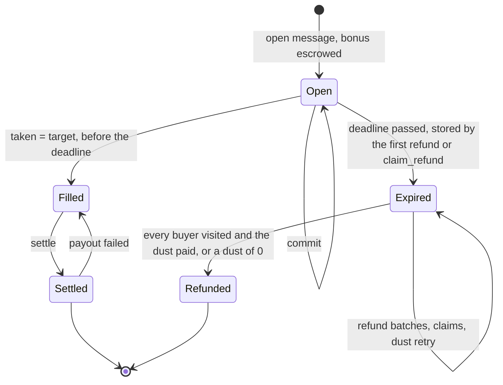
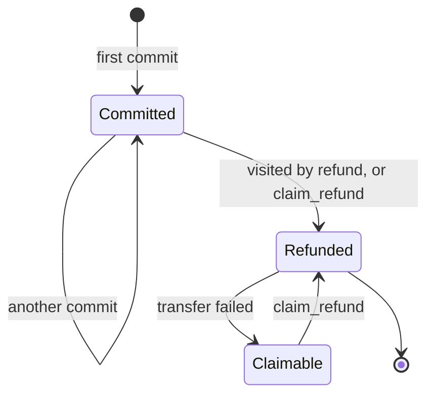

# Pools contract

`quorum-pools` is the escrow contract of Quorum on NEAR, written in Rust on near-sdk 5. One
deployment holds every pool, every seat and every refund bonus, all in one NEP-141 token. A seller
opens a pool with a target number of seats, a seat price and a deadline, and escrows a bonus. Buyers
commit seats. If every seat is taken before the deadline, `settle` pays the seller the seats' price
plus the bonus. If not, `refund` and `claim_refund` pay each buyer its seats' price plus an equal
share of the bonus per seat.

This file is a reference to the code. The full rules, with the invariants, are in section 5 of the
[design spec](../../docs/specs/2026-11-09-quorum-on-near-design.md#5-pools-contract).

## What is simulated, and what is real

The contract simulates nothing: every amount it holds and every transfer it makes is real. On NEAR
testnet its token is Circle's testnet USDC
(`3e2210e1184b45b64c8a434c0a7e7b23cc04ea7eb7a6c3c32520d03d4afcb8af`). The provider that opens pools
in the worked example, and the GPU access it sells, are simulated outside the contract. The sandbox
tests use [Mock USD](../mock-usd/README.md) instead of USDC.

## At a glance

| | |
|---|---|
| Crate | `quorum-pools` |
| Initialisation | `new(token)`, `#[init]` and `#[private]`: only the contract account can call it, and the deployment runs it in the same transaction. It cannot run a second time |
| Token | One NEP-141 token, set by `new` and never changed (`get_token`). The contract account must be registered on it (`storage_deposit`) to receive payments |
| Money in | Only through the token's `ft_transfer_call`, which calls `ft_on_transfer` |
| Money out | `ft_transfer`, scheduled by `settle`, `refund` and `claim_refund`, each with the 1 yoctoNEAR the token requires, paid from the contract's own NEAR |
| Owner or admin methods | None. `settle` and `refund` are open to anyone; each buyer calls `claim_refund` for itself |
| Time | Block time, `env::block_timestamp_ms()`. Deadlines are milliseconds since the Unix epoch |
| Storage | Paid from the contract account's NEAR. No record is ever removed |
| Arithmetic | Checked: an overflow panics |

| File | Content |
|---|---|
| [`src/lib.rs`](src/lib.rs) | State, `new`, the one token method the contract calls |
| [`src/types.rs`](src/types.rs) | Pool and buyer records, statuses, messages, views, limits |
| [`src/receive.rs`](src/receive.rs) | `ft_on_transfer`: the `open` and `commit` messages |
| [`src/settle.rs`](src/settle.rs) | `settle` and its callback |
| [`src/refund.rs`](src/refund.rs) | `refund`, `claim_refund` and their callbacks |
| [`src/views.rs`](src/views.rs) | The views |
| [`src/math.rs`](src/math.rs) | Amounts: bonus share, dust, refund, payout |
| [`src/events.rs`](src/events.rs) | NEP-297 events |
| [`src/gas.rs`](src/gas.rs) | Gas allowances and the entry check |
| [`tests/`](tests/) | Sandbox tests |

### Limits

| Constant | Value | Applies to |
|---|---|---|
| `MAX_TARGET` | 1000 | A pool's `target` |
| `MAX_TERMS_BYTES` | 280 | A pool's `terms`, counted in bytes (UTF-8) |
| `MAX_REFUND_LIMIT` | 10 | The `limit` of `refund` |
| `MAX_PAGE` | 100 | Rows returned by one `list_pools` or `get_seats` call |

## Money in: `ft_on_transfer`

When an account calls `ft_transfer_call` on the token with this contract as receiver, the token
calls `ft_on_transfer(sender_id, amount, msg)`. `msg` is JSON, one of two messages. A call from any
account other than the token is refused.

**A refusal is a panic.** The token then returns the whole amount to the sender, through its
`ft_resolve_transfer`, and nothing is stored. What `ft_on_transfer` returns is the **unused** part
of the amount, which the token also sends back to the sender in the same transaction.

| Refusal (panic message) | Cause |
|---|---|
| `only the pool token is accepted` | The caller is not the token set by `new` |
| `invalid message` | `msg` is not one of the two messages below |

### `open`: open a pool

The amount sent is the bonus. `sender_id` becomes the seller.

```json
{ "open": { "seat_price": "180", "target": 192, "deadline_ms": 1800000000000,
            "max_seats_per_buyer": 24,
            "terms": "8×GPU × 24 h; 1 seat = 1 GPU-hour; prices at 1/10,000 scale" } }
```

| Field | Type | Rule | Refusal (panic message) |
|---|---|---|---|
| `seat_price` | string (an integer in the token's base units) | Above 0 | `seat_price must be positive` |
| `target` | number | 1 to 1000 | `target must be between 1 and 1000` |
| `deadline_ms` | number (ms since the Unix epoch) | Later than the current block time | `deadline must be in the future` |
| `max_seats_per_buyer` | number, or null or left out for no cap | At least 1 when set | `max_seats_per_buyer must be at least 1` |
| `terms` | string | At most 280 bytes | `terms must be at most 280 bytes` |

It keeps the whole amount as the bonus and returns `"0"` unused. Pools are numbered from 0 in order
of creation; the new pool's id is in the `pool_opened` event. The contract accepts a bonus of 0, but
the standard NEP-141 implementation refuses a zero-amount `ft_transfer_call`, so with such a token
every pool has a bonus.

### `commit`: take seats

`sender_id` is the buyer. The amount must be the price of the seats asked for.

```json
{ "commit": { "pool_id": 7, "seats": 2 } }
```

| Rule | Refusal (panic message) |
|---|---|
| The pool exists | `pool not found` |
| Its stored status is Open | `pool is not open` |
| Block time is before `deadline_ms` | `pool is past its deadline` |
| `sender_id` is not the seller | `the seller cannot commit to its own pool` |
| `seats` is at least 1 | `seats must be at least 1` |
| `amount` is `seats × seat_price` | `amount must equal seats times seat_price` |
| The seats the buyer already holds plus `seats` stay within `max_seats_per_buyer`, when set | `commit exceeds max_seats_per_buyer` |
| At least one seat is left | `no seats left` |

It takes `n = min(seats, target − taken)` seats and returns `(seats − n) × seat_price` as unused, so
a payment for more seats than are left takes the rest and gets the excess back in the same
transaction. The cap is checked against the seats asked for, not the seats taken. A buyer that
commits again adds to its record and keeps the position of its first commit. The commit that takes
the last seat makes the pool Filled.

## Change methods

| Method | Who may call | Requires | Pays |
|---|---|---|---|
| `settle(pool_id)` | Anyone | The pool is Filled | The seller, in one transfer: `taken × seat_price + bonus` |
| `refund(pool_id, limit)` | Anyone | `limit` is 1 to 10; the pool is Expired, or Open with its deadline passed | Visits the next `limit` buyers in commit order, and pays each one still Committed `seats × (seat_price + bonus_per_seat)`; a buyer already refunded or claimable is skipped but counts toward `limit`. Once every buyer is visited, the dust goes to the seller |
| `claim_refund(pool_id)` | A buyer of the pool, for itself (the predecessor account) | The pool is Expired or Refunded, or Open with its deadline passed; the buyer is Committed or Claimable | That buyer: `seats × (seat_price + bonus_per_seat)` |

None of them takes a deposit. A Filled pool is never refunded, even after its deadline: only
`settle` ends it. The first `refund` or `claim_refund` after the deadline stores the pool as Expired
and fixes `bonus_per_seat`.

**`refund`** walks the buyers in the order they first committed, from `refund_cursor`. It moves the
cursor past up to `limit` buyers and skips any that is no longer Committed (paid already, claimed
on its own, or Claimable after a failed transfer). Calling it again is safe. When the cursor reaches
the last buyer, it sends the dust to the seller (the whole bonus if no seat was taken). A dust of 0
is not sent, because the standard token refuses a zero transfer: the pool becomes Refunded at once.

**`claim_refund`** works whether or not anyone has called `refund`. It is also how a buyer recovers
a refund that could not be pushed, for example because the buyer was not registered on the token.

### State before transfer

Each method writes the new state first, then schedules the `ft_transfer` followed by a `#[private]`
callback. The callback restores the state if the transfer failed, and never panics.

| Transfer | Marked before | Callback | On success | On failure |
|---|---|---|---|---|
| `settle` payout | Pool Settled | `on_settled` | `pool_settled` | Pool back to Filled; `settle` can be called again |
| `refund`, one buyer | Buyer Refunded | `on_refund_sent` | `seat_refunded` | Buyer Claimable, and `refund_failed`. `refund` skips it from then on; the buyer calls `claim_refund` |
| `refund`, the dust | `dust_sent` true | `on_dust_sent` | Pool Refunded, and `pool_refunded` | `dust_sent` false; the pool stays Expired and the next `refund` sends only the dust |
| `claim_refund` | Buyer Refunded | `on_claim_sent` | `refund_claimed` | Buyer Claimable; it can claim again |

### Refusals

| Method | Panic message | Cause |
|---|---|---|
| All three | `not enough gas: need <n>, have <m>` | See [Gas](#gas) |
| All three | `pool not found` | No pool has that id |
| `settle` | `pool is not filled` | The pool is not Filled (an already Settled pool included) |
| `refund` | `limit must be between 1 and 10` | `limit` is 0 or above 10 |
| `refund` | `pool is not expired` | Before the deadline, Filled, Settled or Refunded |
| `claim_refund` | `pool is neither expired nor refunded` | Before the deadline, Filled or Settled |
| `claim_refund` | `the caller holds no seats in this pool` | The caller never committed to the pool |
| `claim_refund` | `the refund was already paid or is on its way` | The caller is Refunded |

## Gas

`settle`, `refund` and `claim_refund` check at entry, before any state changes, that the gas left
(prepaid gas minus gas used so far) covers every transfer and callback they can schedule. The
allowances are in [`src/gas.rs`](src/gas.rs):

| Constant | Value | What it covers |
|---|---|---|
| `TRANSFER_GAS` | 10 Tgas | Each `ft_transfer` |
| `CALLBACK_GAS` | 10 Tgas | Each callback |
| `BASE_GAS` | 10 Tgas | The method's own work |
| `FEES_PER_TRANSFER` | 3 Tgas | Runtime fees for one transfer and its callback |

| Method | Transfers it can schedule | Gas required at entry |
|---|---|---|
| `settle` | 1 | 33 Tgas |
| `claim_refund` | 1 | 33 Tgas |
| `refund(pool_id, limit)` | `limit` refunds plus the dust | 10 + 23 × (`limit` + 1) Tgas: 56 Tgas at `limit` = 1, 263 Tgas at `limit` = 10 |

Attach more than that, for the gas the call uses before its check: the gateway's keeper attaches
100 Tgas to `settle` and 300 Tgas to `refund` by default. The sandbox gas test
([`tests/gas.rs`](tests/gas.rs)) refuses a full batch of 10 at 262 Tgas and completes it at 280
Tgas, with each transfer and each callback burning under 5 Tgas. `ft_on_transfer` and the views check no gas.

## Views

| View | Returns |
|---|---|
| `get_pool(pool_id)` | The pool (below), or `null` |
| `list_pools(from, limit)` | Pools in id order, from id `from`; `limit` is capped at 100. Empty past the last pool |
| `get_seats(pool_id, from, limit)` | `[{ "buyer", "seats", "state" }]` in the order the buyers first committed, from position `from`; `limit` is capped at 100. Empty for an unknown pool |
| `get_buyer(pool_id, account_id)` | `{ "seats", "state" }`, or `null` |
| `get_token()` | The token's account id |

A pool reads as:

```json
{ "id": 1, "seller": "provider.example.testnet", "seat_price": "320", "target": 192,
  "taken": 100, "deadline_ms": 1800000000000, "bonus": "3072", "max_seats_per_buyer": 24,
  "terms": "…", "status": "expired", "bonus_per_seat": "30", "refund_cursor": 0,
  "dust_sent": false, "buyer_count": 6 }
```

Amounts are decimal strings. `status` is one of `open`, `filled`, `settled`, `expired` and
`refunded`; a buyer's `state` is one of `committed`, `refunded` and `claimable`.

**The status is derived from block time.** An Open pool whose deadline has passed (block time ≥
`deadline_ms`) reads as `expired`, with its `bonus_per_seat`, even before any call has stored that.
Views write nothing. Buyer states are read as stored.

## States

A pool:



A commit needs block time before `deadline_ms`, and a refund needs block time at or after it, so no
moment allows both. Filled is final.

A buyer, in one pool:



The buyers of a Settled pool stay Committed: their seats were paid for, and nothing is owed to them.

## Events

Every event is an NEP-297 log line with `standard` `quorum` and `version` `1.0.0`, for example:

```text
EVENT_JSON:{"data":[{"pool_id":7,"taken":192}],"event":"pool_filled","standard":"quorum","version":"1.0.0"}
```

Amounts are decimal strings; ids and seat counts are numbers.

| Event | Logged by | Data |
|---|---|---|
| `pool_opened` | `open` | `pool_id`, `seller`, `seat_price`, `target`, `deadline_ms`, `bonus`, `terms` |
| `seats_committed` | `commit` | `pool_id`, `buyer`, `seats` (taken by this commit), `amount` (their price), `taken`, `target` |
| `pool_filled` | The commit that takes the last seat | `pool_id`, `taken` |
| `pool_settled` | `on_settled`, on success | `pool_id`, `seller`, `amount` |
| `seat_refunded` | `on_refund_sent`, on success | `pool_id`, `buyer`, `seats`, `amount`, `bonus_share` |
| `refund_failed` | `on_refund_sent`, on failure | `pool_id`, `buyer`, `amount` |
| `refund_claimed` | `on_claim_sent`, on success | `pool_id`, `buyer`, `amount` |
| `pool_refunded` | `refund` (a dust of 0), or `on_dust_sent` on success | `pool_id`, `dust` |

A failed `settle` payout and a failed claim log no event. `pool_refunded` can be logged before the
callbacks of the last batch's refunds have run: whether a buyer's refund arrived is in its state
(`get_buyer`, `get_seats`), not in the order of the events.

## The bonus split

When a pool expires, its bonus is shared equally per seat, rounded down, and the remainder goes back
to the seller:

| Amount | Formula |
|---|---|
| `bonus_per_seat` | `floor(bonus / taken)`, or 0 if no seat was taken |
| A buyer's refund | `seats × (seat_price + bonus_per_seat)` |
| Its `bonus_share` | `seats × bonus_per_seat` |
| The dust, to the seller | `bonus − taken × bonus_per_seat` |
| A settled pool's payout | `taken × seat_price + bonus` |

The refunds plus the dust always equal `taken × seat_price + bonus`. A failed pool has at most
`target − 1` seats taken, so each seat's share is at least `floor(bonus / max(target − 1, 1))`. The
unit tests check both.

Two worked examples, in base units:

| Pool | Outcome |
|---|---|
| 192 seats at 180, bonus 1,728, fills | The seller receives 192 × 180 + 1,728 = 36,288 |
| 192 seats at 320, bonus 3,072, expires with 100 seats taken | `bonus_per_seat` is 30; each seat gets 350 back; the dust is 72 |

## Build and test

From the repository's root, with the Rust toolchain pinned in
[`rust-toolchain.toml`](../../rust-toolchain.toml) (it includes the `wasm32-unknown-unknown` target)
and cargo-near:

```bash
cargo near build non-reproducible-wasm --no-abi --no-embed-abi --manifest-path contracts/pools/Cargo.toml
```

It writes `target/near/quorum_pools/quorum_pools.wasm`.

```bash
cargo test -p quorum-pools --lib    # unit tests, on any OS, Windows included
cargo test --workspace              # unit and sandbox tests of every crate
cargo test -p quorum-pools --test refund    # one sandbox test file
```

The unit tests run in near-sdk's test environment and cover the bonus split and the dust, every
state transition and refusal, and checked arithmetic at the limits.

The sandbox tests start a local NEAR node through
[`quorum-sandbox-support`](../../crates/sandbox-support/README.md), build the contracts themselves,
and run against the mock token, checking the invariants after each step. They need Linux (x86_64 or
aarch64), macOS on Apple silicon, or WSL2, with glibc 2.38 or later (Ubuntu 24.04 or later):
near-sandbox ships no Windows binary.

| File | What it shows |
|---|---|
| [`tests/open_commit.rs`](tests/open_commit.rs) | A pool that fills; a partial last commit; refused commits returning the money; a payment in another token; a commit after the deadline; `new` refused a second time and from another account |
| [`tests/settle.rs`](tests/settle.rs) | Anyone settles a filled pool; a pool that is not filled cannot be settled; a filled pool settles after its deadline; a failed payout, then a retried `settle` |
| [`tests/refund.rs`](tests/refund.rs) | Refunds in batches with the dust to the seller; a dust of 0; a pool with no seats; refusals before the deadline and outside 1 to 10; too little gas; a failed dust transfer retried; a buyer holding several seats |
| [`tests/claim.rs`](tests/claim.rs) | A claim before any `refund`; a refund that cannot be pushed becoming Claimable; a failed claim; a claim's requirements |
| [`tests/gas.rs`](tests/gas.rs) | A full batch of 10 refused just under its gas and completing just over it |

A bare `cargo check` stops at near-sdk's native-build guard, because it leaves out the
dev-dependency that turns on `unit-testing`: use `cargo check --tests`, or
`cargo check --target wasm32-unknown-unknown`.
