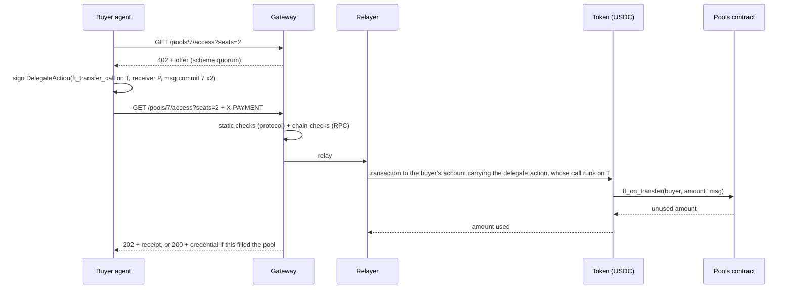
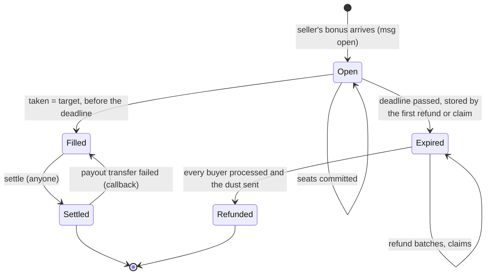

# Quorum on NEAR: design

> **Status: draft.** This spec describes what the system is and how it behaves. Implementation
> plans are written from it into `docs/plans/`.

## 1. Summary

Quorum on NEAR is a threshold group purchase. A seller opens a **pool** for something it will only
sell if enough buyers commit: a number of **seats**, a **seat price** and a **deadline**. When it
opens the pool, the seller also escrows a **refund bonus**. Buyers, usually AI agents acting for a
person or a company, each pay for one or more seats over HTTP 402.

- If every seat is taken before the deadline, the seller is paid, and each buyer receives an access
  credential.
- If not, every buyer gets its seats' price back **plus a share of the bonus**.

The bonus turns the purchase into a *dominant assurance contract*: a buyer that wants a seat at
that price is never worse off for committing, whatever the other buyers do. If the pool fills it
gets what it wanted, and if it does not it gets its money back plus a bonus share (strictly better
off whenever the bonus is above zero). An agent's rule is a
single line: **commit if the seat is worth the price.** The contract holds the bonus from the
moment the pool opens, so the promise is credible to strangers.

**The worked example** is a block of GPU capacity, such as 8 GPUs for 24 hours sold as 192
one-GPU-hour seats. A provider would rather not reserve hardware that is only half committed, and a
small team cannot commit to a whole block alone. Pooling makes that block sellable.

**What is simulated:** the provider, and the GPU access it sells. The access credential is a signed
token, and no GPU stands behind it. **What is real:** the money flow. Seats, the bonus, the payout
and the refunds are all transactions on NEAR testnet, in Circle's testnet USDC. Prices are scaled
down 10,000 times, so that no pool holds, and no run moves, as much as 0.1 USDC (sections 7.2 and
7.3).

## 2. Scope

**In scope**

- A NEAR contract that holds pools, seats and bonuses, and settles or refunds them with no owner or
  admin.
- A mock NEP-141 token for the sandbox tests. On testnet the contract uses Circle's USDC, which
  this system does not deploy.
- An HTTP 402 binding for the contract: a new x402 scheme, `quorum`, on network `near:testnet`.
- A gateway that serves offers, checks and relays payments, issues credentials, and triggers
  settlement and refunds.
- A swarm of scripted buyer agents and a simulated provider agent, all funded from one funding
  account.
- An MCP server through which an LLM-driven agent can act as a buyer.
- A read-only live page showing pools filling, settling and refunding.

**Out of scope** (not built)

- Mainnet.
- Cross-chain funding.
- Automated faucet funding: Circle's web faucet has a human check, and its faucet API does not
  serve NEAR testnet (section 7.2).
- A wallet path for people (every buyer is an agent with its own account).
- Sealed-bid or dynamic pricing.
- Seller-prepaid storage (see section 12).
- A database (the chain holds all money state).
- More than one token per contract.
- Upgrade governance.

## 3. Terms

| Term | Meaning |
|---|---|
| Pool | One offer: a seller, a seat price, a target number of seats, a deadline, a bonus, and free-text terms |
| Seat | The unit a buyer pays for, such as one GPU-hour of the block |
| Target | The number of seats the pool must sell; it is also the maximum |
| Taken | Seats committed so far |
| Bonus | The amount the seller escrows when it opens the pool. It goes back to the seller if the pool fills, and is shared among the buyers if it does not |
| Bonus per seat | `floor(bonus / taken)`, fixed when the pool expires; 0 if no seat was taken |
| Minimum bonus per seat | `floor(bonus / max(target − 1, 1))`: the least each seat receives if the pool fails, whatever the other buyers do, because a failed pool has at most `target − 1` seats taken |
| Dust | `bonus − bonus_per_seat × taken`: the rounding remainder, which goes back to the seller |
| Buyer | A NEAR account that holds seats. In this system, every buyer is an agent's sub-account |
| Relayer | The account that submits buyers' signed delegate actions and pays their gas |
| Keeper | A loop in the gateway that calls `settle` and `refund` when they are due. Anyone else may call them too |

## 4. Architecture

| Unit | Path | Purpose | Depends on |
|---|---|---|---|
| Pools contract | `contracts/pools` | The escrow (section 5) | the token |
| Mock token | `contracts/mock-usd` | NEP-141, name "Mock USD", symbol `mUSD`, 6 decimals, with a capped open `mint`. Used by the sandbox tests only, never deployed to testnet (section 5.7) | — |
| Protocol | `packages/protocol` | The `quorum` scheme types, encoding and decoding, and the static payment checks. No network access | — |
| Gateway | `apps/gateway` | The provider's HTTP side: offers, payment checks, relay, credentials, redemption, the keeper, the activity feed and the static live page | protocol, NEAR RPC |
| Swarm | `apps/swarm` | Account setup, the provider agent and the scripted buyers | protocol, gateway |
| MCP server | `apps/mcp` | Buyer tools for an LLM-driven agent | protocol, gateway |
| Live page | `apps/web` | Plain HTML and ES modules, served by the gateway | NEAR RPC, gateway |

**Toolchain.**
- The contracts are written in Rust with near-sdk 5 and built with `cargo near`, with sandbox tests
  in `near-sandbox` and `near-api`.
- The TypeScript packages run on Node 22 in a pnpm workspace, use `near-api-js` v7, and are tested
  with vitest.
- The live page has no build step and no dependencies.

**The gateway plays both x402 roles.** It is the *resource server*: it answers with the offer, the
`202`, the `200` and the credential. It is also the *facilitator*: it verifies the payment and
settles it by relaying it. These are not separated into two services. A standard `exact`
facilitator cannot take a seat, for two reasons:

- A seat must arrive as `ft_transfer_call` with a `msg`, so that the contract records the buyer and
  the pool in the same call. A plain transfer to `payTo` would leave the contract unable to tell
  who paid for which pool.
- The outcome is conditional: `202 Accepted` while the pool fills, rather than the resource at once.

### 4.1 One payment, end to end



## 5. Pools contract

### 5.1 State

- `token: AccountId`, set by `new(token)`. It is the only token the contract accepts. `new` is
  `#[private]` and runs in the same transaction as the deployment (section 7.2), so nobody can
  initialise the contract with a different token.
- The pools, numbered from 0 in order of creation. Each pool has:
  - `seller`, `seat_price`, `target`, `taken`, `deadline_ms`, `bonus`, `max_seats_per_buyer`
    (optional) and `terms`;
  - `status`, and `bonus_per_seat` (set at expiry);
  - `refund_cursor`, and `dust_sent`.
- For each pool, its buyers in the order they first committed. For each buyer: `seats`, and a
  `state` that is one of `Committed`, `Refunded` or `Claimable`.
- **There are no owner or admin methods.** Nothing can change a pool's terms or move its money
  except the transitions below.

### 5.2 Lifecycle



- Filled is final. A Filled pool is never refunded, even if `settle` runs after the deadline.
- Views report `Expired` as soon as the deadline passes, even before any `refund` call has stored
  it.
- Every deadline is judged by block time (`env::block_timestamp_ms()`). A pool is **past its
  deadline** when block time ≥ `deadline_ms`; a commit needs block time < `deadline_ms`, so no
  moment allows both a commit and a refund.

### 5.3 Messages through `ft_on_transfer`

`ft_on_transfer(sender_id, amount, msg)` panics unless the caller is `token`. Any refusal is a
panic, and the token then returns the whole amount to the sender (NEP-141's `ft_resolve_transfer`).

**Open a pool.** The amount sent is the bonus (0 is allowed by the contract, though the standard
NEP-141 token rejects a zero-amount `ft_transfer_call`, so a pool with no bonus needs a token that
accepts one), and `sender_id` becomes the seller:

```json
{ "open": { "seat_price": "180", "target": 192, "deadline_ms": 1800000000000,
            "max_seats_per_buyer": 24,
            "terms": "8×GPU × 24 h; 1 seat = 1 GPU-hour; prices at 1/10,000 scale" } }
```

It is refused unless all of these hold:
- `seat_price > 0`;
- `1 ≤ target ≤ 1000`;
- `deadline_ms` is in the future;
- `terms` is at most 280 bytes;
- `max_seats_per_buyer`, if set, is at least 1.

It returns `"0"` (nothing unused) and emits `pool_opened`.

**Commit seats.** `sender_id` is the buyer:

```json
{ "commit": { "pool_id": 7, "seats": 2 } }
```

It is refused unless all of these hold:
- the pool exists and its status is Open;
- block time is before `deadline_ms`;
- `sender_id` is not the seller;
- `seats ≥ 1`;
- `amount = seats × seat_price`;
- the seats the buyer already holds, plus the `seats` it asks for, stay within
  `max_seats_per_buyer`. The cap is checked against the seats asked for, before the pool's
  remaining seats are taken into account.

It takes `n = min(seats, target − taken)` seats. If `n = 0`, it is refused. It records the buyer,
adding to its seats if it already holds some, and returns `(seats − n) × seat_price` as unused, so
an over-target payment comes back in the same call. It emits `seats_committed`, and also
`pool_filled` when `taken` reaches `target`.

### 5.4 Methods

| Method | Caller | Behaviour |
|---|---|---|
| `settle(pool_id)` | anyone | Requires Filled. Sets Settled **before** transferring, then sends one `ft_transfer` to the seller of `taken × seat_price + bonus`. On failure, the callback sets the pool back to Filled, so `settle` can be called again. Emits `pool_settled` on success |
| `refund(pool_id, limit)` | anyone | Requires the pool to be Open past its deadline, or Expired. `limit` is 1 to 10. On the first call, Open becomes Expired and `bonus_per_seat` is fixed. It advances `refund_cursor` past up to `limit` buyers, skipping those no longer `Committed`. For each `Committed` one it sets `Refunded`, then sends `ft_transfer` of `seats × (seat_price + bonus_per_seat)` with its own callback; a failed transfer sets the buyer to `Claimable` and emits `refund_failed`. When the cursor reaches the end, it sends the dust to the seller (the whole bonus if `taken = 0`) and marks the pool Refunded. A dust of 0 is not sent, because the standard token implementation rejects a zero amount: the pool is marked Refunded at once. A failed dust transfer leaves the pool Expired, and the next `refund` call retries only the dust. Emits `seat_refunded` for each refund that arrives, `refund_failed` for each that does not, and `pool_refunded` when the pool is marked Refunded |
| `claim_refund(pool_id)` | that buyer | Requires the pool to be Open past its deadline, Expired or Refunded; like `refund`, it first moves an Open pool past its deadline to Expired. The buyer's state must be `Committed` (not yet pushed) or `Claimable` (push failed). It sets `Refunded`, then transfers the buyer's refund; on failure the callback sets `Claimable` again. Emits `refund_claimed`. **If the gateway disappears, every buyer can still get its money back** |
| `get_pool(pool_id)` | view | Every pool field, with the derived status |
| `list_pools(from, limit)` | view | Pools in id order |
| `get_seats(pool_id, from, limit)` | view | `[{buyer, seats, state}]` in commit order |
| `get_buyer(pool_id, account_id)` | view | That buyer's `{seats, state}` or `null` |
| `get_token()` | view | The token the contract accepts, as set by `new` |

Every cross-contract call is a promise with a `#[private]` callback. State is written before each
transfer and restored by the callback if the transfer fails. **Callbacks never panic.** Every
amount is computed with checked arithmetic.

**Gas and deposits.** Each transfer the contract makes is an `ft_transfer`, which needs exactly 1
yoctoNEAR attached; the contract pays it from its own NEAR balance. Each transfer and each callback
is given at least 10 Tgas (near-sdk also shares out among them any gas the call leaves unused), and
each transfer with its callback also costs about 3 Tgas of runtime receipt fees. `settle`, `refund`
and `claim_refund` assert at entry that their remaining prepaid gas covers every transfer and
callback they are about to schedule, with those fees, plus 10 Tgas for their own work, and panic
before changing any state if it does not:

| Method | Transfers it can schedule | Gas required at entry |
|---|---|---|
| `settle` | 1 | 33 Tgas |
| `claim_refund` | 1 | 33 Tgas |
| `refund(pool_id, limit)` | up to `limit` refunds, plus the dust | 10 + 23 × (`limit` + 1) Tgas, so 263 Tgas at `limit` = 10 |

A caller attaches that much plus the few Tgas the call uses before its check: a full `refund`
batch of 10 completes with 280 Tgas, under the 300 Tgas per-transaction cap. The gas for each
promise is reserved when the promise is scheduled, so a call that cannot reserve it fails as a whole
and changes nothing; the entry assertion turns that into a clear refusal. What keeps a callback from
running out of gas, which would leave a buyer marked `Refunded` with no transfer made, is its
allowance. Against the mock token, the sandbox gas test measures about 1.7 Tgas burnt by each
transfer and 1.5 Tgas by each callback, and fails if any of them reaches 5 Tgas. The allowances, and
with them the largest usable `limit`, come from that profiling; `limit` is at most 10.

### 5.5 Invariants

Each invariant is tested after every step of the sandbox tests (section 10).

1. **Solvency:** `ft_balance_of(pools contract)` ≥ the sum over all pools of what each still owes:
   - Open or Filled: `taken × seat_price + bonus`;
   - Settled: 0;
   - Expired or Refunded: the refunds of its buyers still `Committed` or `Claimable`, plus the dust
     if it has not been sent.

   The balance can be higher (anyone can send tokens to the contract), never lower.
2. `taken ≤ target`. A pool becomes Filled only when `taken = target` and block time is before the
   deadline.
3. A pool's money leaves in exactly one of two ways, never both: all to the seller (Settled); or
   each seat's price and bonus share to its buyer, and the dust to the seller (Refunded).
4. For a refunded pool, the sum of buyer refunds plus the dust equals `taken × seat_price + bonus`.
5. A buyer is paid at most once per pool.

### 5.6 Events

These are NEP-297 events with `standard: "quorum"` and `version: "1.0.0"`. Amounts are decimal
strings.

| Event | Data |
|---|---|
| `pool_opened` | `pool_id, seller, seat_price, target, deadline_ms, bonus, terms` |
| `seats_committed` | `pool_id, buyer, seats, amount, taken, target` |
| `pool_filled` | `pool_id, taken` |
| `pool_settled` | `pool_id, seller, amount` |
| `seat_refunded` | `pool_id, buyer, seats, amount, bonus_share` |
| `refund_failed` | `pool_id, buyer, amount` |
| `refund_claimed` | `pool_id, buyer, amount` |
| `pool_refunded` | `pool_id, dust` |

`pool_refunded` is logged when the pool is marked Refunded, which can happen before the callbacks
of the last batch's refunds have run. Whether a buyer's refund arrived is recorded in its state
(`get_buyer`, `get_seats`), not in the order of the events.

### 5.7 Tokens

The contract accepts one token, fixed by `new(token)`. It relies only on standard NEP-141 and
NEP-145 behaviour, and never calls a method outside those standards, so it treats any compliant
token alike.

- **On testnet** the token is **Circle's testnet USDC**, at account
  `3e2210e1184b45b64c8a434c0a7e7b23cc04ea7eb7a6c3c32520d03d4afcb8af`. Its name and symbol are both
  `USDC`, it has 6 decimals, and its `storage_balance_bounds` puts registration at 0.00125 NEAR
  (`min` and `max` alike). This system does not deploy that token and cannot mint it. How accounts
  get USDC is in section 7.2.
- **In the sandbox tests** the token is `contracts/mock-usd`: the standard NEP-141 implementation
  from `near-contract-standards`, with storage management. Its name is "Mock USD", its symbol is
  `mUSD`, and it has 6 decimals, like USDC. It has one extra method, `mint(account_id, amount)`,
  open to anyone and capped at 1,000 mUSD per call, so that tests can fund accounts freely. It is
  never deployed to testnet.

The standards do not fix two things in which the tokens can differ:
- **Gas use.** Two sets of gas figures come from the sandbox, measured against the mock: a commit's
  `minGas` and `maxGas` (section 6.2), and the allowance each of the contract's own transfers and
  callbacks gets (section 5.4). Both are measured again against USDC on testnet (section 10). The
  allowances are compiled into the contract, so if a USDC transfer needs more than its allowance,
  the allowance is raised and the contract redeployed before any pool is opened.
- **Refused transfers.** An issuer can refuse a transfer, for example by pausing the token or
  blocking an account. A refused transfer takes the failure paths of section 5.4: a pushed refund
  becomes `Claimable`, and a failed payout leaves the pool Filled for `settle` to retry.

## 6. The `quorum` x402 scheme

The `quorum` scheme is defined by this spec; it is not one of the published x402 schemes. It uses
the x402 version 1 wire format: a JSON body on the `402` response, the `X-PAYMENT`
request header and the `X-PAYMENT-RESPONSE` response header, each carrying base64-encoded JSON. The
network is written in CAIP-2 form: `near:testnet`.

### 6.1 Endpoints

| Endpoint | Purpose |
|---|---|
| `GET /` | The live page (static files from `apps/web`). No file whose path has a segment that starts with a dot, such as `/.env`, is served (`404`) |
| `GET /pools` | The open pools: `id, terms, seat_price, target, taken, deadline_ms, bonus, min_bonus_per_seat` |
| `GET /pools/:id/access?seats=N` | With no header: `402` with the offer (`seats` defaults to 1; `N` from 1 to 1000, otherwise `400` with `error` set to `invalid_seats`), `404` (`unknown_pool`) for a pool the gateway does not serve, `409` if the pool is filled or has no seat left, `410` if it has expired, `503` (`chain_unavailable`) if the chain cannot be read. With `X-PAYMENT`: process a payment. With `X-QUORUM-PROOF`: redeem (section 6.5) |
| `GET /activity?pool=:id` | The activity feed (section 6.7) |
| `GET /.well-known/jwks.json` | The public key that verifies credentials |
| `POST /rpc` | Only if the public RPC refuses browser requests: a read-only pass-through that forwards `call_function` view calls on the pools contract and the token, and nothing else. Any other call, or `args_base64` over 1,024 characters, is answered `403` (`not_allowed`); a body over 16 KiB `413` (`body_too_large`); a body that is not JSON `400` (`invalid_json`); and an RPC that cannot be reached `503` (`chain_unavailable`) |
| `GET /config.json` | What the live page needs: the network, the RPC URL (`/rpc` when the pass-through is on), the pools contract, the token, the provider and the explorer's transaction link prefix |

**Which pools the gateway serves.** Anyone can open a pool on the contract, but the gateway serves,
lists, relays payments for and redeems only the pools whose `seller` is its configured provider
account. It never relays a payment, or issues a credential, for any other pool.

### 6.2 Offer

```json
{
  "x402Version": 1,
  "error": "payment required",
  "accepts": [{
    "scheme": "quorum",
    "network": "near:testnet",
    "maxAmountRequired": "360",
    "resource": "https://<gateway>/pools/7/access?seats=2",
    "description": "2 seats in pool 7: 8×GPU × 24 h; 1 seat = 1 GPU-hour; prices at 1/10,000 scale",
    "mimeType": "application/json",
    "payTo": "pools.<parent>",
    "maxTimeoutSeconds": 120,
    "asset": "3e2210e1184b45b64c8a434c0a7e7b23cc04ea7eb7a6c3c32520d03d4afcb8af",
    "extra": {
      "poolId": 7, "seats": 2, "seatPrice": "180",
      "target": 192, "taken": 148, "deadlineMs": 1800000000000,
      "bonus": "1728", "minBonusPerSeat": "9",
      "terms": "8×GPU × 24 h; 1 seat = 1 GPU-hour; prices at 1/10,000 scale",
      "relayer": "relay.<parent>", "minGas": "50000000000000", "maxGas": "100000000000000"
    }
  }]
}
```

`asset` is the token the pools contract was initialised with (section 5.7), and every amount is in
its base units. `minBonusPerSeat` is the least each seat receives if the pool fails (section 3),
whatever the other buyers do. The actual share is fixed when the pool expires and can only be
higher. The offer is made for the seats requested, or fewer if fewer are left or the pool's
`max_seats_per_buyer` is lower, and `extra.seats` says so. Once the gateway has read the seats the
buyer already holds (section 6.4, check 8), the fresh offer that comes with a refused payment also
counts them against `max_seats_per_buyer`: with an `over_buyer_cap` refusal, and with a payment the
relayer finds too close to its expiry to send. From here on, "the seats" of a payment means the
seats its `msg` commits to: any number from 1 to the seats of its request (`?seats=N`), so a buyer
that pays an offer reduced to `extra.seats` at the URL it first requested is accepted. `minGas` and
`maxGas` come from the gas profile of a commit in the sandbox tests, measured again against the
token on testnet (section 5.7); the figures above are the defaults; against the mock token a
commit burns about 5.70 Tgas and the one that fills a pool about 5.79 Tgas, and a filling commit
paid at the 50 Tgas minGas completes in the sandbox test. The relayer prepays whatever gas the
delegate action carries, which is why there is an upper bound.

### 6.3 Payment

`X-PAYMENT` carries `base64(JSON)`:

```json
{ "x402Version": 1, "scheme": "quorum", "network": "near:testnet",
  "payload": { "signedDelegate": "<base64 of the Borsh-encoded SignedDelegateAction>" } }
```

The delegate action is signed by the buyer's account, which must use a **full-access key**. It
contains exactly one action, `FunctionCall`, on the token:
- method `ft_transfer_call`;
- arguments `{receiver_id: pools contract, amount: seats × seat_price, msg: "{\"commit\":{\"pool_id\":7,\"seats\":2}}"}`;
- a deposit of 1 yoctoNEAR;
- gas of at least `minGas`.

Before signing, a buyer checks the offer against its own configuration, its request and a
spending limit for this payment (not the token balance of section 7.2; the MCP server's spend cap
of section 7.5 is a separate, running limit): the scheme is `quorum`; `network`, `asset` and `payTo` are its configured network, token
and pools contract, never taken from the gateway; the fields it pays from are well formed;
`extra.poolId` is the pool it requested; `extra.seats` is at most the seats it requested (fewer
is a reduced offer, and accepted); and `maxAmountRequired` is exactly `extra.seats ×
extra.seatPrice` and at most that spending limit. It refuses the first
failure, in that order (`wrong_scheme`, `wrong_network`, `wrong_asset`, `wrong_pay_to`,
`invalid_offer`, `wrong_pool`, `too_many_seats`, `wrong_amount`, `over_budget`), and signs
nothing. The check bounds what the payment commits to and what it costs. Within the limit the
seat price is the offer's, and what `extra` says about the pool (terms, deadline, bonus, seats
taken) is the gateway's word; a buyer that relies on it reads the pool from the chain. A payment
at a seat price other than the pool's own is refused by the contract, and the token returns the
transfer.

### 6.4 Checks, then relay

The gateway relays nothing until every check passes. A failed check is answered with `402`,
carrying the offer as it stands (section 6.2), and `error` set to the code shown.

| # | Check | Done by | Code |
|---|---|---|---|
| 1 | The payload decodes, the scheme and network match, and the signature is valid for `public_key` over the delegate action's signable message | protocol | `invalid_payload`, `invalid_signature` |
| 2 | `receiver_id` is the token; there is exactly one `FunctionCall`; the method is `ft_transfer_call`; the deposit is exactly 1 yoctoNEAR; the gas is between `minGas` and `maxGas` | protocol | `wrong_receiver`, `wrong_method`, `wrong_deposit`, `gas_too_low`, `gas_too_high` |
| 3 | The arguments are exactly `receiver_id`, `amount` and `msg` (no `memo`), and match the offer: `receiver_id` is the pools contract, `amount` is the seats × price, and `msg` parses to a `commit` for this pool and the seats, with no other fields | protocol | `wrong_args`, `wrong_amount`, `wrong_pool` |
| 4 | `public_key` is a full-access key of `sender_id` (`view_access_key`) | gateway | `not_full_access` |
| 5 | `nonce` is above the key's current nonce, and below the final block height × 10^6 (the chain refuses a larger delegate nonce without using it up, so the same payment could be relayed again); `max_block_height` is more than 5 blocks above the final height, and no further ahead than `maxTimeoutSeconds` of blocks (converted with the configured average block time) plus 5 | gateway | `stale_nonce`, `nonce_too_large`, `expired` |
| 6 | The pool is Open, block time is before the deadline, and at least one seat is left. If fewer seats are left than paid for by the time the payment lands, the contract takes what is left and returns the rest | gateway | `pool_closed` |
| 7 | `ft_balance_of(sender_id)` covers the amount | gateway | `insufficient_balance` |
| 8 | `sender_id` is not the pool's seller, and the seats it already holds (`get_buyer`) plus the seats paid for stay within `max_seats_per_buyer`. The contract refuses both, so the gateway refuses them before the relayer pays gas | gateway | `seller_commit`, `over_buyer_cap` |

The delegate action must be signed with an ed25519 or a secp256k1 key; any other key type is
`invalid_payload`. The `ft_transfer_call` arguments must be compact JSON, as `JSON.stringify`
writes them. The gateway reads the contract's views and access keys at optimistic finality, so it
sees state at least as new as the results it relays; heights and deadlines are judged against the
final block. The relayer checks the expiry again once it holds a key, and refuses a payment that
expired while it waited with `expired`. If the chain cannot be read while the checks run, the
gateway answers `503` and relays nothing.

Each buyer has at most one payment in flight; a second one is refused with `payment_in_flight`. A
payment is in flight from the moment it has passed the checks that only the buyer's own fresh
payment can pass (its key on the buyer's account with full access, a nonce above the key's, and a
`max_block_height` within the accepted window: checks 4 and 5) until its result is known or a final
block above its `max_block_height` has been seen.
If the relay ends with the result unknown while the delegate may still land, the buyer stays in
flight after the `502`: the gateway releases it once a final height it reads for a later payment
(the buyer's own or any other buyer's) is above that `max_block_height`, never by its own clock.
Until then, the buyer's payments are refused with `payment_in_flight`.
The checks run at submission time, so a buyer can still spend its balance or use its nonce between
a check and the relay; such a payment fails on chain and costs the relayer its gas. What the checks
do bound is the form of what the relayer submits: one `ft_transfer_call` that matches an offer,
with exactly 1 yoctoNEAR attached and gas within `minGas` and `maxGas`.

**Relay.** The relayer account wraps the signed delegate action in a transaction and submits it. It
holds several access keys and uses each for one transaction at a time, so payments relay in
parallel without nonce clashes. `ft_transfer_call` returns the amount used, and
`seats taken = amount used / seat_price`.

| Outcome | Response |
|---|---|
| Seats taken, pool still Open | `202 Accepted`, with `X-PAYMENT-RESPONSE`, and body `{status: "pending", receipt: {poolId, buyer, seats, txHash}, pool: {taken, target, deadlineMs}}` |
| This payment filled the pool | `200 OK`, with `X-PAYMENT-RESPONSE`, and body `{status: "filled", credential, poolId, seats, terms}` |
| No seats taken because the pool filled in between (the token has returned the money) | `409 Conflict`, with `error` set to `no_seats_taken` and no offer |
| No seats taken while the pool is still Open with a seat left, or the transfer never reached the pools contract | `502 Bad Gateway`, with `error` set to `relay_failed` and the transaction hash. The contract takes whatever seats are left, so something else refused the commit, and the same payment would be refused again |
| The pool had expired: the views say Expired or Refunded, or Open with the final block's time at or past the deadline | `410 Gone` |
| The relay failed, or its result is unknown after the timeout | `502 Bad Gateway`, with the transaction hash if there is one, and `error` set to `relay_failed` or `result_unknown` |

When a commit took no seats, the first of these that applies is the answer: `410` if the pool is
past its deadline, judged by block time; `502` with `relay_failed` if the transfer never reached
the pools contract or the pool is still Open with a seat left; otherwise `409`.

`X-PAYMENT-RESPONSE` carries `base64(JSON {success: true, transaction, network, payer})`.

On an RPC timeout, the gateway looks the result up by transaction hash. It never re-signs or
re-sends a payment. A response counts as the result only once its `final_execution_status` is
`EXECUTED_OPTIMISTIC`, `EXECUTED` or `FINAL`; at a lower status its receipts may not all have run,
so the transaction is looked up again.

### 6.5 Redemption

A buyer that received `202` comes back with `X-QUORUM-PROOF`. This header carries `base64(JSON)` of
an NEP-413 signed message: `{accountId, publicKey, signature, message: "quorum:redeem:<poolId>",
nonce, recipient: "<gateway host>"}`. The first 8 bytes of the 32-byte nonce are the signing time in
milliseconds (big-endian); the rest are random.

The gateway checks four things:
1. the NEP-413 signature;
2. that `publicKey` is a full-access key of `accountId`;
3. that the proof is less than 5 minutes old;
4. that the nonce has not been seen.

The replay check is keyed by the public key and the nonce, which is what NEP-413 signs. A proof
that fails is answered with `401` and `error` set to `invalid_proof`, `wrong_message`,
`wrong_recipient`, `stale_proof`, `invalid_signature`, `not_full_access` or `replayed_proof`. In
the header, `signature` and `nonce` are standard base64, `publicKey` is the key in NEAR's text
form (`ed25519:<base58>` or `secp256k1:<base58>`), and `recipient` is the gateway's host as its
URL writes it (`host` or `host:port`). A signing time up to one minute ahead of the gateway's
clock is accepted, to absorb clock skew, so a nonce is remembered for six minutes.

It then reads `get_buyer` and `get_pool`:

| Pool | Response |
|---|---|
| Open | `202` with `{status: "pending", seats, taken, target, deadlineMs}` |
| Filled or Settled | `200` with `{status: "filled", credential, poolId, seats, terms}` |
| Expired or Refunded | `410` with `{status: "refunded" or "refund_pending" or "claimable", amount, bonusShare, txHash}` |
| The account holds no seats | `404` |

### 6.6 Credential

A compact JWS, `alg: "EdDSA"`, signed with the gateway's credential key. That key is an Ed25519 key
configured in the gateway, and is distinct from every NEAR account key. Claims:

| Claim | Value |
|---|---|
| `iss` | the gateway's URL |
| `sub` | the buyer's account |
| `pool`, `seats`, `terms` | from the contract |
| `iat`, `jti` | issue time, unique id |
| `simulated` | `true`: no resource stands behind the credential |

The same buyer always gets a credential with the same `sub`, `pool` and `seats`. Only `iat` and
`jti` change between calls.

### 6.7 Keeper and activity feed

**The keeper** runs every 5 seconds and signs with the relayer account:
- for each Filled pool, it calls `settle(pool_id)`;
- for each Expired pool (the views report an Open pool past its deadline as Expired; a Filled or
  Settled pool is never refunded), it calls `refund(pool_id, limit)`, with `limit` 10 by default,
  unless the pool's dust transfer is already in flight (every buyer visited and `dust_sent` set),
  when the call would do nothing.

A call makes progress when `settle` settles the pool, or when the `refund` call's receipt at the
pools contract succeeds and either the pool had buyers left to visit (the call moves the refund
cursor, even past buyers who claimed their own refunds and log nothing) or the dust arrives
(`pool_refunded`). A pool whose call makes no progress is retried with a backoff: 30 seconds,
doubling, up to 10 minutes. Only the first failure of such a streak is written to the activity
feed; a refund that could not be pushed to a buyer is always written.

Both methods are open to anyone and safe to repeat, so the keeper is a convenience, not a trusted
party.

**The activity feed** records what the gateway relayed or triggered:
`{at, poolId, kind: commit | settle | refund | dust, account, seats, amount, txHash, ok}`. It is
appended to a JSON-lines file under `data/`, which is gitignored. It exists to give transaction
links; the money state is always read from the contract.

## 7. Accounts and agents

### 7.1 Testnet accounts

The system's own accounts are sub-accounts of one parent account set in the configuration, written
`<parent>` here. Two exceptions: the token, which is Circle's testnet USDC (section 5.7), and the
funding account if it is configured as an account outside `<parent>`.

| Account | Role |
|---|---|
| `funding.<parent>` | The funding account: the only source of USDC. It receives USDC from Circle's testnet faucet, and the buyers and the provider are topped up from it (section 7.2). This name is the default; any named or implicit account the operator holds a key for will do, including `<parent>` itself. NEAR for every account still comes from `<parent>` |
| `pools.<parent>` | The pools contract. Its NEAR balance pays the contract's storage |
| `relay.<parent>` | The relayer and the keeper. It pays gas and the 1 yoctoNEAR deposits, and holds several access keys |
| `provider.<parent>` | The simulated seller. It holds the USDC for its bonuses |
| `buyer-01` … `buyer-20.<parent>` | The scripted buyers |
| `buyer-llm.<parent>` | The buyer the MCP server acts for |

Every buyer holds only its own budget, so a leaked buyer key can lose at most that budget. Keys live
in `.near-credentials/`, which is gitignored, on the machine that runs the agent. The gateway only
ever sees signed delegate actions. The funding account holds most of the USDC. Only `swarm setup`
signs with its key: the gateway, the agents and the MCP server never use it, and `swarm reset` only
sends to it.

### 7.2 Setup

`swarm setup` is idempotent, and is safe to run before every run. It:
1. creates any missing sub-account of `<parent>`, with a fresh key. A funding account outside
   `<parent>` is never created or given a new key: setup only checks that it exists;
2. deploys the pools contract if it is missing, initialising it with the configured token in the
   same transaction as its deployment. If the pools contract exists, setup checks that its
   `get_token` is the configured token, and stops if not (section 7.6);
3. tops each buyer up to a configured amount of NEAR (default 0.05 NEAR, for its account storage
   and as a balance in case a relayed deposit is charged to it, see section 11), and the provider
   and the funding account to enough NEAR for their own transactions;
4. registers the funding account, the pools contract, the provider and each buyer on the token
   (`storage_deposit`, paid by `<parent>`), with the deposit read from the token's
   `storage_balance_bounds`. Accounts already registered are skipped;
5. **tops up** each buyer to its configured budget, and the provider to its configured bonus funds,
   with `ft_transfer` from the funding account. An account that already holds its amount or more
   receives nothing.

Steps 1 to 4 always run, so the first setup creates and registers the funding account, ready to
receive USDC from the faucet. Before step 5, setup checks that the funding account covers every
top-up. If it does not, setup makes none of them, prints the funding account's ID and the
shortfall, and exits with an error, so `swarm demo` stops. A `swarm reset` may cover the shortfall
by returning the provider's takings. Otherwise, filling the funding account is a manual step:
Circle's web faucet has a human check, and Circle's faucet API does not serve NEAR testnet.

**How far one grant goes.** The amounts are small, so one faucet grant to the funding account
covers many runs:
- the default budget is 10,000 base units (0.01 USDC) for each buyer, and the provider's default
  bonus funds are the same, so the 22 accounts hold 0.22 USDC between them;
- a `fills` pool holds at most 0.036288 USDC (192 seats and the bonus), and its run moves
  0.03456 USDC net from the buyers to the provider;
- a `fails` pool holds at most 0.064192 USDC (191 seats and the bonus), and its run moves at most
  the 0.003072 USDC bonus, less the dust, from the provider to the buyers;
- so no pool holds, and no run moves, as much as 0.1 USDC, and each `setup` refills from the
  funding account what the last run moved out of an account.

**Reset.** `swarm reset` returns to the funding account whatever a buyer or the provider holds
above its configured amount: the provider's takings from settled pools, and the bonus shares buyers
received from refunded pools. Each of those accounts signs its own `ft_transfer`. Reset moves
balances only: it never calls `claim_refund`, and money still held by an unresolved pool is not
counted. Once every pool is Settled or Refunded, and if the funding account covers the top-ups, a
reset followed by a setup leaves each buyer and the provider at exactly its configured amount, and
the funding account holds the rest. A second reset in a row transfers nothing. Repeat runs do not
need a reset: without one, setup keeps refilling the buyers from the funding account while the
provider's balance grows.

### 7.3 Provider agent

`swarm open <scenario>` opens a pool by sending the bonus through `ft_transfer_call` with an
`open` message. The two scenarios use illustrative numbers. Base units are in brackets, since USDC
has 6 decimals:

| Scenario | Block | Seats | Seat price | Bonus | Deadline | Expected end |
|---|---|---|---|---|---|---|
| `fills` | 8 GPUs × 24 h | 192 | 0.00018 USDC (180) | 5% of the block: 0.001728 USDC (1,728) | 10 min | Filled, then Settled |
| `fails` | 8 GPUs × 24 h | 192 | 0.00032 USDC (320) | 5% of the block: 0.003072 USDC (3,072) | 3 min | Expired, then Refunded |

The seat prices are illustrative per-GPU-hour prices of 1.80 and 3.20 USDC, divided by 10,000 so
that no pool holds as much as 0.1 USDC (section 7.2). Each pool's `terms` says so ("prices at
1/10,000 scale"). The contract has no minimum price, and every amount stays in whole base units.
At this scale the rounding is visible: the `fills` pool's minimum bonus per seat is 9 base units,
and a `fails` pool that expires with 100 seats pays 30 base units of bonus per seat and sends 72 of
its 3,072 back to the seller as dust (section 3).

`swarm demo <scenario>` runs `setup`, then `open <scenario>`, then `run`, and ends with a check of
the final on-chain state (section 10).

### 7.4 Scripted buyers

`swarm run` runs the 20 scripted buyers in one process. Each has its own account and key, and a
profile from a fixture: the seats it wants and its top price per seat. Each buyer:

1. waits a random delay, so commits arrive spread over the pool's duration;
2. lists the pools with `GET /pools`;
3. applies its rule: **commit if `seat_price ≤ top price`**;
4. requests the offer, signs the delegate action and pays;
5. redeems with its NEP-413 proof until it gets `200` (a credential) or `410` (a refund);
6. logs its outcome.

The fixture is built so that no buyer wants more than the pool's `max_seats_per_buyer`, no buyer's
seats at its top price cost more than its budget, and:
- the buyers who would accept the `fills` price want slightly more than 192 seats in total, so the
  last buyer's offer is for the seats left (the over-target return of section 5.3 is covered by the
  sandbox tests, since a client cannot reach it deterministically through the gateway);
- the buyers who would accept the `fails` price want well under 192 seats.

A budget covers one pool at a time, so the scenarios run one after the other, never together. If
two pools were open at once, a buyer could run out of budget, and the gateway would refuse its
second payment (`insufficient_balance`, section 6.4).

### 7.5 LLM buyer (MCP server)

`apps/mcp` is a stdio MCP server. Any MCP client can use it to act as `buyer-llm`.

| Tool | Input | Returns |
|---|---|---|
| `quorum_pools` | — | The open pools: terms, price, seats left, deadline, bonus. `terms` is free text from the pool's seller: the server returns it as quoted data, and the tool description says it is not an instruction |
| `quorum_offer` | `pool, seats` | The decoded offer, and the least the buyer gets back if the pool fails (seat price plus the minimum bonus per seat, for each seat) |
| `quorum_commit` | `pool, seats` | Signs and pays. Returns the `202` receipt or the `200` credential |
| `quorum_status` | `pool` | Pending, the credential, or the refund with its transaction |

The server enforces a **spend cap** (configured, in the token's base units) before it signs
anything, because the buyer's key is a full-access key. A payment that would take the buyer's total
spend past the cap is refused locally. The cap's default is the buyer's budget (10,000 base units).
The running total is kept on disk, so a restart does not reset it; `swarm setup` clears it when it
tops the buyer up, so the cap bounds what the buyer can spend between two setups.

### 7.6 Configuration

Every value below is configuration, never a constant in code. The implementation plan names the
variables, and none of the secret ones is committed.

| Setting | Used by | Meaning |
|---|---|---|
| Parent account | swarm, gateway | The `<parent>` of section 7.1 |
| Token account | swarm, gateway, MCP server, live page | The token the pools contract is initialised with; default Circle's testnet USDC (section 5.7). Changing it needs a new pools account, because `new(token)` runs once; setup detects a mismatch through `get_token` |
| Funding account | swarm | The account that setup tops up from and reset returns to; default `funding.<parent>` (section 7.2) |
| RPC URL | gateway, swarm, MCP server, live page | The NEAR testnet RPC endpoint. The gateway refuses to start if the RPC's `chain_id` does not fit the network: `testnet` for `near:testnet`, and neither `testnet` nor `mainnet` for `near:sandbox`. It publishes the URL to the live page in `/config.json` unless the pass-through is on, so the URL must not carry an API key. While the pass-through is off, the gateway refuses a URL with a user name, password, query or fragment, but it cannot tell whether a path holds a key: an endpoint with a key anywhere in its URL needs the pass-through on |
| Gateway URL | swarm, MCP server | Where the gateway is reached |
| Provider account | gateway | The only seller whose pools the gateway serves (section 6.1) |
| Relayer keys | gateway | The several access keys of the relayer account (secret), each listed once |
| Credential key | gateway | The Ed25519 key that signs credentials (section 6.6) (secret) |
| Buyer account and key location | swarm, MCP server | One per buyer (secret) |
| Spend cap | MCP server | The most the LLM buyer may spend between two setups, in the token's base units; default the buyer's budget (section 7.5) |
| NEAR per buyer, NEAR for the provider and the funding account | swarm | The NEAR balances setup tops up to (section 7.2) |
| Budget per buyer, bonus funds for the provider | swarm | The token balances setup tops up to and reset returns to, in base units; default 10,000 (0.01 USDC) each (section 7.2) |
| Network | gateway, swarm, MCP server | `near:testnet`, the network that offers and payments name. The gateway refuses any other, except `near:sandbox`, the local chain its sandbox test runs on |
| Pools account | gateway, swarm, MCP server | The pools contract buyers pay; default `pools.<parent>`. A buyer refuses an offer whose `payTo` is not this account (section 6.3) |
| Commit gas bounds | gateway | The offer's `minGas` and `maxGas` (section 6.2): `minGas` at most `maxGas`, both at most 300 Tgas |
| Average block time | gateway, swarm, MCP server | Converts `maxTimeoutSeconds` into blocks (section 6.4, check 5) |
| Keeper settings | gateway | The keeper's interval, the refund batch `limit` (1 to 10), and the gas attached to `settle` and `refund` (section 6.7): at least what the contract requires at entry (section 5.4) plus 17 Tgas for what a call uses before that check, so 50 Tgas for `settle` and 27 + 23 × (`limit` + 1) Tgas for `refund` (280 Tgas at `limit` 10, the figure with which section 5.4 shows a full batch completing), and at most 300 Tgas. The gateway refuses less: a call that attaches only the entry figure always fails at entry |
| RPC pass-through | gateway | Turns `POST /rpc` on (section 6.1) |
| Live page folder | gateway | The folder served at `/` (section 8). The gateway refuses to start if it is, or contains, the gateway's own folder |

## 8. Live page

`apps/web` is `index.html`, `app.js` (an ES module), `totals.js` and `style.css`. There is no build
step, and the gateway serves the folder at `/`. The page never signs anything and needs no wallet.

- **The banner:** "The provider is simulated, and prices are scaled down 10,000 times. The money
  flow is real: USDC on NEAR testnet."
- **The pool card:** the terms, a bar filling seat by seat, the seat price, the bonus escrowed, a
  countdown and the status.
- **The buyer table:** buyer, seats, amount paid, and state (committed; refunded with its bonus
  share; claimable; settled, which is derived from the pool's status and is not a buyer state in the
  contract), with a testnet explorer link for each transaction.
- **The ledger totals:** paid in, paid to the seller, refunded, bonus paid out, and held now.
  *Held now* is shown beside `ft_balance_of(pools contract)`, so the solvency invariant can be seen.
- **Amounts** are shown with all 6 of the token's decimals (read from its `ft_metadata`), since the
  scaled prices are fractions of a cent.
- **Data:** every 2 seconds, it reads pool state from the contract's views (`get_pool`,
  `get_seats`) with RPC `call_function`, and transaction links from `/activity`. The RPC URL is set
  in the page's configuration. If the RPC refuses browser requests, the page uses the gateway's
  `/rpc` pass-through instead (section 6.1).
- `totals.js` is a pure module that computes the totals from the contract's data. It is the one
  piece of logic on the page, and it is unit-tested.

## 9. Error handling

| Case | Behaviour |
|---|---|
| A payment check fails | `402` with the code from section 6.4. Nothing is relayed |
| Two buyers race for the last seats | `409`. The token's resolver has already returned the unused amount |
| The RPC times out during a relay | The result is looked up by transaction hash; the payment is never re-signed or re-sent. If the result is still unknown, `502` with the hash, and the buyer checks through redemption. The buyer stays in flight until a final block above the delegate's `max_block_height` has been seen (section 6.4) |
| A keeper call fails | A call that throws before it has a result is retried on the next tick. A call whose result is rejected or unknown, or shows no progress, is retried with the backoff of section 6.7. The contract's guards make every call safe to repeat |
| A pushed refund fails (for example, the buyer is no longer registered on the token) | The buyer becomes `Claimable`; it registers again and calls `claim_refund` |
| The payout to the seller fails | The pool goes back to Filled, and `settle` is retried |
| The gateway restarts | All money state is on chain. The activity feed is reloaded from its file; a line cut short by a stop mid-write is skipped, and the file is ended with a newline before the next record. The redemption nonce cache restarts empty, so a proof captured before the restart can be replayed once within its life (up to six minutes, section 6.5); the replay returns the credential, a bearer token (section 12). Payments in flight, and buyers held after an unknown result, are forgotten (section 12) |
| Deadlines | Always judged by block time, never by a server clock |

## 10. Testing

| Level | What it covers |
|---|---|
| Contract unit tests (near-sdk test environment) | The bonus split and the dust; every state transition; every refusal in section 5.3; checked arithmetic at the limits |
| Sandbox integration (`near-sandbox` and `near-api`, with the real mock token) | **Fills:** open, commits, fill, settle. **Fails:** expiry, refund in batches, dust to the seller. Also: a partial last commit; a payment from the wrong token; a commit after the deadline; a seller committing to its own pool; a failed pushed refund, then a claim; a failed payout, then a retried `settle`; a claim before any `refund` call; buyers holding several seats, one of them taken in two commits, refunded by a claim and by a push; a pool with no seats at expiry; a pool whose dust is 0 (a bonus of 0 is covered by unit tests only, because the standard token rejects a zero-amount `ft_transfer_call`); `refund` called with just under the gas its entry assertion requires (refused) and with just over it (a full batch of 10 completes, each transfer and callback burning under half its allowance). The invariants of section 5.5 are checked after every step, against `ft_balance_of` |
| Gateway sandbox test (`near-sandbox` from npm and near-api-js, with the contracts' wasm and the mock token) | A relayed commit through the gateway's HTTP path: the `402` offer, a payment answered `202`, a second buyer's payment that fills the pool answered `200` with a credential, and the keeper's `settle`. Which account is debited the 1 yoctoNEAR deposit of a relayed payment. The gas a commit burns, and that the filling commit, paid at the offer's `minGas`, completes. A redemption against the sandbox, and the chain-id check the gateway runs at startup, applied to the sandbox's id |
| `packages/protocol` unit tests | Offer and payload encoding and decoding; the static checks, one test per rejection code, with fixture keys |
| Gateway tests against a stubbed chain | Every row of the response tables in sections 6.4 and 6.5; payments in flight; the RPC timeout path; the keeper's calls |
| MCP unit tests | Each tool against a stubbed gateway; the spend cap |
| Live page | `totals.js` unit tests |
| End to end on testnet, against Circle's testnet USDC | `swarm demo fills` and `swarm demo fails`, each ending with a check of the final on-chain state: pool status, every buyer's state, the seller's and the buyers' balances, and the contract's balance. Gas measured against USDC: a commit's stays within the offer's `minGas` and `maxGas`, and each `ft_transfer` the pools contract makes, read from the `settle` and `refund` receipts, stays within its transfer allowance with margin. `swarm setup` run twice in a row transfers nothing the second time, and so does `swarm reset`. Once every pool is Settled or Refunded, `swarm reset` followed by `swarm setup` leaves each buyer and the provider at its configured amount |

## 11. NEAR rules this design relies on

From NEAR's documentation (docs.near.org: access keys, one-yocto deposits, meta transactions, gas
keys) and the NEP-141, NEP-145, NEP-297, NEP-366 and NEP-413 standards:

- A **function-call access key cannot attach a deposit**, not even 1 yoctoNEAR. Buyers therefore
  sign with a full-access key, since `ft_transfer_call` requires 1 yoctoNEAR.
- In an NEP-366 meta transaction, **the relayer pays the gas for the inner actions and for the
  delegate action**. Gas refunds go to the relayer. NEAR's documentation is not consistent about a
  deposit attached to an inner action: one page says the relayer pays it, another says it comes
  from the client's account. A balance attached to an inner action that fails is refunded to the
  buyer, not the relayer. The design works either way: the deposit is checked to be exactly 1
  yoctoNEAR (section 6.4), buyers keep a small NEAR balance (section 7.2), and a sandbox test
  records which account is debited (section 10).
  In the sandbox, the deposit is debited from the relayer's account.
  The tokens moved by `ft_transfer_call` still come from the sender's own balance.
- A delegate action has **one receiver**, and its inner actions have no atomicity or roll-back
  across receipts.
- Its nonce is the signing key's nonce and must be above the one stored on chain. Its
  `max_block_height` bounds how long it can be relayed.
- Gas keys cannot sign the inner delegate action, so buyers sign with a regular access key.
- With a relayed call, the buyer is `predecessor_account_id` (the token sees the buyer as the
  sender); `signer_account_id` is the relayer. The contract never uses `signer_account_id`.
- NEP-141: an account must be registered (`storage_deposit`) to hold tokens. The deposit is set by
  each token and read from its `storage_balance_bounds` (NEP-145). `ft_transfer_call` calls the
  receiver's `ft_on_transfer`, which returns the unused amount, and `ft_resolve_transfer` refunds
  it. If `ft_on_transfer` panics, the whole amount is refunded.
- Cross-contract calls are asynchronous promises. Their results reach a callback, which must handle
  failure without panicking.

## 12. Known limits

- **Storage** for pools and seats is paid from the contract account's own NEAR balance. A
  production version would make the seller prepay it when opening a pool.
- **The credential is simulated:** it proves a paid seat in a filled pool, not access to any real
  resource.
- **One token** per deployment of the contract.
- **The testnet token is not ours.** Circle's testnet USDC is run by its issuer, which may refuse a
  transfer (section 5.7).
- **Funding is manual.** USDC enters the system only through Circle's testnet faucet, by hand, into
  the funding account (section 7.2). Prices are scaled down (section 7.3) so that one grant lasts
  for many runs.
- **The relayer is a cost centre:** it pays gas for every payment it relays, and the 1 yoctoNEAR
  deposit too if the deposit is charged to it (section 11). The checks in section 6.4 limit what it
  submits to the form of an offered payment, and a production version would also rate-limit per
  buyer.
- **Agents hold full-access keys** to their own sub-accounts. The blast radius is the budget held in
  that sub-account, and the MCP server adds a spend cap.
- **Key custody.** The pools account is an ordinary NEAR account: whoever holds a full-access key
  to it can redeploy the contract, and so move the escrowed tokens. "No owner or admin" describes
  the contract's methods. A deployment that must not depend on its operator deletes the account's
  access keys after deploying and initialising it, which also makes it non-upgradeable.
- **The quorum is soft.** The seller cannot commit to its own pool, but it can commit from a second
  account, and so top up a shortfall at near-zero net cost, since it gets that money back on
  settlement. The guarantee to buyers does not change: each seat still receives at least
  `minBonusPerSeat` if the pool fails.
- **Storage is open to abuse and never freed.** Anyone can open pools and add buyer records, all
  stored at the contract's expense. A flood can drain the contract account's NEAR balance, after
  which commits fail and are refunded. Storage of a finished pool is not released.
- **The dominance claim** is strict only when the bonus is above zero, and it counts money, not the
  time that money is locked until the pool resolves.
- **The credential is a bearer token** with no expiry and no audience: whoever holds it can
  present it.
- **`/rpc` has no rate limit.** With the pass-through on, anyone can send view calls on the pools
  contract and the token through the gateway, up to 16 KiB each, and the RPC's own limits then
  apply to the gateway as a whole. A production version would rate-limit it per client.
- **Credentials are issued at optimistic execution, not finality.** The relayer waits for the
  commit to execute optimistically, and redemption reads the pool at optimistic finality, so a
  credential can be issued before the block holding the commit is final. If that block were not
  finalised, the credential would stand for a seat the contract does not hold.
- **The in-flight hold is bounded by the delegate action, not its receipts.** `max_block_height`
  bounds when the delegate action may execute, not the token and pools receipts it starts. If
  those were still pending when a final block passed it, the buyer is released while its commit
  can still land, and a second payment could commit too. The hold also lives in memory, so a
  gateway restart releases it.
