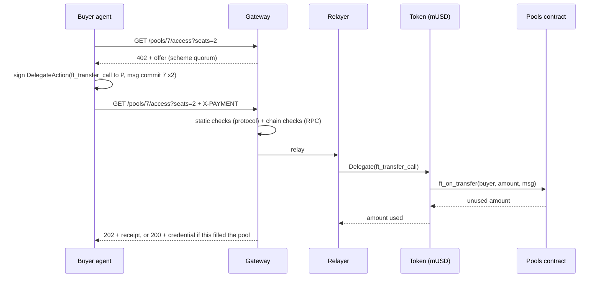
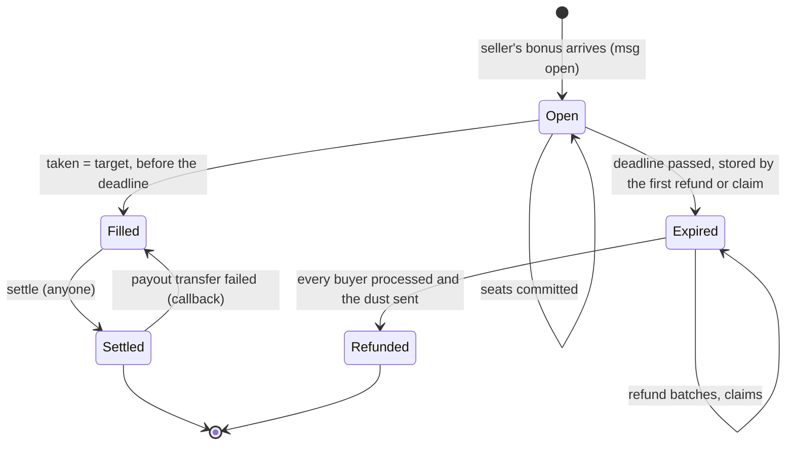

# Quorum on NEAR: design

> **Status: draft.** This spec describes what the system is and how it behaves. Implementation
> plans are written from it into `docs/plans/`.

## 1. Summary

Quorum on NEAR is a threshold group purchase. A seller opens a **pool** for something it will only
sell if enough buyers commit: a number of **seats**, a **seat price** and a **deadline**. When it
opens the pool, the seller also escrows a **refund bonus**. Buyers, usually AI agents acting for a
person or a company, each pay for one or more seats over HTTP 402.

- If every seat is taken before the deadline, the seller is paid, and each buyer receives an access
  credential.
- If not, every buyer gets its seats' price back **plus a share of the bonus**.

The bonus turns the purchase into a *dominant assurance contract*: a buyer that wants a seat at
that price is never worse off for committing, whatever the other buyers do. If the pool fills it
gets what it wanted, and if it does not it gets its money back with a bonus. An agent's rule is a
single line: **commit if the seat is worth the price.** The contract holds the bonus from the
moment the pool opens, so the promise is credible to strangers.

**The worked example** is a reserved block of GPU capacity, such as 8 GPUs for 24 hours sold as 192
one-GPU-hour seats. A provider would rather not reserve hardware that is only half committed, and a
small team cannot commit to a whole block alone. Pooling makes that block sellable.

**What is simulated:** the provider, and the GPU access it sells. The access credential is a signed
token, and no GPU stands behind it. **What is real:** the money flow. Seats, the bonus, the payout
and the refunds are all transactions on NEAR testnet, in a mock stablecoin.

## 2. Scope

**In scope**

- A NEAR contract that holds pools, seats and bonuses, and settles or refunds them with no owner or
  admin.
- A mock NEP-141 stablecoin for testnet.
- An HTTP 402 binding for the contract: a new x402 scheme, `quorum`, on network `near:testnet`.
- A gateway that serves offers, checks and relays payments, issues credentials, and triggers
  settlement and refunds.
- A swarm of scripted buyer agents and a simulated provider agent.
- An MCP server through which an LLM-driven agent can act as a buyer.
- A read-only live page showing pools filling, settling and refunding.

**Out of scope** (not built)

- Mainnet.
- Cross-chain funding.
- A wallet path for people (every buyer is an agent with its own account).
- Sealed-bid or dynamic pricing.
- Seller-prepaid storage (see section 11).
- A database (the chain holds all money state).
- More than one token per contract.
- Upgrade governance.

## 3. Terms

| Term | Meaning |
|---|---|
| Pool | One offer: a seller, a seat price, a target number of seats, a deadline, a bonus, and free-text terms |
| Seat | The unit a buyer pays for, such as one GPU-hour of the block |
| Target | The number of seats the pool must sell; it is also the maximum |
| Taken | Seats committed so far |
| Bonus | The amount the seller escrows when it opens the pool. It goes back to the seller if the pool fills, and is shared among the buyers if it does not |
| Bonus per seat | `floor(bonus / taken)`, fixed when the pool expires; 0 if no seat was taken |
| Minimum bonus per seat | `floor(bonus / max(target − 1, 1))`: the least each seat receives if the pool fails, whatever the other buyers do, because a failed pool has at most `target − 1` seats taken |
| Dust | `bonus − bonus_per_seat × taken`: the rounding remainder, which goes back to the seller |
| Buyer | A NEAR account that holds seats. In this system, every buyer is an agent's sub-account |
| Relayer | The account that submits buyers' signed delegate actions and pays their gas and deposit |
| Keeper | A loop in the gateway that calls `settle` and `refund` when they are due. Anyone else may call them too |

## 4. Architecture

| Unit | Path | Purpose | Depends on |
|---|---|---|---|
| Pools contract | `contracts/pools` | The escrow (section 5) | the token |
| Mock token | `contracts/mock-usd` | NEP-141, name "Mock USD", symbol `mUSD`, 6 decimals, with a capped open `mint` | — |
| Protocol | `packages/protocol` | The `quorum` scheme types, encoding and decoding, and the static payment checks. No network access | — |
| Gateway | `apps/gateway` | The provider's HTTP side: offers, payment checks, relay, credentials, redemption, the keeper, the activity feed and the static live page | protocol, NEAR RPC |
| Swarm | `apps/swarm` | Account setup, the provider agent and the scripted buyers | protocol, gateway |
| MCP server | `apps/mcp` | Buyer tools for an LLM-driven agent | protocol, gateway |
| Live page | `apps/web` | Plain HTML and one ES module, served by the gateway | NEAR RPC, gateway |

**Toolchain.**
- The contracts are written in Rust with near-sdk 5 and built with `cargo near`, with sandbox tests
  in `near-workspaces`.
- The TypeScript packages run on Node 22 in a pnpm workspace, use `near-api-js` v7, and are tested
  with vitest.
- The live page has no build step and no dependencies.

**The gateway plays both x402 roles.** It is the *resource server*: it answers with the offer, the
`202`, the `200` and the credential. It is also the *facilitator*: it verifies the payment and
settles it by relaying it. These are not separated into two services. A standard `exact`
facilitator cannot take a seat, for two reasons:

- A seat must arrive as `ft_transfer_call` with a `msg`, so that the contract records the buyer and
  the pool in the same call. A plain transfer to `payTo` would leave the contract unable to tell
  who paid for which pool.
- The outcome is conditional: `202 Accepted` while the pool fills, rather than the resource at once.

### 4.1 One payment, end to end



## 5. Pools contract

### 5.1 State

- `token: AccountId`, set by `new(token)`. It is the only token the contract accepts.
- The pools, numbered from 0 in order of creation. Each pool has:
  - `seller`, `seat_price`, `target`, `taken`, `deadline_ms`, `bonus`, `max_seats_per_buyer`
    (optional) and `terms`;
  - `status`, and `bonus_per_seat` (set at expiry);
  - `refund_cursor`, and `dust_sent`.
- For each pool, its buyers in the order they first committed. For each buyer: `seats`, and a
  `state` that is one of `Committed`, `Refunded` or `Claimable`.
- **There are no owner or admin methods.** Nothing can change a pool's terms or move its money
  except the transitions below.

### 5.2 Lifecycle



- Filled is final. A Filled pool is never refunded, even if `settle` runs after the deadline.
- Views report `Expired` as soon as the deadline passes, even before any `refund` call has stored
  it.
- Every deadline is judged by block time (`env::block_timestamp_ms()`).

### 5.3 Messages through `ft_on_transfer`

`ft_on_transfer(sender_id, amount, msg)` panics unless the caller is `token`. Any refusal is a
panic, and the token then returns the whole amount to the sender (NEP-141's `ft_resolve_transfer`).

**Open a pool.** The amount sent is the bonus (0 is allowed), and `sender_id` becomes the seller:

```json
{ "open": { "seat_price": "1800000", "target": 192, "deadline_ms": 1800000000000,
            "max_seats_per_buyer": 24, "terms": "8×GPU × 24 h; 1 seat = 1 GPU-hour" } }
```

It is refused unless all of these hold:
- `seat_price > 0`;
- `1 ≤ target ≤ 1000`;
- `deadline_ms` is in the future;
- `terms` is at most 280 bytes;
- `max_seats_per_buyer`, if set, is at least 1.

It returns `"0"` (nothing unused) and emits `pool_opened`.

**Commit seats.** `sender_id` is the buyer:

```json
{ "commit": { "pool_id": 7, "seats": 2 } }
```

It is refused unless all of these hold:
- the pool exists and its status is Open;
- block time is before `deadline_ms`;
- `sender_id` is not the seller;
- `seats ≥ 1`;
- `amount = seats × seat_price`;
- with this commit, the buyer's seats stay within `max_seats_per_buyer`.

It takes `n = min(seats, target − taken)` seats. If `n = 0`, it is refused. It records the buyer,
adding to its seats if it already holds some, and returns `(seats − n) × seat_price` as unused, so
an over-target payment comes back in the same call. It emits `seats_committed`, and also
`pool_filled` when `taken` reaches `target`.

### 5.4 Methods

| Method | Caller | Behaviour |
|---|---|---|
| `settle(pool_id)` | anyone | Requires Filled. Sets Settled **before** transferring, then sends one `ft_transfer` to the seller of `taken × seat_price + bonus`. On failure, the callback sets the pool back to Filled, so `settle` can be called again. Emits `pool_settled` on success |
| `refund(pool_id, limit)` | anyone | Requires the pool to be Open past its deadline, or Expired. `limit` is 1 to 10. On the first call, Open becomes Expired and `bonus_per_seat` is fixed. It advances `refund_cursor` past up to `limit` buyers, skipping those no longer `Committed`. For each `Committed` one it sets `Refunded`, then sends `ft_transfer` of `seats × (seat_price + bonus_per_seat)` with its own callback; a failed transfer sets the buyer to `Claimable` and emits `refund_failed`. When the cursor reaches the end, it sends the dust to the seller (the whole bonus if `taken = 0`) and marks the pool Refunded. A failed dust transfer leaves the pool Expired, and the next `refund` call retries only the dust |
| `claim_refund(pool_id)` | that buyer | Requires the pool to be Open past its deadline, Expired or Refunded; like `refund`, it first moves an Open pool past its deadline to Expired. The buyer's state must be `Committed` (not yet pushed) or `Claimable` (push failed). It sets `Refunded`, then transfers the buyer's refund; on failure the callback sets `Claimable` again. Emits `refund_claimed`. **If the gateway disappears, every buyer can still get its money back** |
| `get_pool(pool_id)` | view | Every pool field, with the derived status |
| `list_pools(from, limit)` | view | Pools in id order |
| `get_seats(pool_id, from, limit)` | view | `[{buyer, seats, state}]` in commit order |
| `get_buyer(pool_id, account_id)` | view | That buyer's `{seats, state}` or `null` |

Every cross-contract call is a promise with a `#[private]` callback. State is written before each
transfer and restored by the callback if the transfer fails. **Callbacks never panic.** Every
amount is computed with checked arithmetic.

### 5.5 Invariants

Each invariant is tested after every step of the sandbox tests (section 10).

1. **Solvency:** `ft_balance_of(pools contract)` ≥ the sum over all pools of what each still owes:
   - Open or Filled: `taken × seat_price + bonus`;
   - Settled: 0;
   - Expired or Refunded: the refunds of its buyers still `Committed` or `Claimable`, plus the dust
     if it has not been sent.

   The balance can be higher (anyone can send tokens to the contract), never lower.
2. `taken ≤ target`. A pool becomes Filled only when `taken = target` and block time is before the
   deadline.
3. A pool's money leaves in exactly one of two ways, never both: all to the seller (Settled); or
   each seat's price and bonus share to its buyer, and the dust to the seller (Refunded).
4. For a refunded pool, the sum of buyer refunds plus the dust equals `taken × seat_price + bonus`.
5. A buyer is paid at most once per pool.

### 5.6 Events

These are NEP-297 events with `standard: "quorum"` and `version: "1.0.0"`. Amounts are decimal
strings.

| Event | Data |
|---|---|
| `pool_opened` | `pool_id, seller, seat_price, target, deadline_ms, bonus, terms` |
| `seats_committed` | `pool_id, buyer, seats, amount, taken, target` |
| `pool_filled` | `pool_id, taken` |
| `pool_settled` | `pool_id, seller, amount` |
| `seat_refunded` | `pool_id, buyer, seats, amount, bonus_share` |
| `refund_failed` | `pool_id, buyer, amount` |
| `refund_claimed` | `pool_id, buyer, amount` |
| `pool_refunded` | `pool_id, dust` |

### 5.7 Mock token

`contracts/mock-usd` is the standard NEP-141 implementation from `near-contract-standards`, with
storage management. It has one extra method, `mint(account_id, amount)`, open to anyone and capped
at 1,000 mUSD per call. It exists for testnet only.

## 6. The `quorum` x402 scheme

The scheme uses the x402 version 1 wire format: a JSON body on the `402` response, the `X-PAYMENT`
request header and the `X-PAYMENT-RESPONSE` response header, each carrying base64-encoded JSON. The
network is written in CAIP-2 form: `near:testnet`.

### 6.1 Endpoints

| Endpoint | Purpose |
|---|---|
| `GET /` | The live page (static files from `apps/web`) |
| `GET /pools` | The open pools: `id, terms, seat_price, target, taken, deadline_ms, bonus, min_bonus_per_seat` |
| `GET /pools/:id/access?seats=N` | With no header: `402` with the offer (`seats` defaults to 1). With `X-PAYMENT`: process a payment. With `X-QUORUM-PROOF`: redeem (section 6.5) |
| `GET /activity?pool=:id` | The activity feed (section 6.7) |
| `GET /.well-known/jwks.json` | The public key that verifies credentials |
| `POST /rpc` | Only if the public RPC refuses browser requests: a read-only pass-through that forwards `call_function` view calls on the pools contract and the token, and nothing else |

### 6.2 Offer

```json
{
  "x402Version": 1,
  "error": "payment required",
  "accepts": [{
    "scheme": "quorum",
    "network": "near:testnet",
    "maxAmountRequired": "3600000",
    "resource": "https://<gateway>/pools/7/access?seats=2",
    "description": "2 seats in pool 7: 8×GPU × 24 h; 1 seat = 1 GPU-hour",
    "mimeType": "application/json",
    "payTo": "pools.<parent>",
    "maxTimeoutSeconds": 120,
    "asset": "musd.<parent>",
    "extra": {
      "poolId": 7, "seats": 2, "seatPrice": "1800000",
      "target": 192, "taken": 148, "deadlineMs": 1800000000000,
      "bonus": "17280000", "minBonusPerSeat": "90471",
      "terms": "8×GPU × 24 h; 1 seat = 1 GPU-hour",
      "relayer": "relay.<parent>", "minGas": "50000000000000"
    }
  }]
}
```

`minBonusPerSeat` is the least each seat receives if the pool fails (section 3), whatever the other
buyers do. The actual share is fixed when the pool expires and can only be higher. If fewer seats
are left than requested, the offer is made for the seats left, and `extra.seats` says so.

### 6.3 Payment

`X-PAYMENT` carries `base64(JSON)`:

```json
{ "x402Version": 1, "scheme": "quorum", "network": "near:testnet",
  "payload": { "signedDelegate": "<base64 of the Borsh-encoded SignedDelegateAction>" } }
```

The delegate action is signed by the buyer's account, which must use a **full-access key**. It
contains exactly one action, `FunctionCall`, on the token:
- method `ft_transfer_call`;
- arguments `{receiver_id: pools contract, amount: seats × seat_price, msg: "{\"commit\":{\"pool_id\":7,\"seats\":2}}"}`;
- a deposit of 1 yoctoNEAR;
- gas of at least `minGas`.

### 6.4 Checks, then relay

The gateway relays nothing until every check passes. A failed check is answered with `402`,
carrying the same offer, and `error` set to the code shown.

| # | Check | Done by | Code |
|---|---|---|---|
| 1 | The payload decodes, the scheme and network match, and the signature is valid for `public_key` over the delegate action's signable message | protocol | `invalid_payload`, `invalid_signature` |
| 2 | `receiver_id` is the token; there is exactly one `FunctionCall`; the method is `ft_transfer_call`; the deposit is 1 yoctoNEAR; the gas is at least `minGas` | protocol | `wrong_receiver`, `wrong_method`, `gas_too_low` |
| 3 | The arguments match the offer: `receiver_id` is the pools contract, `amount` is seats × price, and `msg` commits to this pool for this number of seats | protocol | `wrong_amount`, `wrong_pool` |
| 4 | `public_key` is a full-access key of `sender_id` (`view_access_key`) | gateway | `not_full_access` |
| 5 | `nonce` is above the key's current nonce; `max_block_height` is above the current height and at most 120 blocks ahead | gateway | `stale_nonce`, `expired` |
| 6 | The pool is Open, block time is before the deadline, and at least one seat is left. If fewer seats are left than paid for by the time the payment lands, the contract takes what is left and returns the rest | gateway | `pool_closed` |
| 7 | `ft_balance_of(sender_id)` covers the amount | gateway | `insufficient_balance` |

Each buyer has at most one payment in flight; a second one is refused with `payment_in_flight`.
Because of these checks, the relayer only ever pays for a seat payment that matches a live offer.

**Relay.** The relayer account wraps the signed delegate action in a transaction and submits it. It
holds several access keys and uses each for one transaction at a time, so payments relay in
parallel without nonce clashes. `ft_transfer_call` returns the amount used, and
`seats taken = amount used / seat_price`.

| Outcome | Response |
|---|---|
| Seats taken, pool still Open | `202 Accepted`, with `X-PAYMENT-RESPONSE`, and body `{status: "pending", receipt: {poolId, buyer, seats, txHash}, pool: {taken, target, deadlineMs}}` |
| This payment filled the pool | `200 OK`, with `X-PAYMENT-RESPONSE`, and body `{status: "filled", credential, poolId, seats, terms}` |
| No seats taken (the pool filled or closed in between; the token has returned the money) | `409 Conflict`, with a fresh offer if seats are left |
| The pool had expired | `410 Gone` |
| The relay failed, or its result is unknown after the timeout | `502 Bad Gateway`, with the transaction hash if there is one |

`X-PAYMENT-RESPONSE` carries `base64(JSON {success: true, transaction, network, payer})`.

On an RPC timeout, the gateway looks the result up by transaction hash. It never re-signs or
re-sends a payment.

### 6.5 Redemption

A buyer that received `202` comes back with `X-QUORUM-PROOF`. This header carries `base64(JSON)` of
an NEP-413 signed message: `{accountId, publicKey, signature, message: "quorum:redeem:<poolId>",
nonce, recipient: "<gateway host>"}`. The first 8 bytes of the 32-byte nonce are the signing time in
milliseconds (big-endian); the rest are random.

The gateway checks four things:
1. the NEP-413 signature;
2. that `publicKey` is a full-access key of `accountId`;
3. that the proof is less than 5 minutes old;
4. that the nonce has not been seen.

It then reads `get_buyer` and `get_pool`:

| Pool | Response |
|---|---|
| Open | `202` with `{status: "pending", seats, taken, target, deadlineMs}` |
| Filled or Settled | `200` with `{status: "filled", credential, poolId, seats, terms}` |
| Expired or Refunded | `410` with `{status: "refunded" or "refund_pending" or "claimable", amount, bonusShare, txHash}` |
| The account holds no seats | `404` |

### 6.6 Credential

A compact JWS, `alg: "EdDSA"`, signed with the gateway's credential key. That key is an Ed25519 key
configured in the gateway, and is distinct from every NEAR account key. Claims:

| Claim | Value |
|---|---|
| `iss` | the gateway's URL |
| `sub` | the buyer's account |
| `pool`, `seats`, `terms` | from the contract |
| `iat`, `jti` | issue time, unique id |
| `simulated` | `true`: no resource stands behind the credential |

The same buyer always gets a credential with the same `sub`, `pool` and `seats`. Only `iat` and
`jti` change between calls.

### 6.7 Keeper and activity feed

**The keeper** runs every 5 seconds and signs with the relayer account:
- for each Filled pool, it calls `settle(pool_id)`;
- for each pool past its deadline that is not yet Refunded, it calls `refund(pool_id, 10)`.

Both methods are open to anyone and safe to repeat, so the keeper is a convenience, not a trusted
party.

**The activity feed** records what the gateway relayed or triggered:
`{at, poolId, kind: commit | settle | refund | dust, account, seats, amount, txHash, ok}`. It is
appended to a JSON-lines file under `data/`, which is gitignored. It exists to give transaction
links; the money state is always read from the contract.

## 7. Accounts and agents

### 7.1 Testnet accounts

All are sub-accounts of one parent account set in the configuration, written `<parent>` here.

| Account | Role |
|---|---|
| `musd.<parent>` | The mock token |
| `pools.<parent>` | The pools contract. Its NEAR balance pays the contract's storage |
| `relay.<parent>` | The relayer and the keeper. It pays gas and the 1 yoctoNEAR deposits, and holds several access keys |
| `provider.<parent>` | The simulated seller. It holds the mUSD for its bonuses |
| `buyer-01` … `buyer-20.<parent>` | The scripted buyers |
| `buyer-llm.<parent>` | The buyer the MCP server acts for |

Every buyer holds only its own budget, so a leaked buyer key can lose at most that budget. Keys live
in `.near-credentials/`, which is gitignored, on the machine that runs the agent. The gateway only
ever sees signed delegate actions.

### 7.2 Setup

`swarm setup` is idempotent. It:
1. creates any missing account, with a fresh key;
2. deploys the two contracts if they are missing, and initialises the pools contract with the token;
3. gives each buyer a configured amount of NEAR for its account storage (default 0.05 NEAR);
4. registers the pools contract, the provider and each buyer on the token (`storage_deposit`);
5. mints each buyer's budget and the provider's bonus funds.

### 7.3 Provider agent

`swarm open <scenario>` opens a pool by sending the bonus through `ft_transfer_call` with an
`open` message. The two scenarios use illustrative numbers:

| Scenario | Block | Seats | Seat price | Bonus | Deadline | Expected end |
|---|---|---|---|---|---|---|
| `fills` | 8 GPUs × 24 h | 192 | 1.80 mUSD | 5% of the block (17.28 mUSD) | 10 min | Filled, then Settled |
| `fails` | 8 GPUs × 24 h | 192 | 3.20 mUSD | 5% of the block (30.72 mUSD) | 3 min | Expired, then Refunded |

### 7.4 Scripted buyers

`swarm run` runs the 20 scripted buyers in one process. Each has its own account and key, and a
profile from a fixture: the seats it wants and its top price per seat. Each buyer:

1. waits a random delay, so the pool fills visibly;
2. lists the pools with `GET /pools`;
3. applies its rule: **commit if `seat_price ≤ top price`**;
4. requests the offer, signs the delegate action and pays;
5. redeems with its NEP-413 proof until it gets `200` (a credential) or `410` (a refund);
6. logs its outcome.

The fixture is built so that no buyer wants more than the pool's `max_seats_per_buyer`, and:
- the buyers who would accept the `fills` price want slightly more than 192 seats in total, so the
  last buyer gets only the seats left and the excess comes back in the same call;
- the buyers who would accept the `fails` price want well under 192 seats.

### 7.5 LLM buyer (MCP server)

`apps/mcp` is a stdio MCP server. Any MCP client can use it to act as `buyer-llm`.

| Tool | Input | Returns |
|---|---|---|
| `quorum_pools` | — | The open pools: terms, price, seats left, deadline, bonus |
| `quorum_offer` | `pool, seats` | The decoded offer, and the least the buyer gets back if the pool fails (seat price plus the minimum bonus per seat, for each seat) |
| `quorum_commit` | `pool, seats` | Signs and pays. Returns the `202` receipt or the `200` credential |
| `quorum_status` | `pool` | Pending, the credential, or the refund with its transaction |

The server enforces a **spend cap** (configured, in mUSD) before it signs anything, because the
buyer's key is a full-access key. A payment that would take the buyer's total spend past the cap is
refused locally.

## 8. Live page

`apps/web` is `index.html`, `app.js` (an ES module), `totals.js` and `style.css`. There is no build
step, and the gateway serves the folder at `/`. The page never signs anything and needs no wallet.

- **The banner:** "The provider is simulated. The money flow is real, on NEAR testnet."
- **The pool card:** the terms, a bar filling seat by seat, the seat price, the bonus escrowed, a
  countdown and the status.
- **The buyer table:** buyer, seats, amount paid, and state (committed; refunded with its bonus
  share; claimable; settled), with a testnet explorer link for each transaction.
- **The bookkeeper totals:** paid in, paid to the seller, refunded, bonus paid out, and held now.
  *Held now* is shown beside `ft_balance_of(pools contract)`, so the solvency invariant can be seen.
- **Data:** every 2 seconds, it reads pool state from the contract's views (`get_pool`,
  `get_seats`) with RPC `call_function`, and transaction links from `/activity`. The RPC URL is set
  in the page's configuration. If the RPC refuses browser requests, the page uses the gateway's
  `/rpc` pass-through instead (section 6.1).
- `totals.js` is a pure module that computes the totals from the contract's data. It is the one
  piece of logic on the page, and it is unit-tested.

## 9. Error handling

| Case | Behaviour |
|---|---|
| A payment check fails | `402` with the code from section 6.4. Nothing is relayed |
| Two buyers race for the last seats | `409`. The token's resolver has already returned the unused amount |
| The RPC times out during a relay | The result is looked up by transaction hash; the payment is never re-signed or re-sent. If the result is still unknown, `502` with the hash, and the buyer checks through redemption |
| A keeper call fails | It is retried on the next tick. The contract's guards make every call safe to repeat |
| A pushed refund fails (for example, the buyer is no longer registered on the token) | The buyer becomes `Claimable`; it registers again and calls `claim_refund` |
| The payout to the seller fails | The pool goes back to Filled, and `settle` is retried |
| The gateway restarts | All money state is on chain. The activity feed is reloaded from its file. The redemption nonce cache restarts empty, which is safe because proofs older than 5 minutes are refused |
| Deadlines | Always judged by block time, never by a server clock |

## 10. Testing

| Level | What it covers |
|---|---|
| Contract unit tests (near-sdk test environment) | The bonus split and the dust; every state transition; every refusal in section 5.3; checked arithmetic at the limits |
| Sandbox integration (`near-workspaces`, with the real mock token) | **Fills:** open, commits, fill, settle. **Fails:** expiry, refund in batches, dust to the seller. Also: a partial last commit; a payment from the wrong token; a commit after the deadline; a seller committing to its own pool; a failed pushed refund, then a claim; a failed payout, then a retried `settle`; a claim before any `refund` call; a pool with no seats at expiry. The invariants of section 5.5 are checked after every step, against `ft_balance_of` |
| `packages/protocol` unit tests | Offer and payload encoding and decoding; the static checks, one test per rejection code, with fixture keys |
| Gateway tests against a stubbed chain | Every row of the response tables in sections 6.4 and 6.5; payments in flight; the RPC timeout path; the keeper's calls |
| MCP unit tests | Each tool against a stubbed gateway; the spend cap |
| Live page | `totals.js` unit tests |
| End to end on testnet | `swarm demo fills` and `swarm demo fails`, each ending with a check of the final on-chain state: pool status, every buyer's state, the seller's and the buyers' balances, and the contract's balance |

## 11. NEAR rules this design relies on

From NEAR's documentation (docs.near.org: access keys, one-yocto deposits, meta transactions, gas
keys) and the NEP-141, NEP-297, NEP-366 and NEP-413 standards:

- A **function-call access key cannot attach a deposit**, not even 1 yoctoNEAR. Buyers therefore
  sign with a full-access key, since `ft_transfer_call` requires 1 yoctoNEAR.
- In an NEP-366 meta transaction, **the relayer pays the gas for the inner actions and for the
  delegate action, and any deposit attached to an inner action**. Gas refunds go to the relayer.
  The tokens moved by `ft_transfer_call` still come from the sender's own balance.
- A delegate action has **one receiver**, and its inner actions have no atomicity or roll-back
  across receipts.
- Its nonce is the signing key's nonce and must be above the one stored on chain. Its
  `max_block_height` bounds how long it can be relayed.
- Gas keys cannot sign the inner delegate action, so buyers sign with a regular access key.
- With a relayed call, the buyer is `predecessor_account_id` (the token sees the buyer as the
  sender); `signer_account_id` is the relayer. The contract never uses `signer_account_id`.
- NEP-141: an account must be registered (`storage_deposit`) to hold tokens. `ft_transfer_call`
  calls the receiver's `ft_on_transfer`, which returns the unused amount, and `ft_resolve_transfer`
  refunds it. If `ft_on_transfer` panics, the whole amount is refunded.
- Cross-contract calls are asynchronous promises. Their results reach a callback, which must handle
  failure without panicking.

## 12. Known limits

- **Storage** for pools and seats is paid from the contract account's own NEAR balance. A
  production version would make the seller prepay it when opening a pool.
- **The credential is simulated:** it proves a paid seat in a filled pool, not access to any real
  resource.
- **One token** per deployment of the contract.
- **The relayer is a cost centre:** it pays gas and 1 yoctoNEAR for every payment it relays. The
  checks in section 6.4 limit it to valid seat payments, and a production version would also
  rate-limit per buyer.
- **Agents hold full-access keys** to their own sub-accounts. The blast radius is the budget held in
  that sub-account, and the MCP server adds a spend cap.
