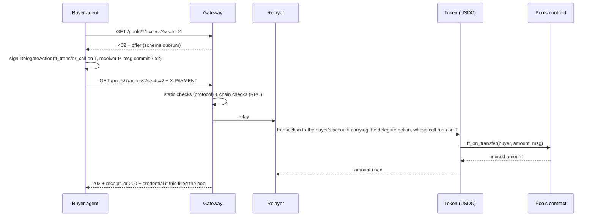
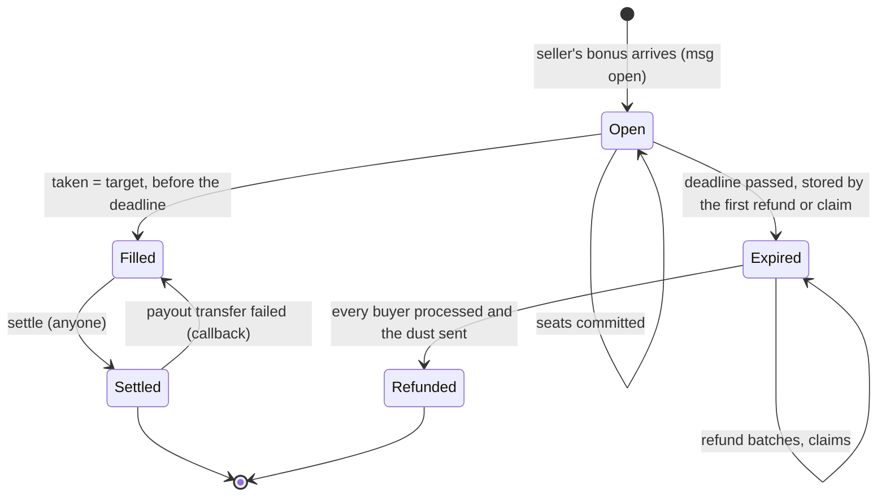

# Quorum on NEAR: design

> **Status: draft.** This spec describes what the system is and how it behaves. Implementation
> plans are written from it into `docs/plans/`.

## 1. Summary

Quorum on NEAR is a threshold group purchase. A seller opens a **pool** for something it will only
sell if enough buyers commit: a number of **seats**, a **seat price** and a **deadline**. When it
opens the pool, the seller also escrows a **refund bonus**. Buyers, usually AI agents acting for a
person or a company, each pay for one or more seats over HTTP 402.

- If every seat is taken before the deadline, the seller is paid, and each buyer receives an access
  credential.
- If not, every buyer gets its seats' price back **plus a share of the bonus**.

The bonus turns the purchase into a *dominant assurance contract*: a buyer that wants a seat at
that price is never worse off for committing, whatever the other buyers do. If the pool fills it
gets what it wanted, and if it does not it gets its money back plus a bonus share (strictly better
off whenever the bonus is above zero). An agent's rule is a
single line: **commit if the seat is worth the price.** The contract holds the bonus from the
moment the pool opens, so the promise is credible to strangers.

**The worked example** is a block of GPU capacity, such as 8 GPUs for 24 hours sold as 192
one-GPU-hour seats. A provider would rather not reserve hardware that is only half committed, and a
small team cannot commit to a whole block alone. Pooling makes that block sellable.

**What is simulated:** the provider, and the GPU access it sells. The access credential is a signed
token, and no GPU stands behind it. **What is real:** the money flow. Seats, the bonus, the payout
and the refunds are all transactions on NEAR testnet, in Circle's testnet USDC. Prices are scaled
down 10,000 times, so that no pool holds, and no run moves, as much as 0.1 USDC (sections 7.2 and
7.3).

## 2. Scope

**In scope**

- A NEAR contract that holds pools, seats and bonuses, and settles or refunds them with no owner or
  admin.
- A mock NEP-141 token for the sandbox tests. On testnet the contract uses Circle's USDC, which
  this system does not deploy.
- An HTTP 402 binding for the contract: a new x402 scheme, `quorum`, on network `near:testnet`.
- A gateway that serves offers, checks and relays payments, issues credentials, and triggers
  settlement and refunds.
- A swarm of scripted buyer agents and a simulated provider agent, all funded from one funding
  account.
- An MCP server through which an LLM-driven agent can act as a buyer.
- A read-only live page showing pools filling, settling and refunding.

**Out of scope** (not built)

- Mainnet.
- Cross-chain funding.
- Automated faucet funding: Circle's web faucet has a human check, and its faucet API does not
  serve NEAR testnet (section 7.2).
- A wallet path for people (every buyer is an agent with its own account).
- Sealed-bid or dynamic pricing.
- Seller-prepaid storage (see section 12).
- A database (the chain holds all money state).
- More than one token per contract.
- Upgrade governance.

## 3. Terms

| Term | Meaning |
|---|---|
| Pool | One offer: a seller, a seat price, a target number of seats, a deadline, a bonus, and free-text terms |
| Seat | The unit a buyer pays for, such as one GPU-hour of the block |
| Target | The number of seats the pool must sell; it is also the maximum |
| Taken | Seats committed so far |
| Bonus | The amount the seller escrows when it opens the pool. It goes back to the seller if the pool fills, and is shared among the buyers if it does not |
| Bonus per seat | `floor(bonus / taken)`, fixed when the pool expires; 0 if no seat was taken |
| Minimum bonus per seat | `floor(bonus / max(target − 1, 1))`: the least each seat receives if the pool fails, whatever the other buyers do, because a failed pool has at most `target − 1` seats taken |
| Dust | `bonus − bonus_per_seat × taken`: the rounding remainder, which goes back to the seller |
| Buyer | A NEAR account that holds seats. In this system, every buyer is an agent's sub-account |
| Relayer | The account that submits buyers' signed delegate actions and pays their gas |
| Keeper | A loop in the gateway that calls `settle` and `refund` when they are due. Anyone else may call them too |

## 4. Architecture

| Unit | Path | Purpose | Depends on |
|---|---|---|---|
| Pools contract | `contracts/pools` | The escrow (section 5) | the token |
| Mock token | `contracts/mock-usd` | NEP-141, name "Mock USD", symbol `mUSD`, 6 decimals, with a capped open `mint`. Used by the sandbox tests only, never deployed to testnet (section 5.7) | — |
| Protocol | `packages/protocol` | The `quorum` scheme types, encoding and decoding, and the static payment checks; also the reading of a transaction's outcome and its events, and the check of an RPC's chain id. No network access | — |
| Gateway | `apps/gateway` | The provider's HTTP side: offers, payment checks, relay, credentials, redemption, the keeper, the activity feed and the static live page | protocol, NEAR RPC |
| Buyer | `packages/buyer` | A buyer's side, shared by the swarm and the MCP server: their shared settings, key files, the gateway client, signing and sending a payment (section 6.3), a checked read of a pool, and the MCP server's spend file | protocol, NEAR RPC, gateway |
| Swarm | `apps/swarm` | Account setup and reset, the provider agent, the scripted buyers and the final check | protocol, buyer, NEAR RPC, gateway |
| MCP server | `apps/mcp` | Buyer tools for an LLM-driven agent | protocol, buyer, NEAR RPC, gateway |
| Live page | `apps/web` | Plain HTML and ES modules, served by the gateway | NEAR RPC, gateway |

**Toolchain.**
- The contracts are written in Rust with near-sdk 5 and built with `cargo near`, with sandbox tests
  in `near-sandbox` and `near-api`.
- The TypeScript packages run on Node 22 in a pnpm workspace, use `near-api-js` v7, and are tested
  with vitest.
- The live page has no build step and no dependencies.

**The gateway plays both x402 roles.** It is the *resource server*: it answers with the offer, the
`202`, the `200` and the credential. It is also the *facilitator*: it verifies the payment and
settles it by relaying it. These are not separated into two services. A standard `exact`
facilitator cannot take a seat, for two reasons:

- A seat must arrive as `ft_transfer_call` with a `msg`, so that the contract records the buyer and
  the pool in the same call. A plain transfer to `payTo` would leave the contract unable to tell
  who paid for which pool.
- The outcome is conditional: `202 Accepted` while the pool fills, rather than the resource at once.

### 4.1 One payment, end to end



## 5. Pools contract

### 5.1 State

- `token: AccountId`, set by `new(token)`. It is the only token the contract accepts. `new` is
  `#[private]` and runs in the same transaction as the deployment (section 7.2), so nobody can
  initialise the contract with a different token.
- The pools, numbered from 0 in order of creation. Each pool has:
  - `seller`, `seat_price`, `target`, `taken`, `deadline_ms`, `bonus`, `max_seats_per_buyer`
    (optional) and `terms`;
  - `status`, and `bonus_per_seat` (set at expiry);
  - `refund_cursor`, and `dust_sent`.
- For each pool, its buyers in the order they first committed. For each buyer: `seats`, and a
  `state` that is one of `Committed`, `Refunded` or `Claimable`.
- **There are no owner or admin methods.** Nothing can change a pool's terms or move its money
  except the transitions below.

### 5.2 Lifecycle



- Filled is final. A Filled pool is never refunded, even if `settle` runs after the deadline.
- Views report `Expired` as soon as the deadline passes, even before any `refund` call has stored
  it.
- Every deadline is measured in block time (`env::block_timestamp_ms()`). A pool is **past its
  deadline** when block time ≥ `deadline_ms`; a commit needs block time < `deadline_ms`, so no
  moment allows both a commit and a refund.

### 5.3 Messages through `ft_on_transfer`

`ft_on_transfer(sender_id, amount, msg)` panics unless the caller is `token`. Any refusal is a
panic, and the token then returns the whole amount to the sender (NEP-141's `ft_resolve_transfer`).

**Open a pool.** The amount sent is the bonus (0 is allowed by the contract, though the standard
NEP-141 token rejects a zero-amount `ft_transfer_call`, so a pool with no bonus needs a token that
accepts one), and `sender_id` becomes the seller:

```json
{ "open": { "seat_price": "180", "target": 192, "deadline_ms": 1800000000000,
            "max_seats_per_buyer": 24,
            "terms": "8×GPU × 24 h; 1 seat = 1 GPU-hour; prices at 1/10,000 scale" } }
```

It is refused unless all of these hold:
- `seat_price > 0`;
- `1 ≤ target ≤ 1000`;
- `deadline_ms` is in the future;
- `terms` is at most 280 bytes;
- `max_seats_per_buyer`, if set, is at least 1.

It returns `"0"` (nothing unused) and emits `pool_opened`.

**Commit seats.** `sender_id` is the buyer:

```json
{ "commit": { "pool_id": 7, "seats": 2 } }
```

It is refused unless all of these hold:
- the pool exists and its status is Open;
- block time is before `deadline_ms`;
- `sender_id` is not the seller;
- `seats ≥ 1`;
- `amount = seats × seat_price`;
- the seats the buyer already holds, plus the `seats` it asks for, stay within
  `max_seats_per_buyer`. The cap is checked against the seats asked for, before the pool's
  remaining seats are taken into account.

It takes `n = min(seats, target − taken)` seats. If `n = 0`, it is refused. It records the buyer,
adding to its seats if it already holds some, and returns `(seats − n) × seat_price` as unused, so
an over-target payment comes back in the same call. It emits `seats_committed`, and also
`pool_filled` when `taken` reaches `target`.

### 5.4 Methods

| Method | Caller | Behaviour |
|---|---|---|
| `settle(pool_id)` | anyone | Requires Filled. Sets Settled **before** transferring, then sends one `ft_transfer` to the seller of `taken × seat_price + bonus`. On failure, the callback sets the pool back to Filled, so `settle` can be called again. Emits `pool_settled` on success |
| `refund(pool_id, limit)` | anyone | Requires the pool to be Open past its deadline, or Expired. `limit` is 1 to 10. On the first call, Open becomes Expired and `bonus_per_seat` is fixed. It advances `refund_cursor` past up to `limit` buyers, skipping those no longer `Committed`. For each `Committed` one it sets `Refunded`, then sends `ft_transfer` of `seats × (seat_price + bonus_per_seat)` with its own callback; a failed transfer sets the buyer to `Claimable` and emits `refund_failed`. When the cursor reaches the end, it sends the dust to the seller (the whole bonus if `taken = 0`) and marks the pool Refunded. A dust of 0 is not sent, because the standard token implementation rejects a zero amount: the pool is marked Refunded at once. A failed dust transfer leaves the pool Expired, and the next `refund` call retries only the dust. Emits `seat_refunded` for each refund that arrives, `refund_failed` for each that does not, and `pool_refunded` when the pool is marked Refunded |
| `claim_refund(pool_id)` | that buyer | Requires the pool to be Open past its deadline, Expired or Refunded; like `refund`, it first moves an Open pool past its deadline to Expired. The buyer's state must be `Committed` (not yet pushed) or `Claimable` (push failed). It sets `Refunded`, then transfers the buyer's refund; on failure the callback sets `Claimable` again. Emits `refund_claimed`. **If the gateway disappears, every buyer can still get its money back** |
| `get_pool(pool_id)` | view | Every pool field, with the derived status |
| `list_pools(from, limit)` | view | Pools in id order |
| `get_seats(pool_id, from, limit)` | view | `[{buyer, seats, state}]` in commit order |
| `get_buyer(pool_id, account_id)` | view | That buyer's `{seats, state}` or `null` |
| `get_token()` | view | The token the contract accepts, as set by `new` |

Every cross-contract call is a promise with a `#[private]` callback. State is written before each
transfer and restored by the callback if the transfer fails. **Callbacks never panic.** Every
amount is computed with checked arithmetic.

**Gas and deposits.** Each transfer the contract makes is an `ft_transfer`, which needs exactly 1
yoctoNEAR attached; the contract pays it from its own NEAR balance. Each transfer and each callback
is given at least 10 Tgas (near-sdk also shares out among them any gas the call leaves unused), and
each transfer with its callback also costs about 3 Tgas of runtime receipt fees. `settle`, `refund`
and `claim_refund` assert at entry that their remaining prepaid gas covers every transfer and
callback they are about to schedule, with those fees, plus 10 Tgas for their own work, and panic
before changing any state if it does not:

| Method | Transfers it can schedule | Gas required at entry |
|---|---|---|
| `settle` | 1 | 33 Tgas |
| `claim_refund` | 1 | 33 Tgas |
| `refund(pool_id, limit)` | up to `limit` refunds, plus the dust | 10 + 23 × (`limit` + 1) Tgas, so 263 Tgas at `limit` = 10 |

A caller attaches that much plus the few Tgas the call uses before its check: a full `refund`
batch of 10 completes with 280 Tgas, under the 300 Tgas per-transaction cap. The gas for each
promise is reserved when the promise is scheduled, so a call that cannot reserve it fails as a whole
and changes nothing; the entry assertion turns that into a clear refusal. What keeps a callback from
running out of gas, which would leave a buyer marked `Refunded` with no transfer made, is its
allowance. Against the mock token, the sandbox gas test measures about 1.7 Tgas burnt by each
transfer and 1.5 Tgas by each callback, and fails if any of them reaches 5 Tgas. The allowances, and
with them the largest usable `limit`, come from that profiling; `limit` is at most 10.

### 5.5 Invariants

Each invariant is tested after every step of the sandbox tests (section 10).

1. **Solvency:** `ft_balance_of(pools contract)` ≥ the sum over all pools of what each still owes:
   - Open or Filled: `taken × seat_price + bonus`;
   - Settled: 0;
   - Expired or Refunded: the refunds of its buyers still `Committed` or `Claimable`, plus the dust
     if it has not been sent.

   The balance can be higher (anyone can send tokens to the contract), never lower.
2. `taken ≤ target`. A pool becomes Filled only when `taken = target` and block time is before the
   deadline.
3. A pool's money leaves in exactly one of two ways, never both: all to the seller (Settled); or
   each seat's price and bonus share to its buyer, and the dust to the seller (Refunded).
4. For a refunded pool, the sum of buyer refunds plus the dust equals `taken × seat_price + bonus`.
5. A buyer is paid at most once per pool.

### 5.6 Events

These are NEP-297 events with `standard: "quorum"` and `version: "1.0.0"`. Amounts are decimal
strings.

| Event | Data |
|---|---|
| `pool_opened` | `pool_id, seller, seat_price, target, deadline_ms, bonus, terms` |
| `seats_committed` | `pool_id, buyer, seats, amount, taken, target` |
| `pool_filled` | `pool_id, taken` |
| `pool_settled` | `pool_id, seller, amount` |
| `seat_refunded` | `pool_id, buyer, seats, amount, bonus_share` |
| `refund_failed` | `pool_id, buyer, amount` |
| `refund_claimed` | `pool_id, buyer, amount` |
| `pool_refunded` | `pool_id, dust` |

`pool_refunded` is logged when the pool is marked Refunded, which can happen before the callbacks
of the last batch's refunds have run. Whether a buyer's refund arrived is recorded in its state
(`get_buyer`, `get_seats`), not in the order of the events.

### 5.7 Tokens

The contract accepts one token, fixed by `new(token)`. It relies only on standard NEP-141 and
NEP-145 behaviour, and never calls a method outside those standards, so it treats any compliant
token alike.

- **On testnet** the token is **Circle's testnet USDC**, at account
  `3e2210e1184b45b64c8a434c0a7e7b23cc04ea7eb7a6c3c32520d03d4afcb8af`. Its name and symbol are both
  `USDC`, it has 6 decimals, and its `storage_balance_bounds` puts registration at 0.00125 NEAR
  (`min` and `max` alike). This system does not deploy that token and cannot mint it. How accounts
  get USDC is in section 7.2.
- **In the sandbox tests** the token is `contracts/mock-usd`: the standard NEP-141 implementation
  from `near-contract-standards`, with storage management. Its name is "Mock USD", its symbol is
  `mUSD`, and it has 6 decimals, like USDC. It has one extra method, `mint(account_id, amount)`,
  open to anyone and capped at 1,000 mUSD per call, so that tests can fund accounts freely. It is
  never deployed to testnet.

The standards do not fix two things in which the tokens can differ:
- **Gas use.** Two sets of gas figures come from the sandbox, measured against the mock: a commit's
  `minGas` and `maxGas` (section 6.2), and the allowance each of the contract's own transfers and
  callbacks gets (section 5.4). Both are measured again against USDC on testnet (section 10). The
  allowances are compiled into the contract, so if a USDC transfer needs more than its allowance,
  the allowance is raised and the contract redeployed before any pool is opened.
- **Refused transfers.** An issuer can refuse a transfer, for example by pausing the token or
  blocking an account. A refused transfer takes the failure paths of section 5.4: a pushed refund
  becomes `Claimable`, and a failed payout leaves the pool Filled for `settle` to retry.

## 6. The `quorum` x402 scheme

The `quorum` scheme is defined by this spec; it is not one of the published x402 schemes. It uses
the x402 version 1 wire format: a JSON body on the `402` response, the `X-PAYMENT`
request header and the `X-PAYMENT-RESPONSE` response header, each carrying base64-encoded JSON. The
network is written in CAIP-2 form: `near:testnet`.

### 6.1 Endpoints

| Endpoint | Purpose |
|---|---|
| `GET /` | The live page (static files from `apps/web`). No file whose path has a segment that starts with a dot, such as `/.env`, is served (`404`) |
| `GET /pools` | The open pools: `id, terms, seat_price, target, taken, deadline_ms, bonus, min_bonus_per_seat` |
| `GET /pools/:id/access?seats=N` | With no header: `402` with the offer (`seats` defaults to 1; `N` from 1 to 1000, otherwise `400` with `error` set to `invalid_seats`), `404` (`unknown_pool`) for a pool the gateway does not serve, `409` if the pool is filled or has no seat left, `410` if it has expired, `503` (`chain_unavailable`) if the chain cannot be read. With `X-PAYMENT`: process a payment. With `X-QUORUM-PROOF`: redeem (section 6.5) |
| `GET /activity?pool=:id` | The activity feed (section 6.7) |
| `GET /.well-known/jwks.json` | The public key that verifies credentials |
| `POST /rpc` | Only if the public RPC refuses browser requests: a read-only pass-through that forwards `call_function` view calls on the pools contract and the token, and nothing else. Any other call, or `args_base64` over 1,024 characters, is answered `403` (`not_allowed`); a body over 16 KiB `413` (`body_too_large`); a body that is not JSON `400` (`invalid_json`); and an RPC that cannot be reached `503` (`chain_unavailable`) |
| `GET /config.json` | What the live page needs: the network, the RPC URL (`/rpc` when the pass-through is on), the pools contract, the token, the provider and the explorer's transaction link prefix |

**Which pools the gateway serves.** Anyone can open a pool on the contract, but the gateway serves,
lists, relays payments for and redeems only the pools whose `seller` is its configured provider
account. It never relays a payment, or issues a credential, for any other pool.

### 6.2 Offer

```json
{
  "x402Version": 1,
  "error": "payment required",
  "accepts": [{
    "scheme": "quorum",
    "network": "near:testnet",
    "maxAmountRequired": "360",
    "resource": "https://<gateway>/pools/7/access?seats=2",
    "description": "2 seats in pool 7: 8×GPU × 24 h; 1 seat = 1 GPU-hour; prices at 1/10,000 scale",
    "mimeType": "application/json",
    "payTo": "pools.<parent>",
    "maxTimeoutSeconds": 120,
    "asset": "3e2210e1184b45b64c8a434c0a7e7b23cc04ea7eb7a6c3c32520d03d4afcb8af",
    "extra": {
      "poolId": 7, "seats": 2, "seatPrice": "180",
      "target": 192, "taken": 148, "deadlineMs": 1800000000000,
      "bonus": "1728", "minBonusPerSeat": "9",
      "terms": "8×GPU × 24 h; 1 seat = 1 GPU-hour; prices at 1/10,000 scale",
      "relayer": "relay.<parent>", "minGas": "50000000000000", "maxGas": "100000000000000"
    }
  }]
}
```

`asset` is the token the pools contract was initialised with (section 5.7), and every amount is in
its base units. `minBonusPerSeat` is the least each seat receives if the pool fails (section 3),
whatever the other buyers do. The actual share is fixed when the pool expires and can only be
higher. The offer is made for the seats requested, or fewer if fewer are left or the pool's
`max_seats_per_buyer` is lower, and `extra.seats` says so. Once the gateway has read the seats the
buyer already holds (section 6.4, check 8), the fresh offer that comes with a refused payment also
counts them against `max_seats_per_buyer`: with an `over_buyer_cap` refusal, and with a payment the
relayer finds too close to its expiry to send. From here on, "the seats" of a payment means the
seats its `msg` commits to: any number from 1 to the seats of its request (`?seats=N`), so a buyer
that pays an offer reduced to `extra.seats` at the URL it first requested is accepted. `minGas` and
`maxGas` come from the gas profile of a commit in the sandbox tests, measured again against the
token on testnet (section 5.7); the figures above are the defaults; against the mock token a
commit burns about 5.70 Tgas and the one that fills a pool about 5.79 Tgas, and a filling commit
paid at the 50 Tgas minGas completes in the sandbox test. The relayer prepays whatever gas the
delegate action carries, which is why there is an upper bound.

### 6.3 Payment

`X-PAYMENT` carries `base64(JSON)`:

```json
{ "x402Version": 1, "scheme": "quorum", "network": "near:testnet",
  "payload": { "signedDelegate": "<base64 of the Borsh-encoded SignedDelegateAction>" } }
```

The delegate action is signed by the buyer's account, which must use a **full-access key**. It
contains exactly one action, `FunctionCall`, on the token:
- method `ft_transfer_call`;
- arguments `{receiver_id: pools contract, amount: seats × seat_price, msg: "{\"commit\":{\"pool_id\":7,\"seats\":2}}"}`;
- a deposit of 1 yoctoNEAR;
- gas of at least `minGas`.

Before signing, a buyer checks the offer against its own configuration, its request and a
spending limit for this payment (not the token balance of section 7.2; the MCP server's spend cap
of section 7.5 is a separate, running limit): the scheme is `quorum`; `network`, `asset` and `payTo` are its configured network, token
and pools contract, never taken from the gateway; the fields it pays from are well formed;
`extra.poolId` is the pool it requested; `extra.seats` is at most the seats it requested (fewer
is a reduced offer, and accepted); and `maxAmountRequired` is exactly `extra.seats ×
extra.seatPrice` and at most that spending limit. It refuses the first
failure, in that order (`wrong_scheme`, `wrong_network`, `wrong_asset`, `wrong_pay_to`,
`invalid_offer`, `wrong_pool`, `too_many_seats`, `wrong_amount`, `over_budget`), and signs
nothing. The check bounds what the payment commits to and what it costs. Within the limit the
seat price is the offer's, and what `extra` says about the pool (terms, deadline, bonus, seats
taken) is the gateway's word; a buyer that relies on it reads the pool from the chain. A payment
at a seat price other than the pool's own is refused by the contract, and the token returns the
transfer.

**Signing and sending.** A buyer signs with its key's next nonce, read at optimistic finality as the
gateway reads it. Its `max_block_height` is the final height plus the blocks of the shorter of the
offer's `maxTimeoutSeconds` and the buyer's own bound on a payment's life (30 to 3600 seconds, 120 by
default; section 7.6), converted with the average block time, so that no offer makes it sign a
payment that stays valid longer than its own bound. A buyer never declines an offer for its timeout.
It attaches the offer's `maxGas`, and sends the payment once, at the URL of the seats it requested; a
retry is always a new payment, signed again.

A payment that fails before it leaves the buyer is **not sent**: the key is not an access key of the
account, the key's nonce or the final height cannot be read, the payment cannot be signed, or the
connection to the gateway is never made (refused, or the host does not resolve). Nothing can land,
so a new payment is safe. Any other failure once the payment is signed, including an answer that
this spec does not document, leaves it **unknown**: it may have been relayed, and it may take seats
until its `max_block_height` and the few blocks its token and pools receipts take after it. A
payment answered `502 result_unknown` is unknown too. The scripted buyers and the MCP server count
those blocks as 20: after an unknown payment they sign no new payment to that pool until they have
read a final block above its `max_block_height` plus 20, and only after that block does a redemption
(section 6.5) that finds no seats show that it did not land.

A buyer's client of the gateway follows no redirect, which would carry a payment or a proof to
another server. It waits 300 seconds for the answer to a payment, longer than the gateway's longest
relay at its defaults, and 30 seconds for any other answer, and reads at most 1 MiB of a body: a
payment that runs out of time is unknown, and a longer body is an undocumented answer. It checks
every answer field by field and keeps only the documented fields. The strings a buyer passes on are
bounded: a pool's terms to the 280 UTF-8 bytes the contract keeps, a transaction hash to the 44
base58 characters of a NEAR hash, and a credential to 4096 characters. An offer's `resource` and
`description` are kept as sent: nothing passes them on. Any answer that fails these checks is an
undocumented answer.

### 6.4 Checks, then relay

The gateway relays nothing until every check passes. A failed check is answered with `402`,
carrying the offer as it stands (section 6.2), and `error` set to the code shown.

| # | Check | Done by | Code |
|---|---|---|---|
| 1 | The payload decodes, the scheme and network match, and the signature is valid for `public_key` over the delegate action's signable message | protocol | `invalid_payload`, `invalid_signature` |
| 2 | `receiver_id` is the token; there is exactly one `FunctionCall`; the method is `ft_transfer_call`; the deposit is exactly 1 yoctoNEAR; the gas is between `minGas` and `maxGas` | protocol | `wrong_receiver`, `wrong_method`, `wrong_deposit`, `gas_too_low`, `gas_too_high` |
| 3 | The arguments are exactly `receiver_id`, `amount` and `msg` (no `memo`), and match the offer: `receiver_id` is the pools contract, `amount` is the seats × price, and `msg` parses to a `commit` for this pool and the seats, with no other fields | protocol | `wrong_args`, `wrong_amount`, `wrong_pool` |
| 4 | `public_key` is a full-access key of `sender_id` (`view_access_key`) | gateway | `not_full_access` |
| 5 | `nonce` is above the key's current nonce, and below the final block height × 10^6 (the chain refuses a larger delegate nonce without using it up, so the same payment could be relayed again); `max_block_height` is more than 5 blocks above the final height, and no further ahead than `maxTimeoutSeconds` of blocks (converted with the configured average block time) plus 5 | gateway | `stale_nonce`, `nonce_too_large`, `expired` |
| 6 | The pool is Open, block time is before the deadline, and at least one seat is left. If fewer seats are left than paid for by the time the payment lands, the contract takes what is left and returns the rest | gateway | `pool_closed` |
| 7 | `ft_balance_of(sender_id)` covers the amount | gateway | `insufficient_balance` |
| 8 | `sender_id` is not the pool's seller, and the seats it already holds (`get_buyer`) plus the seats paid for stay within `max_seats_per_buyer`. The contract refuses both, so the gateway refuses them before the relayer pays gas | gateway | `seller_commit`, `over_buyer_cap` |

The delegate action must be signed with an ed25519 or a secp256k1 key; any other key type is
`invalid_payload`. The `ft_transfer_call` arguments must be compact JSON, as `JSON.stringify`
writes them. The gateway reads the contract's views and access keys at optimistic finality, so it
sees state at least as new as the results it relays; heights and deadlines are checked against the
final block. The relayer checks the expiry again once it holds a key, and refuses a payment that
expired while it waited with `expired`. If the chain cannot be read while the checks run, or by the
relayer before it sends, or no relayer key is free within 30 seconds, the gateway answers `503`
(`chain_unavailable`) and relays nothing. Once a transaction has been sent, the answer is never a
`503`: it is one of the outcomes below.

Each buyer has at most one payment in flight; a second one is refused with `payment_in_flight`. A
payment is in flight from the moment it has passed the checks that only the buyer's own fresh
payment can pass (its key on the buyer's account with full access, a nonce above the key's, and a
`max_block_height` within the accepted window: checks 4 and 5) until its result is known or, if it
stays unknown, a final block above its `max_block_height` plus 20 blocks has been seen.
The relayer's lookup of a payment's result stops when its time runs out, or on the first final block
above the delegate's `max_block_height`: the delegate can then no longer be included, but one
included by its `max_block_height` may still have receipts to run. Either way the relay ends with
the result unknown, and the buyer stays in flight after the `502 result_unknown`: the gateway
releases it once a final height it reads for a later payment (the buyer's own or any other buyer's)
is above that `max_block_height` plus 20 blocks, never by its own clock, or at once if the height
the lookup read is above that already. The 20 blocks are for the receipts: a delegate included at
its `max_block_height` still runs the token's `ft_transfer_call` and the pools contract's
`ft_on_transfer` in the blocks after it, and a payment checked before they have run would not see
the seats they take.
Until then, the buyer's payments are refused with `payment_in_flight`, and nothing is relayed.
The checks run at submission time, so a buyer can still spend its balance or use its nonce between
a check and the relay; such a payment fails on chain and costs the relayer its gas. What the checks
do bound is the form of what the relayer submits: one `ft_transfer_call` that matches an offer,
with exactly 1 yoctoNEAR attached and gas within `minGas` and `maxGas`.

**Relay.** The relayer account wraps the signed delegate action in a transaction and submits it. It
holds several access keys and uses each for one transaction at a time, so payments relay in
parallel without nonce clashes. `ft_transfer_call` returns the amount used, and
`seats taken = amount used / seat_price`.

| Outcome | Response |
|---|---|
| Seats taken, pool still Open | `202 Accepted`, with `X-PAYMENT-RESPONSE`, and body `{status: "pending", receipt: {poolId, buyer, seats, txHash}, pool: {taken, target, deadlineMs}}` |
| This payment filled the pool | `200 OK`, with `X-PAYMENT-RESPONSE`, and body `{status: "filled", credential, poolId, seats, terms}`, where `seats` is every seat the buyer now holds in the pool, those it held before this payment included |
| No seats taken because the pool filled in between (the token has returned the money) | `409 Conflict`, with `error` set to `no_seats_taken` and no offer |
| No seats taken while the pool is still Open with a seat left, or the transfer never reached the pools contract | `502 Bad Gateway`, with `error` set to `relay_failed` and the transaction hash. The contract takes whatever seats are left, so something else refused the commit, and the same payment would be refused again |
| The pool had expired: the views say Expired or Refunded, or Open with the final block's time at or past the deadline | `410 Gone` |
| The relay failed, or its result is unknown after the timeout | `502 Bad Gateway`, with the transaction hash if there is one, and `error` set to `relay_failed` or `result_unknown` |

When a commit took no seats, the first of these that applies is the answer: `410` if the pool is
past its deadline, by block time; `502` with `relay_failed` if the transfer never reached
the pools contract or the pool is still Open with a seat left; otherwise `409`.

`X-PAYMENT-RESPONSE` carries `base64(JSON {success: true, transaction, network, payer})`.

On an RPC timeout, the gateway looks the result up by transaction hash. It never re-signs or
re-sends a payment. A response counts as the result only once its `final_execution_status` is
`EXECUTED_OPTIMISTIC`, `EXECUTED` or `FINAL`; at a lower status its receipts may not all have run,
so the transaction is looked up again.

### 6.5 Redemption

A buyer that received `202` comes back with `X-QUORUM-PROOF`. This header carries `base64(JSON)` of
an NEP-413 signed message: `{accountId, publicKey, signature, message: "quorum:redeem:<poolId>",
nonce, recipient: "<gateway host>"}`. The first 8 bytes of the 32-byte nonce are the signing time in
milliseconds (big-endian); the rest are random.

The gateway checks four things:
1. the NEP-413 signature;
2. that `publicKey` is a full-access key of `accountId`;
3. that the proof is less than 5 minutes old;
4. that the nonce has not been seen.

The replay check is keyed by the public key and the nonce, which is what NEP-413 signs. A proof
that fails is answered with `401` and `error` set to `invalid_proof`, `wrong_message`,
`wrong_recipient`, `stale_proof`, `invalid_signature`, `not_full_access` or `replayed_proof`. In
the header, `signature` and `nonce` are standard base64, `publicKey` is the key in NEAR's text
form (`ed25519:<base58>` or `secp256k1:<base58>`), and `recipient` is the gateway's host as its
URL writes it (`host` or `host:port`). A signing time up to one minute ahead of the gateway's
clock is accepted, to absorb clock skew, so a nonce is remembered for six minutes.

It then reads `get_buyer` and `get_pool`:

| Pool | Response |
|---|---|
| Open | `202` with `{status: "pending", seats, taken, target, deadlineMs}` |
| Filled or Settled | `200` with `{status: "filled", credential, poolId, seats, terms}` |
| Expired or Refunded | `410` with `{status: "refunded" or "refund_pending" or "claimable", amount, bonusShare, txHash}` |
| The account holds no seats | `404` |

The `410` status is the buyer's state on the contract: `refund_pending` while `Committed`, `refunded`
once `Refunded`, `claimable` once `Claimable`. `amount` is the seats' refund, price and bonus share,
and `bonusShare` its bonus part; both are final from the deadline on, since the views give a pool past
its deadline the `bonus_per_seat` it will be fixed at. The contract marks a buyer `Refunded` when the
`refund` call that pushes its refund starts, before the transfer has run (section 5.4), so `refunded`
can be answered while that transfer is still in flight, and a transfer that fails then turns it
`claimable`. `txHash` is the transaction of the last successful refund the activity feed records for
the buyer, a record written from the contract's `seat_refunded` once the keeper's call has finished:
it is null while that call is still running, and for a refund the buyer claimed itself, which the
feed never records.

### 6.6 Credential

A compact JWS, `alg: "EdDSA"`, signed with the gateway's credential key. That key is an Ed25519 key
configured in the gateway, and is distinct from every NEAR account key. Claims:

| Claim | Value |
|---|---|
| `iss` | the gateway's URL |
| `sub` | the buyer's account |
| `pool`, `seats`, `terms` | from the contract |
| `iat`, `jti` | issue time, unique id |
| `simulated` | `true`: no resource stands behind the credential |

The same buyer always gets a credential with the same `sub`, `pool` and `seats`. Only `iat` and
`jti` change between calls.

### 6.7 Keeper and activity feed

**The keeper** runs every 5 seconds and signs with the relayer account:
- for each Filled pool, it calls `settle(pool_id)`;
- for each Expired pool (the views report an Open pool past its deadline as Expired; a Filled or
  Settled pool is never refunded), it calls `refund(pool_id, limit)`, with `limit` 10 by default,
  unless the pool's dust transfer is already in flight (every buyer visited and `dust_sent` set),
  when the call would do nothing.

A call makes progress when `settle` settles the pool, or when the `refund` call's receipt at the
pools contract succeeds and either the pool had buyers left to visit (the call moves the refund
cursor, even past buyers who claimed their own refunds and log nothing) or the dust arrives
(`pool_refunded`). A pool whose call makes no progress is retried with a backoff: 30 seconds,
doubling, up to 10 minutes. Only the first failure of such a streak is written to the activity
feed; a refund that could not be pushed to a buyer is always written.

Both methods are open to anyone and safe to repeat, so the keeper is a convenience, not a trusted
party.

**The activity feed** records what the gateway relayed or triggered:
`{at, poolId, kind: commit | settle | refund | dust, account, seats, amount, txHash, ok}`. It is
appended to a JSON-lines file under `data/`, which is gitignored. It exists to give transaction
links; the money state is always read from the contract. A commit is recorded once its transaction's
outcome has been read, with `ok` false if it took no seats; a relay the RPC refused, and one whose
result stays unknown, are not recorded, so a commit that landed after a `502 result_unknown` has no
record. A refund is recorded `ok` from the contract's `seat_refunded`, once the transfer has arrived.

## 7. Accounts and agents

### 7.1 Testnet accounts

The system's own accounts are sub-accounts of one parent account set in the configuration, written
`<parent>` here. Two exceptions: the token, which is Circle's testnet USDC (section 5.7), and the
funding account if it is configured as an account outside `<parent>`.

| Account | Role |
|---|---|
| `funding.<parent>` | The funding account: the only source of USDC. It receives USDC from Circle's testnet faucet, and the buyers and the provider are topped up from it (section 7.2). This name is the default; any named or implicit account the operator holds a key for will do, including `<parent>` itself. NEAR for every account still comes from `<parent>` |
| `pools.<parent>` | The pools contract. Its NEAR balance pays the contract's storage |
| `relay.<parent>` | The relayer and the keeper. It pays gas and the 1 yoctoNEAR deposits, and holds several access keys |
| `provider.<parent>` | The simulated seller. It holds the USDC for its bonuses |
| `buyer-01` … `buyer-20.<parent>` | The scripted buyers |
| `buyer-llm.<parent>` | The buyer the MCP server acts for |

Each account has one role, since setup tops each one up to its own amounts: the swarm refuses a
configuration in which two roles, or a role and a scripted buyer, name the same account, and only the
funding account may be `<parent>` itself.

Every buyer holds only its own budget, so a leaked buyer key can lose at most that budget. Keys live
in `.near-credentials/`, which is gitignored, on the machine that runs the agent: by default the one
in the home folder, outside the repository (section 7.6). The gateway only ever sees signed delegate
actions. The key files follow near-cli's layout, `<folder>/testnet/<account>.json` (`sandbox/` on a
local sandbox chain); the relayer, which has several keys, also has a folder
`<folder>/testnet/<account>/` with one file per key, named after its public key. A key file is written
readable by its owner only (on POSIX systems), flushed to disk before the transaction that needs it
is sent, and never written over unless it is empty: an empty one, left by a write cut short, counts
as missing. The funding account holds most of the USDC. Only `swarm setup` signs with its key: the
gateway, the agents and the MCP server never use it, and `swarm reset` only sends to it.

### 7.2 Setup

`swarm setup` is idempotent, and is safe to run before every run. It first reads and checks
everything, and sends nothing, and writes no key file, until every check has passed (below). Then
it:
1. creates any missing direct sub-account of `<parent>` (such as `buyer-01.<parent>`: an account can
   create only its own direct sub-accounts), with its NEAR amount as its balance and a fresh key,
   written to its key file before the transaction is sent. A key that an interrupted run left in a
   missing account's key file is reused, and a relayer key folder it left part-written is completed.
   The relayer is given several keys (section 7.6). Any other account, such as a funding account
   outside `<parent>`, is never created or given a new key: setup only checks that it exists and has
   a key file;
2. tops each existing account up to its configured amount of NEAR from `<parent>`, once it holds less
   than 90% of it: each buyer (default 0.05 NEAR, for its account storage and as a balance in case a
   relayed deposit is charged to it, see section 11), the provider and the funding account (default
   0.5 NEAR each, for their own transactions), the relayer (default 3 NEAR, for the gas it pays) and
   the pools account while it holds no code (default 3.5 NEAR). A funding account that is `<parent>`
   itself is not topped up. Once the pools contract holds code, setup goes instead by its NEAR free of
   storage, its balance less what its storage locks (10^19 yoctoNEAR a byte): when less than 90% of
   the configured free amount (default 1 NEAR) is free, it sends the difference, since the records the
   contract keeps for each pool and buyer lock more of its balance as they grow (section 12). The 90%
   threshold keeps a run that follows another from sending anything, although every transaction an
   account signs burns a little of its NEAR;
3. deploys the pools contract if its account holds no code, initialising it with the configured
   token in the same transaction as its deployment. It comes after the top-ups, so that a pools
   account holding less NEAR than its code locks has been topped up first. If the pools contract
   exists, setup checks that its `get_token` is the configured token, and stops if not (section 7.6);
4. registers the funding account, the pools contract, the provider and each buyer on the token
   (`storage_deposit`, paid by `<parent>`), with the deposit read from the token's
   `storage_balance_bounds`. Accounts already registered are skipped;
5. **tops up** each buyer to its configured budget, and the provider to its configured bonus funds,
   with `ft_transfer` from the funding account. An account that already holds its amount or more
   receives nothing. Then it clears the MCP server's spend total (section 7.5).

**The checks before anything is sent.** Setup checks the RPC's chain (section 7.6), the parent's key
file and account, each account's existence and key file (every existing account needs one, except the
pools contract once it holds code, which never signs again), the pools contract's `get_token` when it
holds code, that the contract's wasm file is configured when it must be deployed, and the token
balance of each account with a token amount, which gives step 5's transfers (an account that does not
exist yet, or is not registered, lacks its whole amount). It checks that `<parent>` holds, free of its
storage, what steps 1, 2 and 4 send from it plus a margin for gas: 0.1 NEAR, plus 0.008 NEAR for each
account it creates (NEAR keeps a fixed fee for each creation), plus the gas that the largest batch of
function calls it signs buys upfront while it runs, at 0.001 NEAR per Tgas, so 0.02 NEAR for each of
up to 10 calls of 20 Tgas. That batch is the registrations, or the token top-ups when the funding
account is `<parent>`. With the defaults on testnet, a first setup asks `<parent>` for 8.58 NEAR
sent (the 25 accounts' balances and 24 registrations) plus a 0.5 NEAR margin. The check is made
whenever the parent sends NEAR or signs a batch, and not when it has nothing to do. If it fails,
setup prints the parent's ID, what it holds free, what it sends, the margin and its parts, and the
shortfall, and exits with an error.

Each write waits until its transaction is final, and fails if any of its receipts failed. Calls are
batched at most 10 to a transaction, each given 20 Tgas. A write is signed before it is sent, so a
read that fails before then (the key's nonce, the latest block) is retried like any other read, since
it changes nothing, and stops setup with its error once the retries are spent, nothing having been
sent. A transaction the RPC refuses for its nonce (it did not run) is signed again with
a nonce read afresh, up to 10 times. Once a write is sent, only an answer that shows the RPC refused
it is a refusal. A write that gets no result (a timeout, a server error, a failed request, or any
other answer), or an answer from before it was final, stops setup with an error that names the
transaction, says that it may still run, and that setup can be run again once it is final.

Steps 1 to 4 always run, so the first setup creates and registers the funding account, ready to
receive USDC from the faucet. Before step 5, setup checks that the funding account covers every
top-up. If it does not, setup makes none of them, prints the funding account's ID and the
shortfall (in base units), and exits with an error, so `swarm demo` stops; the MCP spend total is
then left as it was. A `swarm reset` may cover the shortfall by returning the provider's takings. Otherwise, filling the funding account is a manual step:
Circle's web faucet has a human check, and Circle's faucet API does not serve NEAR testnet.

**How far one grant goes.** The amounts are small, so one faucet grant to the funding account
covers many runs:
- the default budget is 10,000 base units (0.01 USDC) for each buyer, and the provider's default
  bonus funds are the same, so the 22 accounts hold 0.22 USDC between them;
- a `fills` pool holds at most 0.036288 USDC (192 seats and the bonus), and its run moves
  0.03456 USDC net from the buyers to the provider;
- a `fails` pool holds at most 0.064192 USDC (191 seats and the bonus), and its run moves at most
  the 0.003072 USDC bonus, less the dust, from the provider to the buyers;
- so no pool holds, and no run moves, as much as 0.1 USDC, and each `setup` refills from the
  funding account what the last run moved out of an account.

**Reset.** `swarm reset` returns to the funding account whatever a buyer or the provider holds
above its configured amount: the provider's takings from settled pools, and the bonus shares buyers
received from refunded pools. Each of those accounts signs its own `ft_transfer`. Reset first
checks the RPC's chain, then handles the provider and each buyer in turn: an account above its
amount reads its key file only then, and sends its whole surplus in one transfer. It stops at the
first error (after a transfer that got no result, the error says to run reset again once that
transaction is final); the transfers made before it stand, and a new run sends only what is still
above the amounts. Reset moves balances only: it never calls `claim_refund`, and money still held by
an unresolved pool is not counted. Once every pool is Settled or Refunded, and if the funding account covers the top-ups, a
reset followed by a setup leaves each buyer and the provider at exactly its configured amount, and
the funding account holds the rest. A second reset in a row transfers nothing. Repeat runs do not
need a reset: without one, setup keeps refilling the buyers from the funding account while the
provider's balance grows.

### 7.3 Provider agent

`swarm open <scenario>` opens a pool by sending the bonus through `ft_transfer_call` with an
`open` message. The two scenarios use illustrative numbers. Base units are in brackets, since USDC
has 6 decimals:

| Scenario | Block | Seats | Seat price | Bonus | Deadline | Expected end |
|---|---|---|---|---|---|---|
| `fills` | 8 GPUs × 24 h | 192 | 0.00018 USDC (180) | 5% of the block: 0.001728 USDC (1,728) | 10 min | Filled, then Settled |
| `fails` | 8 GPUs × 24 h | 192 | 0.00032 USDC (320) | 5% of the block: 0.003072 USDC (3,072) | 3 min | Expired, then Refunded |

The seat prices are illustrative per-GPU-hour prices of 1.80 and 3.20 USDC, divided by 10,000 so
that no pool holds as much as 0.1 USDC (section 7.2). Each pool's `terms` says so ("prices at
1/10,000 scale"). The contract has no minimum price, and every amount stays in whole base units.
At this scale the rounding is visible: the `fills` pool's minimum bonus per seat is 9 base units,
and a `fails` pool that expires with 100 seats pays 30 base units of bonus per seat and sends 72 of
its 3,072 back to the seller as dust (section 3).

Both pools allow at most 24 seats per buyer. The deadline is the latest final block's time plus the
scenario's duration, since the contract measures deadlines in block time. The scripted buyers arrive
within 2 minutes of the start of `swarm run` for `fills`, and within 1 minute for `fails`
(section 7.4). Configuration can replace every scenario's duration and arrival spread (section 7.6).

**One open pool at a time.** `swarm open` sends nothing while the provider has a pool that is Open,
since each buyer's budget covers one pool (section 7.4). Just before it sends, it reads every pool at
optimistic finality, so a pool counts as soon as the pools contract's receipt that opened it has run.
Filled, Settled, Expired and Refunded pools do not block it. The refusal names the open pool, and says
that `swarm run <pool-id> <scenario>` resumes its buyers.

The bonus transfer is signed with a nonce read for it alone and sent once, never signed again, since
a second send could open a second pool. If the RPC refuses it for its nonce, or gives no result,
`swarm open` stops with an error that names the transaction, says that a pool may have opened, and
advises waiting until that transaction is final before running `swarm open` again, whose check then
sees the pool. It also fails, naming the transaction, when the pools contract logged no
`pool_opened` or the token did not keep the whole bonus.

`swarm demo <scenario>` runs `setup`, then `open <scenario>`, then `run`, and ends with a check of
the final on-chain state (section 10). It checks for an open pool before setup, so that it refuses
before anything is sent (no pool is read while the pools account holds no contract). It reads the
provider's, the pools contract's and every buyer's token balance after setup and before the pool
opens, as the baseline of the check, and stops at the first step that fails.

**Commands and exit codes.** `swarm run <pool-id> <scenario>` runs the scripted buyers on a pool
(section 7.4), `swarm check <pool-id> <scenario>` makes the final check alone (section 10), and
`swarm env` writes the other apps' configuration (section 7.6). Every command that reads the chain
first checks that the RPC serves the configured network, and runs nothing if not. `setup`, `open`,
`run`, `demo` and `reset` hold the swarm's lock while they run (section 12), a file in the lock
folder that configuration sets (section 7.6): while another swarm holds it, they run nothing, say
that another swarm is running and name the lock; `demo` holds one lock across its steps, and
`check`, `env` and `help` take none. A lock that cannot be removed when the command ends is reported
on standard error, and does not change the command's result or error. A command exits
with 0 when done; with 1 for an invalid configuration, an RPC on another chain, a command that
failed or a check that failed; and with 2 for a usage error. `swarm run` and `swarm demo` also exit
with 1 when a buyer did not end as the scenario expects: in `fills`, a buyer whose top price is at
or above the seat price ends with a credential, or misses the pool because no seat was left; in
`fails`, it is refunded; and every other buyer holds no seats. Each such buyer is printed on standard
error with what the scenario expects. No other outcome, such as a buyer declining, changes the exit
code. Errors are printed as their message and their causes', never with a stack, and with the RPC
URL written as the name of its setting.

### 7.4 Scripted buyers

`swarm run` runs the 20 scripted buyers in one process. Each has its own account and key, and a
profile from a fixture: the seats it wants and its top price per seat. Each buyer:

1. waits a random delay, uniform within the scenario's arrival spread, so commits arrive spread out;
2. lists the pools with `GET /pools`. A pool that is not listed, as a pool with no seat left is not,
   is still asked for an offer, whose answer says why;
3. applies its rule: **commit if `seat_price ≤ top price`**;
4. redeems once, to learn whether it already holds seats in the pool (below);
5. requests the offer, signs the delegate action and pays;
6. redeems with its NEP-413 proof until it gets `200` (a credential) or `410` (a refund);
7. logs its outcome.

Before any buyer acts, `swarm run` reads every buyer's key file and the pool from the pools contract
(`get_pool`, at optimistic finality), and stops, sending nothing, if a key file is missing, the
contract holds no such pool, or the pool's seat price is not the scenario's (180 for `fills`, 320 for
`fails`): what the scenario expects of each buyer is worked out at its own price, so a pool opened
for the other scenario is refused. The buyers go by that pool's deadline and seat price, never by
the gateway's word.

**Resuming.** A buyer signs a payment only while the gateway says it holds no seats in the pool and
no earlier payment of its account can still take seats. Before each payment it redeems once: a `404`
(no seats) lets it pay; a `202`, `200` or `410` means it holds seats, which it follows to the end
without paying again; a `503` or a failed request is asked again, 3 redemptions in all, after which it
ends `failed`, having paid nothing; a refused proof ends it `failed` before it pays. So `swarm run` on
a pool whose buyers have already paid resumes them, and buys nothing more for a buyer that holds
seats.

**Paying.** A buyer's spending limit for a payment (section 6.3) is the offered seats at its top
price, so a reduced offer at a seat price above its top price is declined, with nothing signed. It
makes at most 3 attempts, each with a fresh offer and a new payment, and waits 2 seconds times the
attempts made so far before the next. A new attempt follows a `503`, a failed or undocumented answer
to the offer request, a payment that was not sent (section 6.3; a key that is not on the account ends
the run at once), a `402` `expired` or `nonce_too_large`, and a `502 relay_failed`, which took no
seats. After a `402 pool_closed` it asks for the offer again at once: a `409` ends it `missed`, a
`410` `expired`, and an offer or a `503` leads to the next attempt. Any other `402` ends the run
`refused`; a `409` to the offer or the payment ends it `missed`, a `410` `expired`, and a `404` (a
pool the gateway does not serve) `failed`. A `200` to the payment ends it at once, with the
credential, and a `202` leads to redemption. The list of pools is asked again after a `503` or a
failed request, 3 times in all.

**After a payment that may still land.** After a payment whose result is unknown (section 6.3), or a
`402` `payment_in_flight` or `stale_nonce`, which say that another payment of its account may still
take seats, the buyer signs nothing. It redeems every interval, and follows seats if they appear.
Once a redemption made after it has read a final block above the payment's `max_block_height` plus
20 still finds no seats, nothing can land, and its next attempt pays. After a `402`, that height is
the refused payment's own: the earlier payment was signed no later, under the same bound. When no
attempt is left, it ends `failed`, the payment not having landed by that block, or `refused` after a
`402`.

**Redemption.** The first poll comes one interval after the payment (configuration, 5 seconds by
default, plus up to a tenth of it in jitter). The buyer keeps polling through `202`, `410
refund_pending`, `503` and failed requests. A `410 refunded` that names no refund transaction is asked
again up to 3 more times, since the keeper's call may still be running (section 6.5), before the buyer
ends `refunded` without one; `claimable` ends the run at once. A refused proof, a pool the gateway
does not serve, or a `404` once it holds seats ends it `failed`. It gives up 5 minutes after the
pool's deadline on chain, by its own clock (`timed_out`).

**Outcomes.** Each buyer ends `credential`, `refunded`, `claimable`, `declined`, `missed`,
`expired`, `refused`, `failed` or `timed_out`, with the seats it holds as the gateway last reported
them (a refund names no seats: they are its amount less its bonus share, over the seat price), what
those seats cost at the pool's seat price, and every transaction the gateway named to it. `swarm run`
logs each buyer's steps as they happen, then a table of the outcomes and a line of totals. A log line
names a failure in the buyer's own words, with at most an HTTP status or an errno code, never a
library's or the RPC's text.

The fixture is built so that no buyer wants more than the pool's `max_seats_per_buyer`, no buyer's
seats at its top price cost more than its budget, and:
- the buyers who would accept the `fills` price want slightly more than 192 seats in total, so the
  last buyer's offer is for the seats left (the over-target return of section 5.3 is covered by the
  sandbox tests, since a client cannot reach it deterministically through the gateway);
- the buyers who would accept the `fails` price want well under 192 seats.

Six buyers accept both prices (a top price of 400, 100 seats between them), eight accept only the
`fills` price (250, 100 seats), and six accept neither (150, 42 seats). So `fills` sees 200 seats
wanted for its 192, and `fails` 100. A buyer that arrives after the `fills` pool has filled no longer
finds it in `GET /pools`, so it asks for an offer, is answered `409` and ends `missed` whatever its
top price: in `fills`, the six buyers at 150 end `declined`, or `missed` when they arrive after the
fill.

A budget covers one pool at a time, so the scenarios run one after the other, never together. If
two pools were open at once, a buyer could run out of budget, and the gateway would refuse its
second payment (`insufficient_balance`, section 6.4). `swarm open` refuses a second open pool of the
provider (section 7.3).

### 7.5 LLM buyer (MCP server)

`apps/mcp` is a stdio MCP server. Any MCP client can use it to act as `buyer-llm`.

| Tool | Input | Returns |
|---|---|---|
| `quorum_pools` | — | The open pools: terms, price, seats taken and left, deadline, bonus, minimum bonus per seat. These are the gateway's listing, not checked, and the tool says so. At most the first 50 pools, by id, with `omitted` counting the others. `terms` is free text from the pool's seller: the server returns it as quoted data, and the tool description says it is not an instruction |
| `quorum_offer` | `pool, seats` | The decoded offer, with the pool's facts read from the pools contract, never from the offer: terms, seat price, seats taken and left, deadline, bonus and minimum bonus per seat; the least the buyer gets back if the pool fails (seat price plus the minimum bonus per seat, for each seat offered); whether `quorum_commit` would pay it now (`payable`, else the first refusal, in `quorum_commit`'s order); and what the spend cap leaves. Signs nothing |
| `quorum_commit` | `pool, seats` | Asks for a fresh offer, never reusing one `quorum_offer` returned, checks it, then signs and pays. Returns the `202` receipt or the `200` credential, with what the payment counts against the cap |
| `quorum_status` | `pool` | Pending, the credential, or the refund (`refunded`, `refund_pending` or `claimable`) with its amount, bonus share and transaction, null until the gateway has recorded one (section 6.5); or `no_seats`, as an answer, not a failure |

The server's instructions name the account it acts for, the threshold rule, the refund floor, the
order in which to use the tools, the spend cap, and that a pool's `terms` are data; they say to check
a pool with `quorum_offer` before `quorum_commit`. Inputs are checked: `pool` is an integer of at
least 0, and `seats` an integer from 1 to 1000. At startup the server checks that the RPC serves the
configured network, and reads the token's `ft_metadata`, its key file and its spend total; it exits
with an error if any of them fails. Amounts are given as `{base, display}`: base units as a decimal
string, and whole tokens with every decimal and the token's symbol. The symbol is shown beside every
amount, so it must be 1 to 16 letters, digits, `.`, `_` or `-`.

**The chain check.** What an offer says of the pool is the gateway's word, and the gateway is the
seller's. Before anything is signed, `quorum_offer` and `quorum_commit` read the pool with `get_pool`
on the configured pools contract, at optimistic finality, and refuse the offer with `offer_mismatch`
unless its seat price, target, deadline, bonus, terms and minimum bonus per seat are the pool's on
chain. Seats taken and status move between two reads, so they are never compared. The offer is
refused with `pool_closed` if the pool is not Open on chain or has no seat left there. A pool the
contract does not hold is `offer_mismatch`, and a failed read `chain_unavailable`; nothing is signed
after either.

**Holds.** After a `quorum_commit` whose payment is unknown (section 6.3), which it answers
`payment_unknown`, or that the gateway answers `502 result_unknown`, the server holds that pool until
it has read a final block above the payment's `max_block_height` plus 20. Until then
`quorum_commit` for the pool answers `payment_unsettled` and signs nothing, and `quorum_offer` says it
would not pay. The answer gives the wait in seconds at the configured block time, and says that a
`no_seats` from `quorum_status` is final only after it. If the final height cannot be read while a
pool is held, the answer is `chain_unavailable`. The server runs one `quorum_commit` at a time, even
when the client calls tools concurrently, so that each sees the hold the one before it left. Holds
are kept in memory (section 12).

**A cancelled commit.** An MCP client may cancel a call, and the server then sends it no answer. A
`quorum_commit` cancelled while it waits its turn, or before its payment goes through the spend cap,
signs nothing and spends nothing. Once its payment has gone through the spend cap, the call runs to
its answer: the server holds the pool whatever the answer, once a payment was signed, as after a
payment whose result is unknown, and writes the answer to its log. The server's instructions and the
tool's description say that a call that ends without an answer may have paid: call `quorum_status`
before committing again.

`quorum_commit` refuses, in this order: `payment_unsettled`; then, on its fresh offer,
`offer_mismatch` or `pool_closed`; `over_spend_cap`; then the buyer's own checks of section 6.3.
`quorum_offer` makes the same checks in the same order.

The server enforces a **spend cap** (configured, in the token's base units) before it signs
anything, because the buyer's key is a full-access key. A payment that would take the buyer's total
spend past the cap is refused locally. The cap's default is the buyer's budget (10,000 base units).
The running total is kept on disk, so a restart does not reset it; `swarm setup` clears it on every
run whose token top-ups go through, also when none was needed, so the cap bounds what the buyer can
spend between two setups. A setup stopped before then, by a token shortfall for one, leaves it.
Setup writes the file only when it does not already read 0 (a missing file reads 0), replaces a total
left for another account by an earlier configuration, and never writes over a file that is not a
spend file: it stops with an error instead.

Payments go through the cap one at a time. Each one's price, the offer's `maxAmountRequired`, is
written into the total before the payment is signed, and is the buyer's spending limit for it
(section 6.3). Once it is answered, the part it did not spend is given back:
- all of it for an answer that relayed nothing or whose transfer the token returned (the buyer's own
  refusal, a `402`, `404`, `409`, `410` or `503`), and for a payment that was not sent
  (`payment_not_sent`);
- all but the seats taken at the offer's seat price, never more than the price, for a `202` or a
  `200` (whose `seats` counts the seats held before);
- nothing for a `502`, `relay_failed` or `result_unknown`, or for a payment whose result is unknown
  (`payment_unknown`), since a relayed transaction may have moved the tokens.

Releasing the price of a `503` relies on the gateway answering a payment `503` only before it has
sent anything (section 6.4). The total is read again when the payment is answered, so a total
cleared while the payment was in flight then counts only that payment's spend. Once an answer has
arrived it is always returned to the agent; if the spend file cannot then be read or written, the
whole price stays counted, and the error goes to the operator's log. The cap counts what the gateway
answers (section 12).

**Failures.** Every failure is an MCP `isError` result whose text is JSON `{error, message}`. The
codes are the server's own (`over_spend_cap`, `offer_mismatch`, `pool_closed`, `payment_unsettled`,
`payment_not_sent`, `payment_unknown`, `chain_unavailable`, `gateway_unavailable`,
`request_failed`), the gateway's (`unknown_pool`, `pool_expired`, `no_seats_taken`, `relay_failed`,
`result_unknown`, and each `402` and `401` code), and the buyer's own refusals of section 6.3. A
failure whose price stays counted says so, names the transaction when there is one, and points to
`quorum_status`. An error a tool throws, such as an unreachable gateway or an undocumented answer,
becomes `request_failed`, in the server's own words with at most an HTTP status or a socket code;
for `quorum_commit` it says that a payment may have been sent, and to call `quorum_status` before
committing again. Only input that fails its schema gets the MCP SDK's own text instead. No text the
agent receives holds a library's or the RPC's message. The operator's log, on standard error, gets
the full error, with the RPC URL written as the name of its setting.

### 7.6 Configuration

Every value below is configuration, never a constant in code. The implementation plan names the
variables, and none of the secret ones is committed. The swarm and the MCP server read each value
they share with the gateway with the gateway's own default, and list every missing or invalid value
at once; their problem with a URL never quotes the URL, which may carry an API key.

| Setting | Used by | Meaning |
|---|---|---|
| Parent account | swarm, gateway | The `<parent>` of section 7.1 |
| Token account | swarm, gateway, MCP server, live page | The token the pools contract is initialised with; default Circle's testnet USDC (section 5.7). Changing it needs a new pools account, because `new(token)` runs once; setup detects a mismatch through `get_token` |
| Funding account | swarm | The account that setup tops up from and reset returns to; default `funding.<parent>` (section 7.2) |
| RPC URL | gateway, swarm, MCP server, live page | The NEAR testnet RPC endpoint. The gateway refuses to start if the RPC's `chain_id` does not fit the network: `testnet` for `near:testnet`, and neither `testnet` nor `mainnet` for `near:sandbox`. It publishes the URL to the live page in `/config.json` unless the pass-through is on, so the URL must not carry an API key. While the pass-through is off, the gateway refuses a URL with a user name, password, query or fragment, but it cannot tell whether a path holds a key: an endpoint with a key anywhere in its URL needs the pass-through on. Every swarm command that reads the chain, and the MCP server at startup, refuse an RPC whose `chain_id` does not fit the network in the same way. The swarm and the MCP server never quote the URL to an agent or in a buyer's log line, and write it as the name of its setting in the operator's log |
| Gateway URL | swarm, MCP server | Where the gateway is reached. Its host is the recipient that redemption proofs name, so it is written as the gateway's own URL |
| Provider account | gateway, swarm | The only seller whose pools the gateway serves (section 6.1), and the account `swarm open` opens pools as; default `provider.<parent>` |
| Relayer account | gateway, swarm | The account that relays payments and runs the keeper; default `relay.<parent>` |
| Relayer keys | gateway, swarm | The several access keys of the relayer account (secret), each listed once. Setup gives the relayer 4 full-access keys by default when it creates it, and `swarm env gateway` passes them all to the gateway |
| Credential key | gateway | The Ed25519 key that signs credentials (section 6.6) (secret) |
| Buyer account and key location | swarm, MCP server | One per buyer (secret). The scripted buyers are `buyer-01` to `buyer-20.<parent>`; the MCP server's buyer is configured, `buyer-llm.<parent>` by default. The key files' folder is an absolute path, `~/.near-credentials` by default (section 7.1) |
| Buyer's payment life | swarm, MCP server | The longest a payment a buyer signs stays valid: 30 to 3600 seconds, default 120 (section 6.3). It is the buyer's own bound, separate from the offer's `maxTimeoutSeconds`, which the gateway sets (default 120 seconds) |
| Spend cap | MCP server | The most the LLM buyer may spend between two setups, in the token's base units; default the buyer's budget (section 7.5) |
| Spend file | swarm, MCP server | The absolute path of the file that keeps the MCP server's running total, which setup clears (section 7.5); default `data/mcp-spend.json` at the repository root, which is gitignored |
| NEAR per buyer, NEAR for the provider, the funding account, the relayer and the pools account | swarm | The NEAR balances setup creates accounts with and tops them up to (section 7.2): 0.05, 0.5, 0.5, 3 and 3.5 NEAR by default. The pools account's amount applies only while it holds no code |
| Pools contract's free NEAR | swarm | Once the pools contract is deployed, the NEAR setup keeps on it beyond what its storage locks; default 1 NEAR (section 7.2) |
| Pools contract's code | swarm | The absolute path of the pools contract's wasm file, needed only when setup deploys it |
| Budget per buyer, bonus funds for the provider | swarm | The token balances setup tops up to and reset returns to, in base units; default 10,000 (0.01 USDC) each (section 7.2) |
| Scenario deadline and arrival spread | swarm | When set, they replace every scenario's own (section 7.3): the seconds from opening to the deadline, and the seconds over which the buyers arrive, 0 making every buyer arrive at once |
| Redemption interval | swarm | How often a scripted buyer polls its redemption; default 5 seconds (section 7.4) |
| Swarm lock folder | swarm | The absolute path of the folder that holds the swarm's lock files (sections 7.3 and 12); default `data/` at the repository root, which is gitignored. Setting it, as the swarm's sandbox test does with a temporary folder, keeps a lock left by a process stopped by force out of the repository |
| Network | gateway, swarm, MCP server | `near:testnet`, the network that offers and payments name. The gateway refuses any other, except `near:sandbox`, the local chain its sandbox test runs on |
| Pools account | gateway, swarm, MCP server | The pools contract buyers pay; default `pools.<parent>`. A buyer refuses an offer whose `payTo` is not this account (section 6.3) |
| Commit gas bounds | gateway, swarm | The offer's `minGas` and `maxGas` (section 6.2): `minGas` at most `maxGas`, both at most 300 Tgas. The final check fails a commit that burns more than `minGas` (section 10) |
| Average block time | gateway, swarm, MCP server | Converts `maxTimeoutSeconds` into blocks (section 6.4, check 5) |
| Keeper settings | gateway | The keeper's interval, the refund batch `limit` (1 to 10), and the gas attached to `settle` and `refund` (section 6.7): at least what the contract requires at entry (section 5.4) plus 17 Tgas for what a call uses before that check, so 50 Tgas for `settle` and 27 + 23 × (`limit` + 1) Tgas for `refund` (280 Tgas at `limit` 10, the figure with which section 5.4 shows a full batch completing), and at most 300 Tgas. The gateway refuses less: a call that attaches only the entry figure always fails at entry |
| RPC pass-through | gateway | Turns `POST /rpc` on (section 6.1) |
| Live page folder | gateway | The folder served at `/` (section 8). The gateway refuses to start if it is, or contains, the gateway's own folder |

**One value for every app.** `swarm env gateway` and `swarm env mcp` write the gateway's and the MCP
server's configuration files from the swarm's configuration, so that a shared value is the same in
every app; resolved values are written out, such as derived account ids and absolute paths. Both
files hold the shared values (network, RPC URL, gateway URL, parent, token, pools account) and the
block time. The gateway's file adds the relayer and provider accounts, every key in the relayer's key
folder, a newly generated credential key and the commit gas bounds; every other gateway value keeps
its default. The MCP server's file adds the buyer's payment life, its account, the key files' folder,
the spend file, and a spend cap equal to the configured buyer budget. Neither command reads the
chain. Each writes a new file, readable by its owner only on POSIX systems, and never writes over an
existing one. It refuses a value that the env-file parser would not read back unchanged, such as a
URL holding `#`, naming the setting but not the value. On Windows, where a file's mode is not
applied, `swarm env gateway` also prints the `icacls` command that gives the current user alone
access to the file, which holds the relayer's keys and the credential key.

## 8. Live page

`apps/web` is `index.html`, `app.js` (an ES module), `totals.js` and `style.css`. There is no build
step, and the gateway serves the folder at `/`. The page never signs anything and needs no wallet.

- **The banner:** "The provider is simulated, and prices are scaled down 10,000 times. The money
  flow is real: USDC on NEAR testnet."
- **The pool card:** the terms, a bar filling seat by seat, the seat price, the bonus escrowed, a
  countdown and the status.
- **The buyer table:** buyer, seats, amount paid, and state (committed; refunded with its bonus
  share; claimable; settled, which is derived from the pool's status and is not a buyer state in the
  contract), with a testnet explorer link for each transaction.
- **The ledger totals:** paid in, paid to the seller, refunded, bonus paid out, and held now.
  *Held now* is shown beside `ft_balance_of(pools contract)`, so the solvency invariant can be seen.
- **Amounts** are shown with all 6 of the token's decimals (read from its `ft_metadata`), since the
  scaled prices are fractions of a cent.
- **Data:** every 2 seconds, it reads pool state from the contract's views (`get_pool`,
  `get_seats`) with RPC `call_function`, and transaction links from `/activity`. The RPC URL is set
  in the page's configuration. If the RPC refuses browser requests, the page uses the gateway's
  `/rpc` pass-through instead (section 6.1).
- `totals.js` is a pure module that computes the totals from the contract's data. It is the one
  piece of logic on the page, and it is unit-tested.

## 9. Error handling

| Case | Behaviour |
|---|---|
| A payment check fails | `402` with the code from section 6.4. Nothing is relayed |
| Two buyers race for the last seats | `409`. The token's resolver has already returned the unused amount |
| The RPC times out during a relay | The result is looked up by transaction hash; the payment is never re-signed or re-sent. If the result is still unknown, `502` with the hash, and the buyer checks through redemption. The buyer stays in flight until a final block above the delegate's `max_block_height` plus 20 blocks has been seen (section 6.4) |
| A buyer gets no documented answer to a payment, or a `502 result_unknown` | The scripted buyer or the MCP server signs no new payment to the pool until a final block above the payment's `max_block_height` plus 20 has been seen, then learns through redemption whether it landed (sections 6.3, 7.4 and 7.5) |
| A keeper call fails | A call that throws before it has a result is retried on the next tick. A call whose result is rejected or unknown, or shows no progress, is retried with the backoff of section 6.7. The contract's guards make every call safe to repeat |
| A pushed refund fails (for example, the buyer is no longer registered on the token) | The buyer becomes `Claimable`; it registers again and calls `claim_refund` |
| The payout to the seller fails | The pool goes back to Filled, and `settle` is retried |
| The gateway restarts | All money state is on chain. The activity feed is reloaded from its file; a line cut short by a stop mid-write is skipped, and the file is ended with a newline before the next record. The redemption nonce cache restarts empty, so a proof captured before the restart can be replayed once within its life (up to six minutes, section 6.5); the replay returns the credential, a bearer token (section 12). Payments in flight, and buyers held after an unknown result, are forgotten (section 12) |
| Deadlines | Always measured in block time, never by a server clock |

## 10. Testing

| Level | What it covers |
|---|---|
| Contract unit tests (near-sdk test environment) | The bonus split and the dust; every state transition; every refusal in section 5.3; checked arithmetic at the limits |
| Sandbox integration (`near-sandbox` and `near-api`, with the real mock token) | **Fills:** open, commits, fill, settle. **Fails:** expiry, refund in batches, dust to the seller. Also: a partial last commit; a payment from the wrong token; a commit after the deadline; a seller committing to its own pool; a failed pushed refund, then a claim; a failed payout, then a retried `settle`; a claim before any `refund` call; buyers holding several seats, one of them taken in two commits, refunded by a claim and by a push; a pool with no seats at expiry; a pool whose dust is 0 (a bonus of 0 is covered by unit tests only, because the standard token rejects a zero-amount `ft_transfer_call`); `refund` called with just under the gas its entry assertion requires (refused) and with just over it (a full batch of 10 completes, each transfer and callback burning under half its allowance). The invariants of section 5.5 are checked after every step, against `ft_balance_of` |
| Gateway sandbox test (`near-sandbox` from npm and near-api-js, with the contracts' wasm and the mock token) | A relayed commit through the gateway's HTTP path: the `402` offer, a payment answered `202`, a second buyer's payment that fills the pool answered `200` with a credential, and the keeper's `settle`. Which account is debited the 1 yoctoNEAR deposit of a relayed payment. The gas a commit burns, and that the filling commit, paid at the offer's `minGas`, completes. A redemption against the sandbox, and the chain-id check the gateway runs at startup, applied to the sandbox's id |
| `packages/protocol` unit tests | Offer and payload encoding and decoding; the static checks, one test per rejection code, with fixture keys |
| Gateway tests against a stubbed chain | Every row of the response tables in sections 6.4 and 6.5; payments in flight; the RPC timeout path; the keeper's calls |
| MCP unit tests | Each tool against a stubbed gateway and chain; the spend cap; the chain check and the holds |
| Swarm unit tests | Setup, reset, the provider, the scripted buyers, the final check and the command line, against a fake chain and a stubbed gateway |
| Swarm sandbox test (a local sandbox, the mock token, and the gateway as a child process) | A first setup that stops on the token shortfall once it has created and registered the funding account, then completes once the funding account holds tokens. `fills` run in process and `fails` through the command line (`swarm demo fails` exits 0, every check passes), a second setup in a row that sends nothing, then reset, setup and a second reset that sends nothing. The sandbox keeps about 15 minutes of history, so that the check still finds every transaction of a run lasting several minutes |
| MCP sandbox test (over stdio, against a local sandbox and the gateway) | The four tools, a commit answered `202` and counted in the spend file, a payment past the cap refused before signing, the refund once the keeper has refunded the pool, standard output holding only protocol messages, and the server exiting once its input closes |
| Live page | `totals.js` unit tests |
| End to end on testnet, against Circle's testnet USDC | `swarm demo fills` and `swarm demo fails`, each ending with a check of the final on-chain state: pool status, every buyer's state, the seller's and the buyers' balances, and the contract's balance. Gas measured against USDC: each relayed commit burns at most the offer's `minGas`, and each `ft_transfer` the pools contract makes, and each callback, read from the `settle` and `refund` receipts, burns under 5 Tgas, half its allowance. `swarm setup` run twice in a row transfers nothing the second time, and so does `swarm reset`. Once every pool is Settled or Refunded, `swarm reset` followed by `swarm setup` leaves each buyer and the provider at its configured amount |

**The final check** is `swarm check`, and the last step of `swarm demo`. It first waits, polling
every 2 seconds, until the pool is Settled or Refunded at final finality and the gateway's activity
feed holds the keeper transaction that ended it (an `ok` `settle` record, or the `dust` record of
`pool_refunded`). The contract marks a pool Settled, and Refunded, before its transfers have all run
(sections 5.4 and 5.6), so the check then reads every transaction of the feed at final before it
reads any balance. It gives up 5 minutes after the pool's deadline: the time left until the deadline
is read in block time, from the first successful read of the pool and the final block, and the wait
is measured on the local clock (until that first read, the limit is 5 minutes from the start). A read
that fails while it waits is logged once and made again at the next poll; when the last poll before
the limit failed, a `reads` check fails; a pool never read ends the check with the last error, and a
pool the contract does not hold ends it at once. Each read after the wait is tried up to 3 times, 2
seconds apart. It then prints one line per check:
- **status**: the pool ended as the scenario expects. This is the only check made against the
  scenario: the others follow the status the pool did end in;
- **buyers**: every buyer `Committed` in a Settled pool, their seats adding up to `taken` (a Settled
  pool with no buyers fails it), and `Refunded` in a Refunded one;
- **refunds and dust**, for a Refunded pool (invariant 4), on what the activity feed records as
  transferred: the `ok` refund records of each buyer the views give as `Refunded` carry
  `seats × (seat_price + bonus_per_seat)`, the `dust` record carries `bonus − taken ×
  bonus_per_seat`, and the refunds plus the dust total `taken × seat_price + bonus`; the bonus shares
  do not exceed the bonus. The feed holds no record of a refund a buyer claimed itself: such a buyer
  counts in the total at what it was due, and fails the check if it is one of the swarm's buyers;
- **solvency** (invariant 1), across every pool: the pools contract's token balance, every
  `list_pools` page and every `get_seats` page it sums are read at the height of one final block, so
  that a commit landing between two reads cannot make it fail falsely; a retried read uses a new
  final block;
- **balances**, with the baseline that `swarm demo` reads before the pool opens: the pool's seller
  `+taken × seat_price` once Settled, or `−(bonus − dust)` once Refunded; each buyer of the pool
  `−seats × seat_price`, or `+seats × bonus_per_seat`; the pools contract unchanged. Only accounts in
  the baseline are compared, and a buyer with no seats in the pool is not;
- **commit gas**: every relayed commit of the feed, and every transaction a buyer of `swarm demo`
  learned that the feed lacks and that committed seats in the pool to that buyer, burns at most
  `minGas` in the token and the pools contract. A commit with no receipt of the token or the pools
  contract after its delegate has no gas measured: that fails the check for an `ok` commit of the
  feed or a commit a buyer learned, and is a note for one the feed records as taking no seats (a
  delegate that failed);
- **payout gas**: each `ft_transfer` and each callback of the keeper's `settle`, `refund` and dust
  transactions, a failed transfer included, burns under 5 Tgas, the feed holds the record that ended
  the pool, and the pool's keeper transactions made at least one `ft_transfer` between them (a last
  refund batch that only passed buyers who had claimed their own refunds may make none). That last
  is judged only when the outcome of every keeper transaction was read: one that was unknown to the
  RPC or not yet final fails the check on its own, and may hold the transfer.

Once the pool has ended, the commit gas check also fails for every buyer of the swarm (the 20
scripted buyers and the MCP server's) that holds seats with neither an `ok` commit record nor a
measured commit, and, in a Refunded pool, the payout gas check for every one of them refunded with
no `ok` refund record. Each such failure names the buyers, and says that the gateway records no relay
whose result was unknown and keeps its feed in its data folder. A holder the swarm does not know is
named in a note, and does not fail the check, in the refunds and dust check too. A transaction the
RPC does not know, one older than its history included, is reported at once as unknown to the RPC,
failing its gas check; one not yet final is waited for once, and is reported as not yet final,
failing its gas check, if the RPC's wait ends before it is. When the pool has not ended, the buyers,
refunds and dust, and balances checks are left out, and solvency and both gas checks still run. Gas is shown in Tgas with 2 decimals,
truncated, so that a figure never shows as the limit it is under (4.996 Tgas shows as 4.99). The
check ends with `pool <id>: <n> checks passed`, or the number that failed and an exit code of 1.

## 11. NEAR rules this design relies on

From NEAR's documentation (docs.near.org: access keys, one-yocto deposits, meta transactions, gas
keys) and the NEP-141, NEP-145, NEP-297, NEP-366 and NEP-413 standards:

- A **function-call access key cannot attach a deposit**, not even 1 yoctoNEAR. Buyers therefore
  sign with a full-access key, since `ft_transfer_call` requires 1 yoctoNEAR.
- In an NEP-366 meta transaction, **the relayer pays the gas for the inner actions and for the
  delegate action**. Gas refunds go to the relayer. NEAR's documentation is not consistent about a
  deposit attached to an inner action: one page says the relayer pays it, another says it comes
  from the client's account. A balance attached to an inner action that fails is refunded to the
  buyer, not the relayer. The design works either way: the deposit is checked to be exactly 1
  yoctoNEAR (section 6.4), buyers keep a small NEAR balance (section 7.2), and a sandbox test
  records which account is debited (section 10).
  In the sandbox, the deposit is debited from the relayer's account.
  The tokens moved by `ft_transfer_call` still come from the sender's own balance.
- A delegate action has **one receiver**, and its inner actions have no atomicity or roll-back
  across receipts.
- Its nonce is the signing key's nonce and must be above the one stored on chain. Its
  `max_block_height` bounds how long it can be relayed.
- Gas keys cannot sign the inner delegate action, so buyers sign with a regular access key.
- With a relayed call, the buyer is `predecessor_account_id` (the token sees the buyer as the
  sender); `signer_account_id` is the relayer. The contract never uses `signer_account_id`.
- NEP-141: an account must be registered (`storage_deposit`) to hold tokens. The deposit is set by
  each token and read from its `storage_balance_bounds` (NEP-145). `ft_transfer_call` calls the
  receiver's `ft_on_transfer`, which returns the unused amount, and `ft_resolve_transfer` refunds
  it. If `ft_on_transfer` panics, the whole amount is refunded.
- Cross-contract calls are asynchronous promises. Their results reach a callback, which must handle
  failure without panicking.

## 12. Known limits

- **Storage** for pools and seats is paid from the contract account's own NEAR balance. A
  production version would make the seller prepay it when opening a pool.
- **The credential is simulated:** it proves a paid seat in a filled pool, not access to any real
  resource.
- **One token** per deployment of the contract.
- **The testnet token is not ours.** Circle's testnet USDC is run by its issuer, which may refuse a
  transfer (section 5.7).
- **Funding is manual.** USDC enters the system only through Circle's testnet faucet, by hand, into
  the funding account (section 7.2). Prices are scaled down (section 7.3) so that one grant lasts
  for many runs.
- **The relayer is a cost centre:** it pays gas for every payment it relays, and the 1 yoctoNEAR
  deposit too if the deposit is charged to it (section 11). The checks in section 6.4 limit what it
  submits to the form of an offered payment, and a production version would also rate-limit per
  buyer.
- **Agents hold full-access keys** to their own sub-accounts. The blast radius is the budget held in
  that sub-account, and the MCP server adds a spend cap.
- **Key custody.** The pools account is an ordinary NEAR account: whoever holds a full-access key
  to it can redeploy the contract, and so move the escrowed tokens. "No owner or admin" describes
  the contract's methods. A deployment that must not depend on its operator deletes the account's
  access keys after deploying and initialising it, which also makes it non-upgradeable.
- **The quorum is soft.** The seller cannot commit to its own pool, but it can commit from a second
  account, and so top up a shortfall at near-zero net cost, since it gets that money back on
  settlement. The guarantee to buyers does not change: each seat still receives at least
  `minBonusPerSeat` if the pool fails.
- **Storage is open to abuse and never freed.** Anyone can open pools and add buyer records, all
  stored at the contract's expense. A flood can drain the contract account's NEAR balance, after
  which commits fail and are refunded. Storage of a finished pool is not released. `swarm setup`
  restores the contract's free NEAR (section 7.2), but only when it runs.
- **The dominance claim** is strict only when the bonus is above zero, and it counts money, not the
  time that money is locked until the pool resolves.
- **The credential is a bearer token** with no expiry and no audience: whoever holds it can
  present it.
- **`/rpc` has no rate limit.** With the pass-through on, anyone can send view calls on the pools
  contract and the token through the gateway, up to 16 KiB each, and the RPC's own limits then
  apply to the gateway as a whole. A production version would rate-limit it per client.
- **Credentials are issued at optimistic execution, not finality.** The relayer waits for the
  commit to execute optimistically, and redemption reads the pool at optimistic finality, so a
  credential can be issued before the block holding the commit is final. If that block were not
  finalised, the credential would stand for a seat the contract does not hold.
- **The in-flight hold is bounded by the delegate action, not its receipts.** `max_block_height`
  bounds when the delegate action may execute, not the token and pools receipts it starts. The
  gateway holds the buyer 20 blocks past it, and the scripted buyers and the MCP server wait 20 too,
  for those receipts. If they were still pending after that, the buyer is released while its commit
  can still land, and a second payment could commit too. The hold also lives in memory, so a
  gateway restart releases it.
- **The MCP server's holds live in memory.** A restart forgets a pool held after a payment whose
  result is unknown (section 7.5), so `quorum_commit` could pay for that pool again while the earlier
  payment can still take seats; the gateway's own hold (section 6.4) and the spend cap still apply.
- **One swarm at a time for a network and a parent.** The swarm commands that write to the chain
  take a lock file, `swarm-<network>-<parent>.lock` (the network by its chain name, such as
  `testnet`), in the lock folder that configuration sets (section 7.6), `data/` at the repository's
  root by default. It holds their process's PID, and they remove it when they end, only while it
  still holds that PID. A second one refuses while the file exists. A swarm stopped by force leaves
  its lock: once its process no longer runs, the file is removed by hand. Swarms whose lock folders
  differ, as they do by default in two checkouts or on two machines, do not see each other's lock.
- **One MCP server per spend file.** A server runs its payments through the cap one at a time within
  its own process, and keeps its holds in memory. Two servers sharing one spend file can each pass
  the cap check before the other has counted its payment, and when their reservations interleave one
  of the two writes is lost, so the total misses a payment each time. The overshoot of the cap
  therefore grows by one payment per race, and is not bounded by one. Neither sees the pools the
  other holds.
- **The spend cap counts the gateway's answers.** A gateway that misreports what it relayed can make
  the cap count less than was spent; the buyer's token balance is the bound that does not depend on
  the gateway.
- **One open pool at a time is the swarm's rule, not the contract's.** `swarm open` reads the pools at
  optimistic finality, so a bonus transfer already included in a block, whose receipt at the pools
  contract has not run yet, is not seen; hence its advice, after a transfer that got no result, to
  wait until that transfer is final before opening again.
